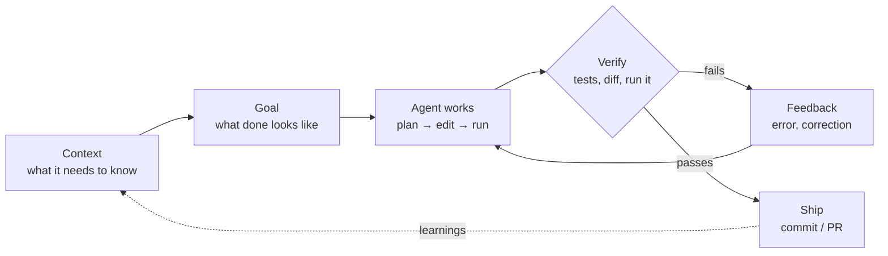
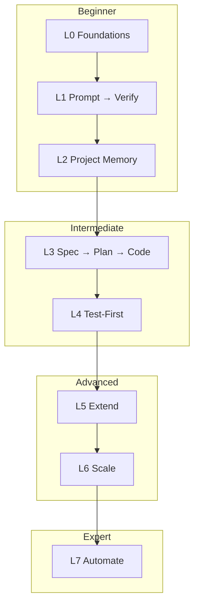
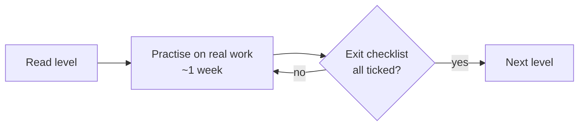

# AI Engineering — Zero to Hero with Claude Code

A step-by-step playbook for building software **with** an AI coding agent (Claude Code) the right way:
start small, build habits that scale, and add power only when the basics are solid.

> **Core idea:** The AI writes code fast. Your job is to give it the right **context**, a clear **goal**,
> and a fast way to **verify** the result. Everything in this guide is a variation of that loop.

> **Disclaimer:** This guide is a proposal, not a set of hard rules. Take what works for you, skip what
> doesn't, and adapt it to your own practices. It's also a working document, so expect changes.

---

## The one loop that matters



```
  ┌─────────┐   ┌──────┐   ┌─────────────┐   ┌────────┐   ┌──────┐
  │ CONTEXT │──▶│ GOAL │──▶│ AGENT WORKS │──▶│ VERIFY │──▶│ SHIP │
  └─────────┘   └──────┘   └─────────────┘   └────────┘   └──────┘
       ▲                          ▲              │ fail        │
       │                          └── feedback ──┘             │
       └──────────────── learnings into CLAUDE.md ─────────────┘
```

Each level makes one part of this loop stronger.

---

## Roadmap



| Level | Topic | You learn to… | Strengthens |
|---|---|---|---|
| [L0](levels/L0-foundations.md) | Foundations | Understand how the agent works, set it up safely | everything |
| [L1](levels/L1-prompt-verify.md) | Prompt → Verify | Give one clear task, read every diff | Goal, Verify |
| [L2](levels/L2-project-memory.md) | Project Memory | Make the agent know your project via `CLAUDE.md` | Context |
| [L3](levels/L3-spec-plan-code.md) | Spec → Plan → Code | Explore, plan, implement, commit as a workflow | Goal, Ship |
| [L4](levels/L4-test-first.md) | Test-First | Let tests be the agent's feedback loop | Verify |
| [L5](levels/L5-extend.md) | Extend | Skills, hooks, MCP, plugins: encode your process | Context, Verify |
| [L6](levels/L6-scale.md) | Scale | Subagents, worktrees, parallel sessions, legacy repos | Agent works |
| [L7](levels/L7-automate.md) | Automate | Headless runs, AFK loops, CI, scheduled agents, Agent SDK | Ship |

**Cross-cutting practices** (read alongside any level):

- [Best practices cheat sheet](practices/best-practices.md): the most common rules on one page
- [Security & permissions](practices/security.md)
- [Context & cost management](practices/context-and-cost.md)
- [Anti-patterns & recovery](practices/anti-patterns.md)
- [Staying sharp](practices/staying-sharp.md): keep your own skills while the AI types
- [Working in a team](practices/team.md): shared setup, handoff, and review when you're not solo
- [Commits, versions & releases](practices/releases.md): Conventional Commits, breaking changes, git + Docker tags
- [VM sandbox](practices/vm-sandbox.md): unattended Claude Code runs in a throwaway VM that only reaches the public internet

**Copy-paste templates** → [`templates/`](templates/)

| Template | Use it in |
|---|---|
| [`CLAUDE.md`](templates/CLAUDE.md) | L2: project memory for a Go project |
| [`spec.md`](templates/spec.md) | L3: describe *what* and *why* before coding |
| [`plan.md`](templates/plan.md) | L3: the agent's implementation plan |
| [`review-checklist.md`](templates/review-checklist.md) | L1/L4: review AI-written diffs |
| [`.claude/settings.json`](templates/.claude/settings.json) | L0/L5: permissions + hooks |
| [`.claude/skills/`](templates/.claude/skills/) | L5: reusable workflows (`/spec`, `/grill-me`, `/tdd`, `/ship`) |
| [`.claude/agents/`](templates/.claude/agents/) | L6: specialised subagents |
| [`.github/workflows/claude.yml`](templates/.github/workflows/claude.yml) | L7: Claude in GitHub Actions |
| [`vm-runner/`](templates/vm-runner/) | L7: Ansible playbook, plan/issue/AFK run in a throwaway VM |
| [`.github/workflows/pr-title.yml`](templates/.github/workflows/pr-title.yml), [`release.yml`](templates/.github/workflows/release.yml) | L7: conventional PR titles, release + Docker tags |

---

## How to use this guide

1. **Don't read it all at once.** Do one level, practise it on a real project for a week or so, then move on.
2. **Each level ends with "Level up when…".** That's your exit check. If you can't tick it, stay on the level.
3. **Levels add up.** L4 assumes you still do everything from L1–L3. Advanced practice is the basics done consistently, plus automation.
4. **Running example:** most exercises use `shorty`, a small Go URL-shortener API, plus one existing (legacy) repo of your own.
5. **Feeling overwhelmed?** Fall back to L1: one small task, read the diff, run the tests. That always works.



---

## Minimum viable process (if you read nothing else)

1. Start every project with a `CLAUDE.md`: build/test commands plus conventions (`/init` makes one).
2. One task per session. `/clear` between unrelated tasks.
3. For anything bigger than one small change: **explore → plan (plan mode) → implement → verify → commit**.
4. Give the agent a way to check its own work: tests, `go vet`, a running server, a screenshot.
5. Read every diff before you commit. You own the code, not the AI.
6. When the agent makes the same mistake twice, write the fix into `CLAUDE.md`.

---

*Examples use Go and Claude Code. The principles carry over to other languages. Claude Code changes fast,
so when a command here doesn't match your version, check `claude --help`, `/help`, and the
[official docs](https://code.claude.com/docs).*
