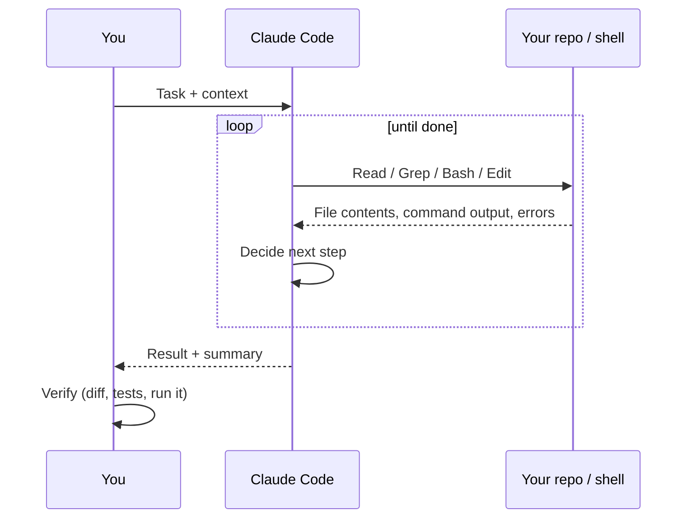
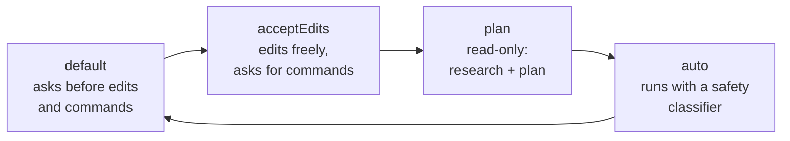

# L0 — Foundations

**Goal:** Understand what the agent actually is, install it safely, and know the handful of controls you'll use every day.

---

## 1. The mental model

Claude Code isn't autocomplete. It's an **agent running a loop**: it reads files, runs commands, edits code,
looks at the results, and decides what to do next until it thinks the task is done.



Four facts follow from this:

| Fact | Consequence |
|---|---|
| It only knows what's in its **context window** (prompt, files it read, command output) | Give it context on purpose. If it hasn't read a file, it's guessing about it. |
| Context is **limited**, and quality drops as it fills | Keep sessions focused. Clear between tasks. |
| It **acts** on your machine | Permissions matter. Start conservative. |
| It's **confident even when wrong** | Verification is your job, and it's never optional. |

> A useful framing: treat it like a **very fast, very well-read junior engineer with no memory of yesterday.**
> Brief it well, check its work, and write down what it should remember.

---

## 2. Setup

```bash
# install (see official docs for your platform)
curl -fsSL https://claude.ai/install.sh | bash

cd your-project
claude            # start an interactive session
```

First-run checklist:

- [ ] Run it inside a **git repository**. Git is your undo button.
- [ ] Commit (or stash) before every AI session, so `git diff` shows exactly what the agent changed.
- [ ] Run `/init` once to generate a starter `CLAUDE.md` (see [L2](02-project-memory.md)).
- [ ] Open `/permissions` and look at what's allowed.

---

## 3. Permission modes

Press **Shift+Tab** to cycle modes. Choose the mode based on how much you trust the task, not on how impatient you are.



| Mode | Use when |
|---|---|
| **default** | Learning, unfamiliar repo, risky areas (infra, auth, migrations) |
| **acceptEdits** | Normal feature work in a clean git tree |
| **plan** | Understanding code, designing a change. Nothing gets modified. |
| **auto** | Longer tasks you've scoped well, with tests to catch mistakes |
| `bypassPermissions` | Only inside a disposable container/VM. Never on your laptop with real credentials. |

Pre-approve safe, frequent commands so you aren't clicking "yes" 50 times (this is in [`templates/.claude/settings.json`](../templates/.claude/settings.json)):

```json
{
  "permissions": {
    "allow": ["Bash(go test:*)", "Bash(go vet:*)", "Bash(go build:*)", "Bash(gofmt:*)", "Bash(git diff:*)", "Bash(git status)"],
    "deny":  ["Read(./.env)", "Read(./.env.*)", "Bash(git push:*)"]
  }
}
```

More in [Security & permissions](../practices/security.md).

---

## 4. The daily controls

| Control | What it does | When |
|---|---|---|
| `Esc` | Stop the agent mid-action | It's heading the wrong way. Stop early, it's cheap. |
| `Esc Esc` / `/rewind` | Jump back to an earlier point (conversation and/or code) | A path went bad, so try again from before it |
| `/clear` | Empty the context | Between unrelated tasks |
| `/compact [focus]` | Summarise the conversation to free space | Long task, context getting full |
| `/context` | Show what fills the context window | Agent seems "dumb" or slow |
| `/model` | Switch model | Harder reasoning vs. faster/cheaper work |
| `@path/to/file` | Pull a file into the prompt | You know exactly what's relevant |
| `!command` | Run a shell command and put its output in context | Share a failing test output directly |
| Shift+Tab | Cycle permission modes | See above |

---

## 5. Exercise

1. Create the running example:
   ```bash
   mkdir shorty && cd shorty && git init && go mod init example.com/shorty
   claude
   ```
2. In **plan mode** ask: *"Explain how you would structure a small Go HTTP API for a URL shortener. Don't write code."*
3. Switch to **default** mode and ask: *"Create a `main.go` with a `/healthz` endpoint returning 200. Then run `go build ./...`."*
   Approve each step on purpose and watch what the agent does.
4. `git diff` and read it. Commit.
5. Run `/context` and see what's using space.

---

## Level up when…

- [ ] You can explain the agent loop and why context is limited
- [ ] Every session starts from a clean git state
- [ ] You know when to use default, acceptEdits, plan and auto mode
- [ ] You use `Esc`, `/rewind`, `/clear` without thinking about it
- [ ] You have an allow/deny list for your common commands

→ Next: [L1 — Prompt → Verify](01-prompt-verify.md)
