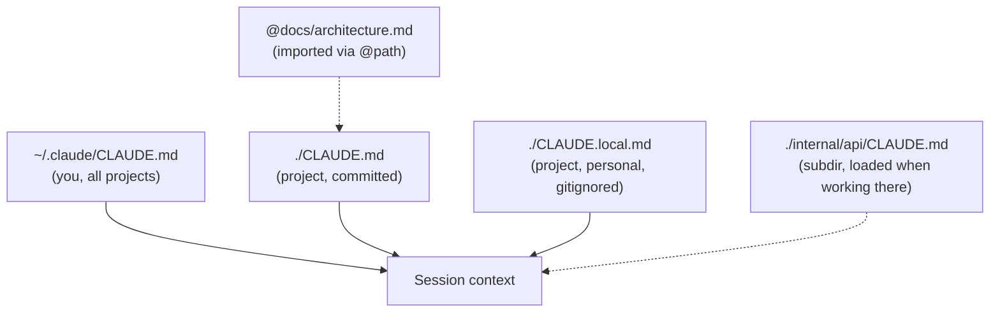
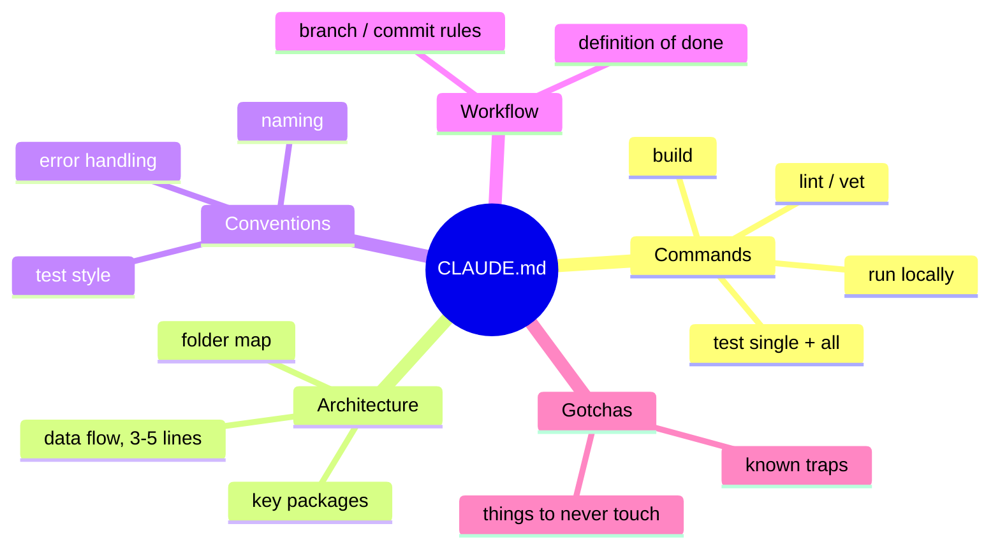
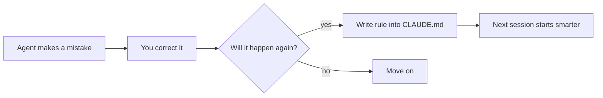

# L2 — Project Memory

**Goal:** Stop repeating yourself. Make the agent start every session already knowing how your project
builds, tests, and is organised, and what mistakes to avoid.

---

## 1. Why memory

The agent has **no memory between sessions**. Without project memory, every session starts with it
re-discovering your build commands, guessing your conventions, and repeating last week's mistakes.

`CLAUDE.md` is a markdown file that's **loaded into context automatically** at the start of every session.



| File | Put here |
|---|---|
| `~/.claude/CLAUDE.md` | Personal preferences across all projects ("I prefer table-driven tests", "explain before big refactors") |
| `./CLAUDE.md` | Project facts every session needs. **Commit it.** |
| `./CLAUDE.local.md` | Your personal notes for this repo (gitignored) |
| `./some/dir/CLAUDE.md` | Rules that only matter in that part of the codebase |

Edit memory with `/memory`, or just tell the agent: *"Add to CLAUDE.md: always run `go vet` before finishing."*

---

## 2. What goes into a good CLAUDE.md

Start from [`templates/CLAUDE.md`](../templates/CLAUDE.md), or run `/init` and **trim** what it gives you.



**Rules for writing it:**

| Do | Don't |
|---|---|
| Keep it short (aim for under ~150 lines) | Paste whole docs. Link them with `@docs/x.md` or "see docs/x.md" |
| Use concrete commands: `go test ./internal/store -run TestGet` | Vague advice: "write good tests" |
| Write rules the agent **actually broke** | List every rule you can think of |
| State *why* for non-obvious rules | Use ALL CAPS and "NEVER EVER" everywhere. If everything is emphasised, nothing is. |
| Update it when the project changes | Let it go stale. Stale memory is worse than none. |

> **Test for every line:** "Would the agent get this wrong without being told?" If not, delete the line.
> Every line costs context in every session.

---

## 3. The memory feedback loop

This is the habit that compounds:



```
 mistake ─▶ correct ─▶ "will this recur?" ─ yes ─▶ add 1 line to CLAUDE.md ─▶ next session is better
```

Examples of good learned rules:

```markdown
- Use `errors.Is`, never compare error strings.
- Handlers return errors; `internal/http/respond.go` turns them into JSON responses. Don't write responses directly.
- `internal/legacy/` is frozen. Don't refactor it, only fix bugs when asked.
- Integration tests need `docker compose up -d db` first.
```

---

## 4. Beyond CLAUDE.md: docs as context

For larger projects, keep deeper docs in the repo and **point** to them instead of inlining them:

```
docs/
  architecture.md     # components, data flow (with a diagram)
  decisions/          # ADRs: why we chose X over Y
  templates/          # spec/plan templates (see L3)
```

`docs/` holds **knowledge**: things that stay true until the code changes. Work items (specs, plans, TODO lists,
tickets) don't belong here. They go stale once the work is done, and the agent will still read them as current.
Track work in GitHub issues and keep specs/plans in a gitignored `.scratch/` folder ([L3](03-spec-plan-code.md#where-the-spec-lives)).

In `CLAUDE.md`:

```markdown
## Further reading (read when relevant)
- Architecture: docs/architecture.md
- Why Postgres and not SQLite: docs/decisions/0002-postgres.md
```

The agent reads them when the task needs them, so they don't cost context in every session.

---

## 5. Exercise

1. In `shorty`, run `/init`. Compare the result with [`templates/CLAUDE.md`](../templates/CLAUDE.md) and trim it to the essentials.
2. Add a "Definition of done" section: `gofmt`, `go vet ./...`, `go test ./...` all pass.
3. For your **legacy repo**: run `/init` there too. Then in plan mode ask *"What are the five most important things a new developer should know about this repo?"* Put the useful answers in `CLAUDE.md`.
4. Over the next week, every time you correct the agent, ask yourself whether the correction belongs in `CLAUDE.md`.

---

## Level up when…

- [ ] Every project you work on has a committed, concise `CLAUDE.md`
- [ ] It contains exact build/test/lint commands and a definition of done
- [ ] You've added at least 3 rules learned from real agent mistakes
- [ ] Deep docs are linked, not pasted
- [ ] You have a personal `~/.claude/CLAUDE.md` for your preferences

→ Next: [L3 — Spec → Plan → Code](03-spec-plan-code.md)
