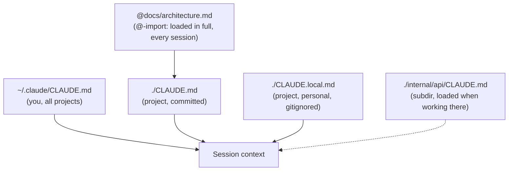
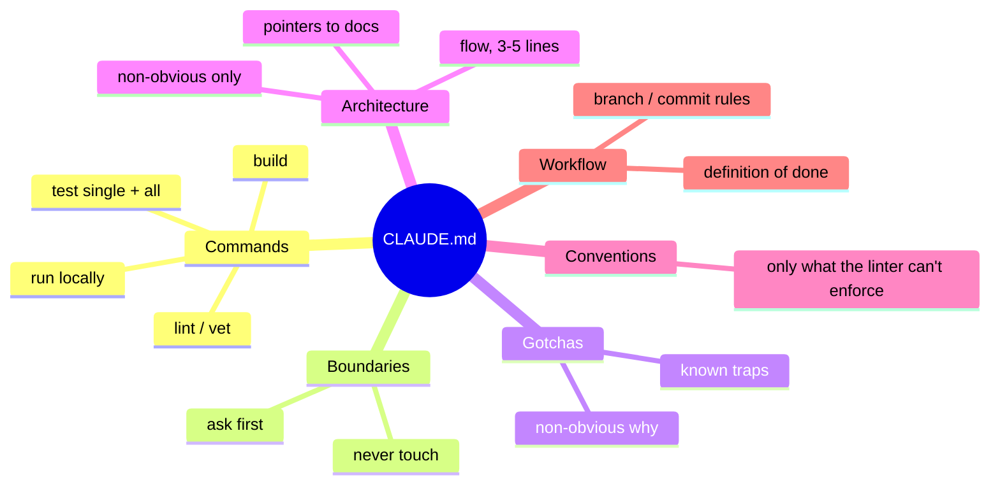
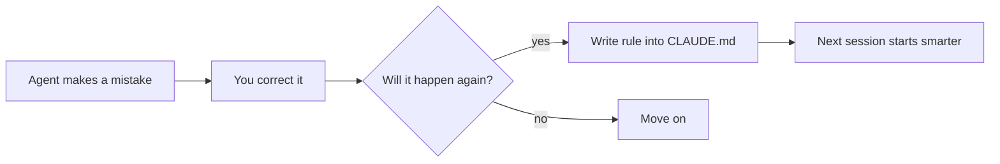

# L2 — Project Memory

**Goal:** Stop repeating yourself. Make the agent start every session already knowing how your project
builds, tests, and is organised, and what mistakes to avoid.

---

## 1. Why memory

The agent has **no memory between sessions**. Without project memory, every session starts with it
re-discovering your build commands, guessing your conventions, and repeating last week's mistakes.

`CLAUDE.md` is a markdown file that's **loaded into context automatically** at the start of every session.



| File | Put here |
|---|---|
| `~/.claude/CLAUDE.md` | Personal preferences across all projects ("I prefer table-driven tests", "explain before big refactors") |
| `./CLAUDE.md` | Project facts every session needs. **Commit it.** |
| `./CLAUDE.local.md` | Your personal notes for this repo (gitignored) |
| `./some/dir/CLAUDE.md` | Rules that only matter in that part of the codebase |

In a team, `./CLAUDE.md` is shared and your preferences go into the personal files. See [Working in a team](../practices/team.md).

> `@path` inside `CLAUDE.md` is an **import**, not a link: the file is pulled into context at session start, every
> session, whether the task needs it or not. See [§4](#4-beyond-claudemd-docs-as-context) for the cheaper alternative.

Edit memory with `/memory`, or just tell the agent: *"Add to CLAUDE.md: always run `go vet` before finishing."*

---

## 2. What goes into a good CLAUDE.md

Start from [`templates/CLAUDE.md`](../templates/CLAUDE.md), or run `/init` and **trim** what it gives you.

### Only what the agent can't know by itself

The agent already knows Go, reads `go.mod`, and can `ls` your folders. `CLAUDE.md` is for what it **would get wrong,
or would waste effort finding out again every session**.

| Include | Leave out |
|---|---|
| **Tools and exact commands**, including non-obvious ones (`docker compose up -d db` before integration tests) | Language, framework, dependencies: visible in `go.mod` |
| **Boundaries**: what not to touch, what to ask before doing, frozen dirs | A folder listing it can get with `ls` |
| **Gotchas**: traps it fell into, rules whose *why* isn't in the code | Generic advice ("write clean code", "handle errors") |
| **Definition of done** | Style a formatter or linter already enforces |
| A short map of what's **expensive to rediscover**: request flow, where the rules live (3–5 lines) | Long architecture prose: put it in `docs/` and point to it (§4) |

"Could it discover this?" isn't the test. Rediscovering costs tokens in every session. The test is: **would it get
this wrong, or burn effort finding it out?**



**Rules for writing it:**

| Do | Don't |
|---|---|
| Keep it short (aim for under ~150 lines) | Paste whole docs |
| Mention docs by plain path plus when to read them: `docs/architecture.md: read before adding a package` | `@`-import docs by default. They load in full in every session. |
| Use concrete commands: `go test ./internal/store -run TestGet` | Vague advice: "write good tests" |
| Write rules the agent **actually broke** | List every rule you can think of |
| State *why* for non-obvious rules | Use ALL CAPS and "NEVER EVER" everywhere. If everything is emphasised, nothing is. |
| Update it when the project changes | Let it go stale. Stale memory is worse than none. |

> **Test for every line:** "Would the agent get this wrong without being told?" If not, delete the line.
> Every line costs context in every session.

---

## 3. The memory feedback loop

This is the habit that compounds:



```
 mistake ─▶ correct ─▶ "will this recur?" ─ yes ─▶ add 1 line to CLAUDE.md ─▶ next session is better
```

Examples of good learned rules:

```markdown
- Use `errors.Is`, never compare error strings.
- Handlers return errors; `internal/http/respond.go` turns them into JSON responses. Don't write responses directly.
- `internal/legacy/` is frozen. Don't refactor it, only fix bugs when asked.
- Integration tests need `docker compose up -d db` first.
```

---

## 4. Beyond CLAUDE.md: docs as context

For larger projects, keep deeper docs in the repo and **point** to them instead of inlining them:

```
docs/
  architecture.md     # components, data flow (with a diagram)
  decisions/          # ADRs: why we chose X over Y
  templates/          # spec/plan templates (see L3)
```

`docs/` holds **knowledge**: things that stay true until the code changes. Work items (specs, plans, TODO lists,
tickets) don't belong here. They go stale once the work is done, and the agent will still read them as current.
Track work in GitHub issues and keep specs/plans in a gitignored `.scratch/` folder ([L3](03-spec-plan-code.md#where-the-spec-lives)).

### `@`-import or plain path?

| In `CLAUDE.md` | When it's loaded | Cost | Use for |
|---|---|---|---|
| `@docs/architecture.md` | Session start, in full, every session | Whole file, every session | Rarely. Only short docs needed in almost every session: you'd pay for them anyway, and the import saves a tool call. |
| `docs/architecture.md: read before …` | When the agent decides the task needs it | One line until read | **Default** for deep docs |

Don't import by default. Importing is fine for the few short docs that nearly every session needs.

Loading on demand only works if the hint says **when** to read the doc. Otherwise the agent won't know it should:

```markdown
## Further reading
<!-- weak: when should the agent read this? -->
- Architecture: docs/architecture.md

<!-- good: the trigger is in the line -->
- docs/architecture.md: read before adding a package or changing how packages depend on each other
- docs/decisions/0002-postgres.md: read before touching the store layer or suggesting another database
```

This rule is about `CLAUDE.md`. In a **prompt**, `@file` is still the right way to point at the file the task is
about ([L1](01-prompt-verify.md)). That costs context once, for a task that needs it.

---

## 5. Exercise

1. In `shorty`, run `/init`. Compare the result with [`templates/CLAUDE.md`](../templates/CLAUDE.md) and trim it to the essentials.
2. Add a "Definition of done" section: `gofmt`, `go vet ./...`, `go test ./...` all pass.
3. For your **legacy repo**: run `/init` there too. Then in plan mode ask *"What are the five most important things a new developer should know about this repo?"* Put the useful answers in `CLAUDE.md`.
4. Over the next week, every time you correct the agent, ask yourself whether the correction belongs in `CLAUDE.md`.

---

## Level up when…

- [ ] Every project you work on has a committed, concise `CLAUDE.md`
- [ ] It contains exact build/test/lint commands and a definition of done
- [ ] You've added at least 3 rules learned from real agent mistakes
- [ ] Every line passes the test: "would the agent get this wrong, or waste effort finding it out?"
- [ ] Deep docs are referenced by plain path with a "read when…" hint, not pasted or `@`-imported
- [ ] You have a personal `~/.claude/CLAUDE.md` for your preferences

→ Next: [L3 — Spec → Plan → Code](03-spec-plan-code.md)
