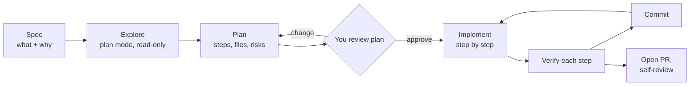
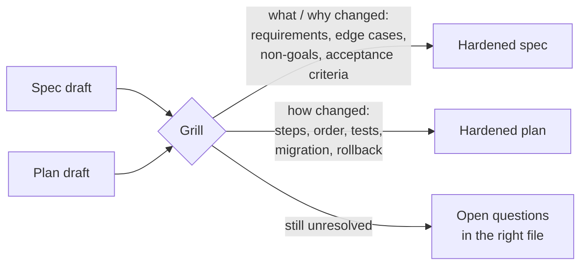
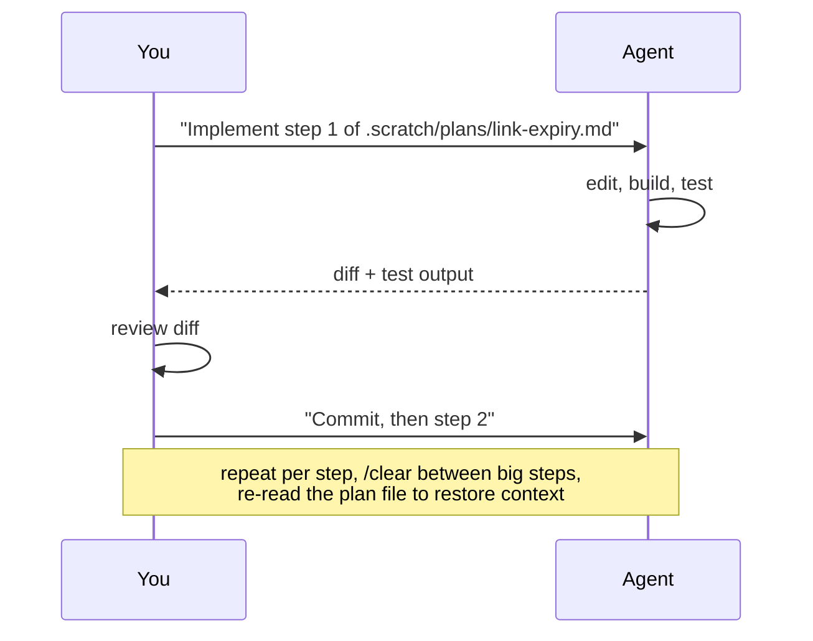
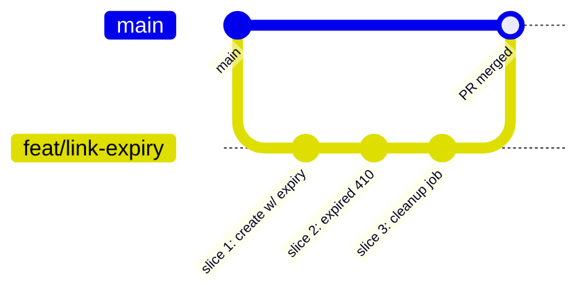

# L3 — Spec → Plan → Code

**Goal:** Handle features bigger than one prompt. Separate **thinking** from **typing**: decide *what* and *how*
before the agent edits anything, then run the work through branches and PRs.

---

## 1. The workflow: Explore → Plan → Implement → Commit



```
 ┌──────┐  ┌─────────┐  ┌──────┐  ┌────────┐  ┌───────────┐  ┌────────┐  ┌────────┐
 │ SPEC │─▶│ EXPLORE │─▶│ PLAN │─▶│ REVIEW │─▶│ IMPLEMENT │─▶│ VERIFY │─▶│ COMMIT │──▶ PR
 └──────┘  └─────────┘  └──────┘  └────────┘  └───────────┘  └────────┘  └────────┘
   you        agent       agent      you          agent       agent+you     agent
            (plan mode) (plan mode)              (per step)                (you read)
```

**Why it works:** most bad AI code comes from the agent jumping straight to code with a wrong assumption.
A plan is cheap to correct. Ten edited files are not.

**When to use it:**

| Task size | Approach |
|---|---|
| Typo, rename, one-function fix | L1 micro-loop, no plan |
| Clear change touching 2–5 files | Plan mode → implement |
| New feature, unclear design, or legacy code | Full spec → explore → plan → implement |

---

## 2. Spec: what and why (you write it, with help)

A spec is a short document **you own**. Use [`templates/spec.md`](../templates/spec.md). Keep it in `.scratch/specs/`,
a **gitignored** working folder (see [Where the spec lives](#where-the-spec-lives) below). One-time setup per project:

```bash
mkdir -p .scratch/specs .scratch/plans && echo ".scratch/" >> .gitignore
```

Let the agent help you write it, interview style:

```text
I want to add link expiry to shorty. Interview me with questions until the requirements
are clear, then write .scratch/specs/link-expiry.md using @docs/templates/spec.md.
Don't write any code.
```

A good spec has:

- **Problem / goal**: why we're doing this
- **Scope / non-goals**: what we're *not* doing (this stops scope creep)
- **Behaviour**: concrete examples, inputs → outputs, edge cases
- **Acceptance criteria**: checkable statements. These later become tests (L4).

For anything non-trivial, consider grilling the spec before you plan (see the bonus at the end of section 3).

### Where the spec lives

**Don't commit work items.** Specs, plans, TODO lists and tickets describe work that *will* be done. Once it's done,
they go stale, but a committed file stays in the repo, and months later the agent reads it as if it were still true.
So split the two jobs:

- **The work item is a GitHub issue.** Idea, why, and later a link to the PR. It's your backlog, and `Closes #12`
  retires it when the PR merges. A closed issue doesn't sit in the agent's way.
- **The spec and plan are working files in `.scratch/`** (gitignored). The agent reads them with `@.scratch/specs/x.md`.
  No network, no `gh`, no comments from other people in its context. They survive `/clear` and compaction.
- **When the PR is merged, condense and delete.** The final decisions go into the PR description or a closing comment
  on the issue. A decision that should last (architecture, "why Postgres") becomes an ADR in `docs/decisions/`
  ([L2](02-project-memory.md#4-beyond-claudemd-docs-as-context)). Then delete the scratch files.

```
Issue #12 "Link expiry"          → idea, why, final decisions          (work item, closed by the PR)
.scratch/specs/link-expiry.md    → the spec / PRD, hardened by /grill-me  (temporary, gitignored)
.scratch/plans/link-expiry.md    → the tasks                              (temporary, gitignored)
PR "Closes #12"                  → closes the loop, explains the change
docs/decisions/NNNN-*.md         → only for decisions that outlive the feature
```

What stays committed is **knowledge**: code, tests, CLAUDE.md, `docs/architecture.md`, ADRs. See
[Where work lives](../practices/best-practices.md#where-work-lives).

Want the issue body itself to be the spec (team discussion, GitHub Projects, Jira, `@claude` issue → PR)?
See [L7: Issue tracker as the spec](07-automate.md#advanced-optional-issue-tracker-as-the-spec).

---

## 3. Explore and plan (plan mode)

Switch to **plan mode** (Shift+Tab) so the agent can only read.

```text
Read @.scratch/specs/link-expiry.md. Explore how links are stored and served
(internal/store, internal/http). Then propose a step-by-step implementation plan:
files to change, new types, migration of existing data, tests to add, risks.
Think hard about edge cases.
```

What a good plan looks like ([`templates/plan.md`](../templates/plan.md)):

- Numbered **steps**, each small enough to verify and commit on its own
- **Files** each step touches
- **Tests** each step adds
- **Open questions / risks**, called out instead of silently decided

### Slice vertically, not horizontally

Agents like to plan by layer: "1. models, 2. store, 3. handlers, 4. tests". Nothing works until the last step, and
step 1 can't be checked on its own. Ask for **vertical slices** (also called *tracer bullets*) instead: each step cuts a thin path
through **every** layer and ends in behaviour you can demo or test.

```
 HORIZONTAL (avoid)                        VERTICAL (prefer)
 ┌──────────────────────────────┐          ┌────────┬────────┬────────┐
 │ 1. migration + model         │          │ 1      │ 2      │ 3      │
 ├──────────────────────────────┤          │ create │ expired│ cleanup│
 │ 2. store methods             │          │ with   │ → 410  │ job    │
 ├──────────────────────────────┤          │ expiry │        │        │
 │ 3. HTTP handlers             │          │ (db→   │ (store→│ (store→│
 ├──────────────────────────────┤          │ api→   │ api→   │ cron→  │
 │ 4. tests                     │          │ test)  │ test)  │ test)  │
 └──────────────────────────────┘          └────────┴────────┴────────┘
 works only after step 4                   each column is green and demoable
```

```text
Re-cut the plan into vertical slices: each step is a thin end-to-end path
(migration → store → handler → test) that is demoable on its own and fits one
fresh session. Put any prefactoring first. For each step, list which earlier
steps it's blocked by.
```

Why it matters: every step stays verifiable (L4), you can stop after any slice and still have working software, and
slices whose blockers are done can run **in parallel**. [L7](07-automate.md#the-pipeline) turns them into tickets (GitHub issues) on a board.

**Review the plan like a design review.** Push back:
"Why a new package?", "Step 3 is too big, split it", "Use the existing clock interface for testability."
Save approved plans for bigger features: `.scratch/plans/link-expiry.md`. They survive `/clear` and context compaction.

### 💡 Bonus (optional): grill to harden the spec and the plan

Your own review catches what *you* think to question. A grilling session flips it around: the agent questions
**you** without letting up, until every requirement and every step has a clear answer. It turns up hidden
assumptions, vague steps and "we'll figure it out later" before they turn into code.

Use Matt Pocock's [`grill-me`](https://claudemarketplaces.com/skills/mattpocock/skills/grill-me) skill, vendored in [`templates/.claude/skills/grill-me/`](../templates/.claude/skills/grill-me/)
(it hands off to [`grilling/`](../templates/.claude/skills/grilling/), so copy both). It asks in **rounds**: every question
whose prerequisites are already settled, numbered, each with a recommended answer ("yes" accepts it). It writes no files,
so you ask for the write-back afterwards.

The result isn't a new document. Grilling **hardens the two you already have**:



```
               ┌──────────────────────────────────────┐
 spec draft ──▶│                                      │──▶ .scratch/specs/x.md  (what/why decisions)
               │  /grill-me: rounds of questions      │
 plan draft ──▶│                                      │──▶ .scratch/plans/x.md  (how decisions)
               └──────────────────────────────────────┘
                     unresolved ──▶ "Open questions" in the file it belongs to
```

```text
/grill-me @.scratch/specs/link-expiry.md @.scratch/plans/link-expiry.md
```

When the frontier is empty and you've confirmed the shared understanding:

```text
Write the decisions back: requirement/scope changes into the spec, step/task/test/
migration changes into the plan, anything unresolved under "Open questions" in the
file it belongs to. Check every acceptance criterion is covered by a plan step and
a test. Don't write any code.
```

| Use it when | Skip it when |
|---|---|
| Unclear design, legacy code, data migrations, anything hard to undo | The change is small and obvious (2–3 clear steps) |
| You feel "pretty sure" but couldn't defend each step in a design review | Nothing has changed since the last grilling |

Tips:
- **Grill twice if it's big:** once on the spec (before planning, so the plan starts from solid requirements), once on spec + plan together (before approving).
- **Don't just nod.** Answering "yes" to every recommendation means the agent decided, not you. Push back where you disagree.
- **Prefer one question at a time?** Add `When grilling, ask one question at a time.` to your CLAUDE.md.
- **"I don't know" is a valid answer.** Take the recommendation, or record it under *Open questions*.
- **Write the result back**, or the grilling is lost on the next `/clear`. The spec and plan are what the agent re-reads during implementation.
- Leave plan mode off while grilling: it pushes the agent to produce a plan instead of asking.

---

## 4. Implement step by step



- One step → verify → commit. Don't say "implement the whole plan" until you trust the process (and the tests).
- If reality differs from the plan, **stop and update the plan** instead of improvising.
- Long feature? `/clear` between steps and restart with *"Read .scratch/plans/x.md. Steps 1–3 are done. Do step 4."*
  This way each step starts in the [smart zone](../practices/context-and-cost.md#smart-zone-vs-dumb-zone) instead of at the end of a bloated session.

---

## 5. Git and PR workflow (solo, GitHub)



1. `git switch -c feat/link-expiry` (or ask the agent to). Spec and plan stay in `.scratch/`, not in a commit.
2. One commit per plan step.
3. Ask the agent to open the PR: *"Push and open a PR with `gh pr create`. Summarise the change and the key decisions
   from the spec, list how it was tested, and include `Closes #12`."*
4. **Self-review the PR on GitHub** as if a stranger wrote it. Seeing the change in a different UI catches things you missed in the terminal.
5. Optionally get an independent AI review in a **fresh session** (no shared bias): `/code-review` or *"Review this PR diff for bugs and missing tests."* More in [L6](06-scale.md).
6. After merge: anything from the spec worth keeping goes into the PR/issue (or an ADR), then
   `rm .scratch/specs/link-expiry.md .scratch/plans/link-expiry.md`.

Even solo, PRs give you a reviewable unit, a CI gate (L7), and history that explains *why*.

---

## 6. Exercise

Feature: **link expiry** for shorty (links can have `expires_at`; expired links return 410).

1. Open a GitHub issue "Link expiry" (idea + why, 3 lines)
2. Interview-style spec → `.scratch/specs/link-expiry.md`
3. Plan mode → plan → review → push back at least once → `.scratch/plans/link-expiry.md`
   - Check the steps are vertical slices. If the agent planned by layer, re-cut it.
   - *Optional:* `/grill-me` on spec + plan, write the decisions back, and check that the decisions landed in the right file
4. Branch, implement step by step with commits
5. PR via `gh` with `Closes #N`, self-review on GitHub, merge
6. Condense the decisions into the PR/issue, delete the scratch files, and check `git status` shows no work files

---

## Level up when…

- [ ] You default to plan mode for anything touching more than ~2 files
- [ ] You've changed a plan before approving it
- [ ] Your plans are cut into vertical slices, each one demoable on its own
- [ ] Features have a spec with acceptance criteria and non-goals
- [ ] Work goes through an issue, a branch, and a PR with one commit per step
- [ ] No specs, plans or TODO lists are committed; they live in `.scratch/` and are deleted after merge
- [ ] You can resume a feature after `/clear` from the plan file

→ Next: [L4 — Test-First](04-test-first.md)
