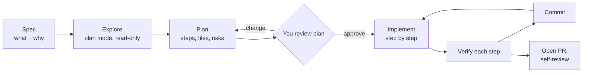
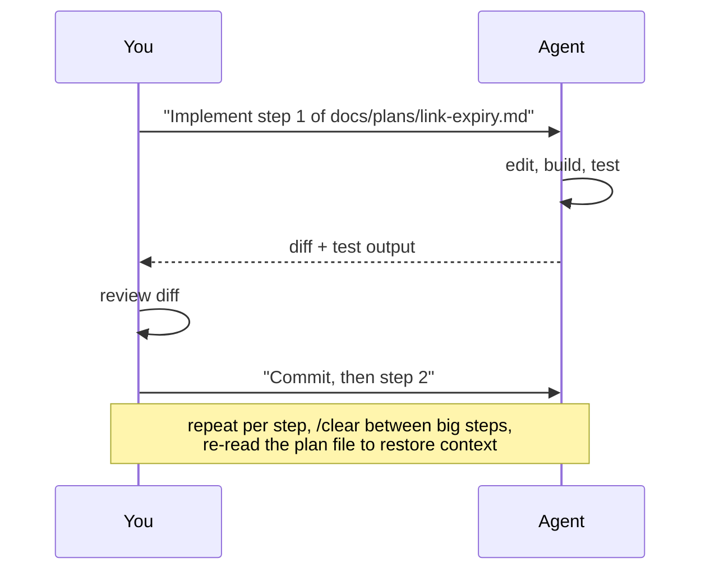
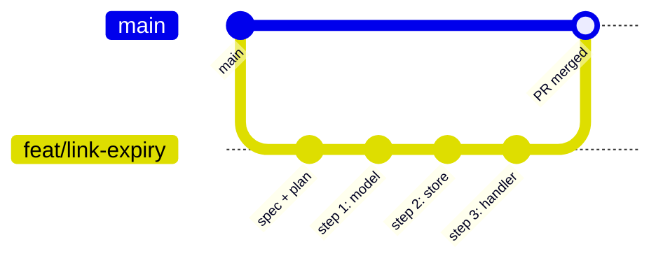

# L3 — Spec → Plan → Code

**Goal:** Handle features bigger than one prompt. Separate **thinking** from **typing**: decide *what* and *how*
before the agent edits anything, then run the work through branches and PRs.

---

## 1. The workflow: Explore → Plan → Implement → Commit



```
 ┌──────┐  ┌─────────┐  ┌──────┐  ┌────────┐  ┌───────────┐  ┌────────┐  ┌────────┐
 │ SPEC │─▶│ EXPLORE │─▶│ PLAN │─▶│ REVIEW │─▶│ IMPLEMENT │─▶│ VERIFY │─▶│ COMMIT │──▶ PR
 └──────┘  └─────────┘  └──────┘  └────────┘  └───────────┘  └────────┘  └────────┘
   you        agent       agent      you          agent       agent+you     agent
            (plan mode) (plan mode)              (per step)                (you read)
```

**Why it works:** most bad AI code comes from the agent jumping straight to code with a wrong assumption.
A plan is cheap to correct. Ten edited files are not.

**When to use it:**

| Task size | Approach |
|---|---|
| Typo, rename, one-function fix | L1 micro-loop, no plan |
| Clear change touching 2–5 files | Plan mode → implement |
| New feature, unclear design, or legacy code | Full spec → explore → plan → implement |

---

## 2. Spec: what and why (you write it, with help)

A spec is a short document **you own**. Use [`templates/spec.md`](../templates/spec.md). Store it in `docs/specs/`.

Let the agent help you write it, interview style:

```text
I want to add link expiry to shorty. Interview me with questions until the requirements
are clear, then write docs/specs/link-expiry.md using @docs/specs/TEMPLATE.md.
Don't write any code.
```

A good spec has:

- **Problem / goal**: why we're doing this
- **Scope / non-goals**: what we're *not* doing (this stops scope creep)
- **Behaviour**: concrete examples, inputs → outputs, edge cases
- **Acceptance criteria**: checkable statements. These later become tests (L4).

---

## 3. Explore and plan (plan mode)

Switch to **plan mode** (Shift+Tab) so the agent can only read.

```text
Read @docs/specs/link-expiry.md. Explore how links are stored and served
(internal/store, internal/http). Then propose a step-by-step implementation plan:
files to change, new types, migration of existing data, tests to add, risks.
Think hard about edge cases.
```

What a good plan looks like ([`templates/plan.md`](../templates/plan.md)):

- Numbered **steps**, each small enough to verify and commit on its own
- **Files** each step touches
- **Tests** each step adds
- **Open questions / risks**, called out instead of silently decided

**Review the plan like a design review.** Push back:
"Why a new package?", "Step 3 is too big, split it", "Use the existing clock interface for testability."
Save approved plans for bigger features: `docs/plans/link-expiry.md`. They survive `/clear` and context compaction.

---

## 4. Implement step by step



- One step → verify → commit. Don't say "implement the whole plan" until you trust the process (and the tests).
- If reality differs from the plan, **stop and update the plan** instead of improvising.
- Long feature? `/clear` between steps and restart with *"Read docs/plans/x.md. Steps 1–3 are done. Do step 4."*

---

## 5. Git and PR workflow (solo, GitHub)



1. `git switch -c feat/link-expiry` (or ask the agent to).
2. Commit spec + plan first.
3. One commit per plan step.
4. Ask the agent to open the PR: *"Push and open a PR with `gh pr create`. Summarise the change, link the spec, list how it was tested."*
5. **Self-review the PR on GitHub** as if a stranger wrote it. Seeing the change in a different UI catches things you missed in the terminal.
6. Optionally get an independent AI review in a **fresh session** (no shared bias): `/code-review` or *"Review this PR diff for bugs and missing tests."* More in [L6](06-scale.md).

Even solo, PRs give you a reviewable unit, a CI gate (L7), and history that explains *why*.

---

## 6. Exercise

Feature: **link expiry** for shorty (links can have `expires_at`; expired links return 410).

1. Interview-style spec → `docs/specs/link-expiry.md`
2. Plan mode → plan → review → push back at least once → `docs/plans/link-expiry.md`
3. Branch, implement step by step with commits
4. PR via `gh`, self-review on GitHub, merge

---

## Level up when…

- [ ] You default to plan mode for anything touching more than ~2 files
- [ ] You've changed a plan before approving it
- [ ] Features have a spec with acceptance criteria and non-goals
- [ ] Work goes through a branch + PR with one commit per step
- [ ] You can resume a feature after `/clear` from the plan file

→ Next: [L4 — Test-First](04-test-first.md)
