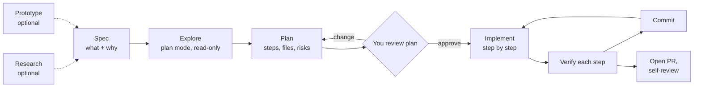
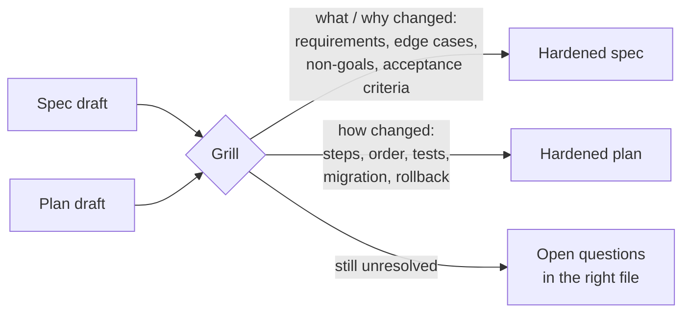
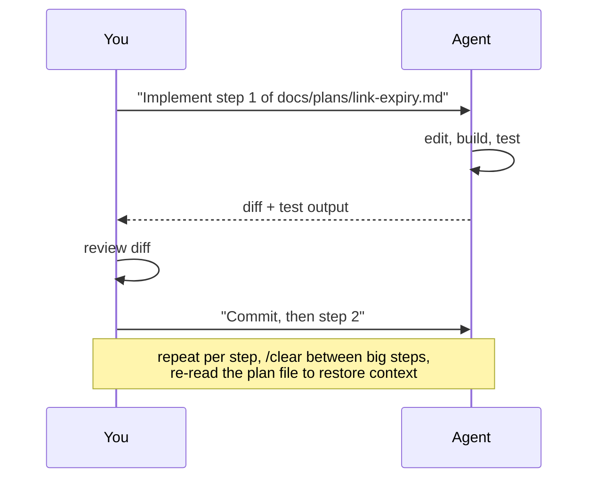
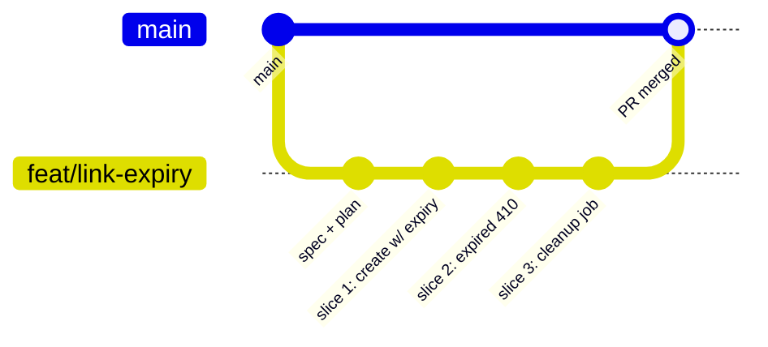

# L3 — Spec → Plan → Code

**Goal:** Handle features bigger than one prompt. Separate **thinking** from **typing**: decide *what* and *how*
before the agent edits anything, then run the work through branches and PRs.

---

## 1. The workflow: Explore → Plan → Implement → Commit



```
 (optional) RESEARCH ─┐
 (optional) PROTOTYPE ┴─▶ feed the spec
 ┌──────┐  ┌─────────┐  ┌──────┐  ┌────────┐  ┌───────────┐  ┌────────┐  ┌────────┐
 │ SPEC │─▶│ EXPLORE │─▶│ PLAN │─▶│ REVIEW │─▶│ IMPLEMENT │─▶│ VERIFY │─▶│ COMMIT │──▶ PR
 └──────┘  └─────────┘  └──────┘  └────────┘  └───────────┘  └────────┘  └────────┘
   you        agent       agent      you          agent       agent+you     agent
            (plan mode) (plan mode)              (per step)                (you read)
```

**Why it works:** most bad AI code comes from the agent jumping straight to code with a wrong assumption.
A plan is cheap to correct. Ten edited files are not.

**When to use it:**

| Task size | Approach |
|---|---|
| Typo, rename, one-function fix | L1 micro-loop, no plan |
| Clear change touching 2–5 files | Plan mode → implement |
| New feature, unclear design, or legacy code | Full spec → explore → plan → implement |
| Unknown territory: new library, unfamiliar subsystem, "is this even possible?" | Research and/or prototype first (section 2), then the full flow |

---

## 2. Before the spec (optional): research and prototype

Both steps are optional. Use them when you can't write a good spec yet because you don't know enough.

| Step | Use it when | Output | Merged? |
|---|---|---|---|
| **Research** | Exploring is expensive: big or legacy codebase, external APIs, several options to compare | `docs/research/<feature>.md` | Yes, with the spec |
| **Prototype** | You need to *see* it to decide: API shape, library fit, performance, UX | Learnings + reusable assets | **No**, the code is thrown away |

### Research: cache the exploration in a file

An explore phase can burn a lot of context. If it only lives in the chat, the next `/clear`, the next session or the
next AFK round ([L7](07-automate.md#3-afk-loop-work-through-a-board-in-a-sandbox-ralph)) pays for it again. Write it down once.

```text
I want to add link expiry to shorty. Research, don't change anything:
how links are stored, read and cached (internal/store, internal/http), and how
other Go projects do TTL cleanup (cron job vs. lazy delete on read).
Write the findings to docs/research/link-expiry.md: how it works today with
file:line references, constraints, options with trade-offs, sources (URLs +
versions), open questions. Date it. Facts only, no plan yet.
```

- Use plan mode or Explore subagents ([L6](06-scale.md#1-subagents-separate-context-for-separate-jobs)) so nothing gets edited.
- **Spot-check the `file:line` references** and sources. A wrong research file misleads every later session.
- Link it from the spec (`Related:`) and point the planner at it: *"Read @docs/research/link-expiry.md, then plan."*
- It goes stale. The date tells you when to re-check it. Don't keep research for code that has changed a lot since.

### Prototype: throwaway code for early feedback

A prototype answers **one question** quickly. It is not the first version of the feature.

```text
On a new branch spike/link-expiry, build the quickest possible prototype to answer:
"Can we expire links with a Postgres partial index + lazy check on read, without a
cleanup job?" No tests, no error handling polish. Timebox: this session.
At the end, write what we learned and the reusable pieces to
docs/research/link-expiry.md under "Prototype".
```

Rules:

- **Own branch (`spike/<feature>`), never merged.** The real implementation starts from the spec and plan, with tests ([L4](04-test-first.md)).
- **One question, timeboxed.** If it grows into "almost done", stop. That's the mega-prompt anti-pattern in disguise.
- **Keep the assets, not the code:** the SQL that worked, a sample request/response, a test fixture, a benchmark number,
  the API shape you settled on. Copy them into the research file so implementation can reuse them.
- Feed the answer into the spec (behaviour, constraints, non-goals). Then delete the branch or leave it unmerged.

---

## 3. Spec: what and why (you write it, with help)

A spec is a short document **you own**. Use [`templates/spec.md`](../templates/spec.md). Store it in `docs/specs/`.

Let the agent help you write it, interview style:

```text
I want to add link expiry to shorty. Interview me with questions until the requirements
are clear, then write docs/specs/link-expiry.md using @docs/specs/TEMPLATE.md.
Don't write any code.
```

A good spec has:

- **Problem / goal**: why we're doing this
- **Scope / non-goals**: what we're *not* doing (this stops scope creep)
- **Behaviour**: concrete examples, inputs → outputs, edge cases
- **Acceptance criteria**: checkable statements. These later become tests (L4).

For anything non-trivial, consider grilling the spec before you plan (see the bonus at the end of section 4).

### Where the spec lives

**Default: a file in the repo** (`docs/specs/<feature>.md`). It's your PRD.

- Versioned with the code: spec, plan and code land in the same PR, and `git log` explains *why* later.
- Grilling changes show up as a reviewable diff.
- The agent reads it with `@docs/specs/x.md`. No network, no `gh`, no comments from other people in its context.

**Optional: a GitHub issue as a pointer.** If you like a backlog, open a short issue (idea, why, link to the spec)
and close it from the PR with `Closes #12`. The issue tracks the work; the spec file stays the single source of truth.

```
Issue #12 "Link expiry"       → 3 lines: idea, why, link to spec   (backlog, optional)
docs/research/link-expiry.md  → findings + prototype learnings     (optional)
docs/specs/link-expiry.md     → the spec / PRD, hardened by /grill-me  (source of truth)
docs/plans/link-expiry.md     → the tasks
PR "Closes #12"               → closes the loop
```

Want the issue itself to be the spec (team discussion, GitHub Projects, Jira, `@claude` issue → PR)? That's an
advanced setup. See [L7: Issue tracker as the spec](07-automate.md#advanced-optional-issue-tracker-as-the-spec).

---

## 4. Explore and plan (plan mode)

Switch to **plan mode** (Shift+Tab) so the agent can only read.

```text
Read @docs/specs/link-expiry.md. Explore how links are stored and served
(internal/store, internal/http). Then propose a step-by-step implementation plan:
files to change, new types, migration of existing data, tests to add, risks.
Think hard about edge cases.
```

What a good plan looks like ([`templates/plan.md`](../templates/plan.md)):

- Numbered **steps**, each small enough to verify and commit on its own
- **Files** each step touches
- **Tests** each step adds
- **Open questions / risks**, called out instead of silently decided

### Slice vertically, not horizontally

Agents like to plan by layer: "1. models, 2. store, 3. handlers, 4. tests". Nothing works until the last step, and
step 1 can't be checked on its own. Ask for **vertical slices** (also called *tracer bullets*) instead: each step cuts a thin path
through **every** layer and ends in behaviour you can demo or test.

```
 HORIZONTAL (avoid)                        VERTICAL (prefer)
 ┌──────────────────────────────┐          ┌────────┬────────┬────────┐
 │ 1. migration + model         │          │ 1      │ 2      │ 3      │
 ├──────────────────────────────┤          │ create │ expired│ cleanup│
 │ 2. store methods             │          │ with   │ → 410  │ job    │
 ├──────────────────────────────┤          │ expiry │        │        │
 │ 3. HTTP handlers             │          │ (db→   │ (store→│ (store→│
 ├──────────────────────────────┤          │ api→   │ api→   │ cron→  │
 │ 4. tests                     │          │ test)  │ test)  │ test)  │
 └──────────────────────────────┘          └────────┴────────┴────────┘
 works only after step 4                   each column is green and demoable
```

```text
Re-cut the plan into vertical slices: each step is a thin end-to-end path
(migration → store → handler → test) that is demoable on its own and fits one
fresh session. Put any prefactoring first. For each step, list which earlier
steps it's blocked by.
```

Why it matters: every step stays verifiable (L4), you can stop after any slice and still have working software, and
slices whose blockers are done can run **in parallel** ([L6 worktrees](06-scale.md#3-parallel-sessions-with-git-worktrees)).
[L7](07-automate.md#3-afk-loop-work-through-a-board-in-a-sandbox-ralph) turns them into tickets on a board that an agent loop works through.

**Review the plan like a design review.** Push back:
"Why a new package?", "Step 3 is too big, split it", "Use the existing clock interface for testability."
Save approved plans for bigger features: `docs/plans/link-expiry.md`. They survive `/clear` and context compaction.

### 💡 Bonus (optional): grill to harden the spec and the plan

Your own review catches what *you* think to question. A grilling session flips it around: the agent questions
**you** without letting up, until every requirement and every step has a clear answer. It turns up hidden
assumptions, vague steps and "we'll figure it out later" before they turn into code.

Use Matt Pocock's [`grill-me`](https://claudemarketplaces.com/skills/mattpocock/skills/grill-me) skill, vendored in [`templates/.claude/skills/grill-me/`](../templates/.claude/skills/grill-me/)
(it hands off to [`grilling/`](../templates/.claude/skills/grilling/), so copy both). It asks in **rounds**: every question
whose prerequisites are already settled, numbered, each with a recommended answer ("yes" accepts it). It writes no files,
so you ask for the write-back afterwards.

The result isn't a new document. Grilling **hardens the two you already have**:



```
               ┌──────────────────────────────────────┐
 spec draft ──▶│                                      │──▶ docs/specs/x.md  (what/why decisions)
               │  /grill-me: rounds of questions      │
 plan draft ──▶│                                      │──▶ docs/plans/x.md  (how decisions)
               └──────────────────────────────────────┘
                     unresolved ──▶ "Open questions" in the file it belongs to
```

```text
/grill-me @docs/specs/link-expiry.md @docs/plans/link-expiry.md
```

When the frontier is empty and you've confirmed the shared understanding:

```text
Write the decisions back: requirement/scope changes into the spec, step/task/test/
migration changes into the plan, anything unresolved under "Open questions" in the
file it belongs to. Check every acceptance criterion is covered by a plan step and
a test. Don't write any code.
```

| Use it when | Skip it when |
|---|---|
| Unclear design, legacy code, data migrations, anything hard to undo | The change is small and obvious (2–3 clear steps) |
| You feel "pretty sure" but couldn't defend each step in a design review | Nothing has changed since the last grilling |

Tips:
- **Grill twice if it's big:** once on the spec (before planning, so the plan starts from solid requirements), once on spec + plan together (before approving).
- **Don't just nod.** Answering "yes" to every recommendation means the agent decided, not you. Push back where you disagree.
- **Prefer one question at a time?** Add `When grilling, ask one question at a time.` to your CLAUDE.md.
- **"I don't know" is a valid answer.** Take the recommendation, or record it under *Open questions*.
- **Write the result back**, or the grilling is lost on the next `/clear`. The spec and plan are what the agent re-reads during implementation.
- Leave plan mode off while grilling: it pushes the agent to produce a plan instead of asking.

---

## 5. Implement step by step



- One step → verify → commit. Don't say "implement the whole plan" until you trust the process (and the tests).
- If reality differs from the plan, **stop and update the plan** instead of improvising.
- Long feature? `/clear` between steps and restart with *"Read docs/plans/x.md. Steps 1–3 are done. Do step 4."*

---

## 6. Git and PR workflow (solo, GitHub)



1. `git switch -c feat/link-expiry` (or ask the agent to).
2. Commit spec + plan first.
3. One commit per plan step.
4. Ask the agent to open the PR: *"Push and open a PR with `gh pr create`. Summarise the change, link the spec, list how it was tested."*
   If there's a backlog issue, include `Closes #12` so merging closes it.
5. **Self-review the PR on GitHub** as if a stranger wrote it. Seeing the change in a different UI catches things you missed in the terminal.
6. Optionally get an independent AI review in a **fresh session** (no shared bias): `/code-review` or *"Review this PR diff for bugs and missing tests."* More in [L6](06-scale.md).

Even solo, PRs give you a reviewable unit, a CI gate (L7), and history that explains *why*.

---

## 7. Exercise

Feature: **link expiry** for shorty (links can have `expires_at`; expired links return 410).

0. *Optional:* research how links are stored → `docs/research/link-expiry.md`. If cleanup is unclear, prototype
   one option on `spike/link-expiry` and record the result there. Don't merge the spike.
1. Interview-style spec → `docs/specs/link-expiry.md`
2. Plan mode → plan → review → push back at least once → `docs/plans/link-expiry.md`
   - Check the steps are vertical slices. If the agent planned by layer, re-cut it.
   - *Optional:* `/grill-me` on spec + plan, write the decisions back, and check that the decisions landed in the right file
3. Branch, implement step by step with commits
4. PR via `gh`, self-review on GitHub, merge

---

## Level up when…

- [ ] You default to plan mode for anything touching more than ~2 files
- [ ] You've changed a plan before approving it
- [ ] Your plans are cut into vertical slices, each one demoable on its own
- [ ] Features have a spec with acceptance criteria and non-goals
- [ ] Work goes through a branch + PR with one commit per step
- [ ] You can resume a feature after `/clear` from the plan file
- [ ] When you don't know enough to write a spec, you research into a file or prototype on a throwaway branch first

→ Next: [L4 — Test-First](04-test-first.md)
