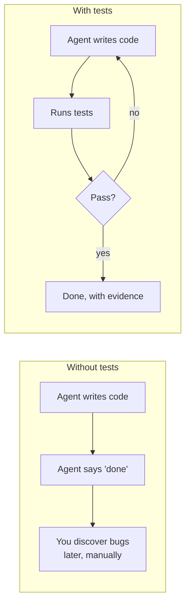
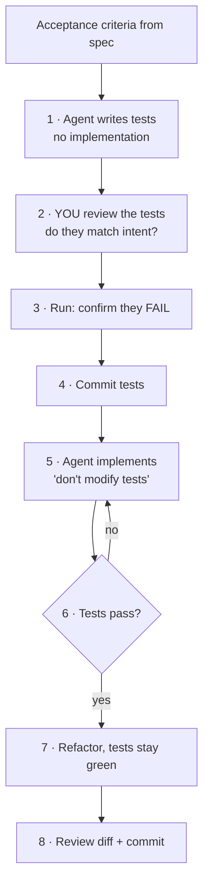
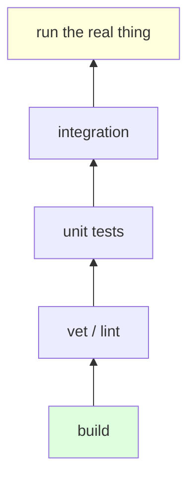
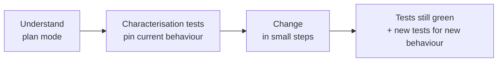

# L4 — Test-First

**Goal:** Make tests the agent's **feedback loop**. When the agent can check its own work objectively,
you can give it bigger tasks and trust the result more. This is the backbone of everything after this level.

---

## 1. Why tests matter more with AI



- The agent **iterates on its own** against a clear target instead of guessing.
- "Done" becomes **objective**, not just the agent claiming it.
- Tests are a **spec the agent can't misunderstand**. Acceptance criteria from L3 become executable.
- They protect you from **regressions** in later sessions, when the agent no longer remembers why code is the way it is.

---

## 2. TDD with an agent



```
 criteria ─▶ write tests ─▶ YOU review tests ─▶ confirm RED ─▶ commit tests
                                                                  │
          commit ◀─ review ◀─ refactor ◀── GREEN ◀── implement ◀──┘
                                                       ▲   │ fail
                                                       └───┘
```

**The key step is #2: you review the tests.** The tests are where your intent gets written down.
Reviewing 40 lines of tests is easier than reviewing 400 lines of implementation, and if the tests are right,
the implementation is constrained.

Prompts:

```text
# step 1
Based on the acceptance criteria in @docs/specs/link-expiry.md, write table-driven tests
in internal/store/expiry_test.go. Do NOT write the implementation. Use the fake clock
from internal/clock. Run them and confirm they fail for the right reason.

# step 5
Implement the code so the tests in internal/store/expiry_test.go pass.
Do not modify the test file. Run `go test ./... -race` and show the output.
```

**Committing the tests before implementing** means that if the agent touches them later, `git diff` shows it right away.

---

## 3. Go testing conventions to put in CLAUDE.md

```markdown
## Testing
- Table-driven tests with `t.Run(tc.name, ...)`.
- Unit tests next to code (`foo_test.go`); use `package foo_test` for black-box tests of public API.
- No sleeps: inject time via `internal/clock.Clock`.
- HTTP handlers: test with `httptest.NewRecorder` / `httptest.NewServer`.
- Run single test: `go test ./internal/store -run TestExpiry -v`
- Always before done: `go test ./... -race && go vet ./...`
```

---

## 4. Verification beyond unit tests

The rule: **give the agent a way to see what you would see.**

| Layer | Go tooling | Prompt hint |
|---|---|---|
| Compiles | `go build ./...` | built in |
| Static checks | `go vet`, `golangci-lint run`, `staticcheck` | "lint must be clean" |
| Unit | `go test ./...` | TDD as above |
| Race conditions | `go test -race` | "run with -race" |
| Integration | `httptest.NewServer`, testcontainers | "start the server and curl it" |
| Behaviour | the actual running app | "run it, hit the endpoint, show the response" |
| Fuzz / property | `go test -fuzz` | for parsers, validators, encoders |



Cheap checks at the bottom run constantly. Expensive ones at the top run before you finish a task.

---

## 5. The AI review checklist

Use [`templates/review-checklist.md`](../templates/review-checklist.md) for every PR. At this level, add:

- [ ] Do the tests check **behaviour**, or do they just mirror the implementation?
- [ ] Are edge cases from the spec covered (empty, invalid, boundary, concurrent)?
- [ ] Would the tests **fail** if the feature broke? (Try it: break the code on purpose and run them.)
- [ ] Were any existing tests weakened, skipped (`t.Skip`), or deleted?
- [ ] Is there test logic that "can't fail" (assertions on mocks only, `if err != nil { return }` in tests)?

> **Mutation spot-check:** sometimes ask the agent to *"introduce a subtle bug in the implementation and check
> whether the tests catch it, then revert."* It's a quick way to test your tests.

---

## 6. Legacy code: tests first, then change

For legacy repos without tests, don't refactor blind:



```text
Before changing internal/billing/calc.go, write characterisation tests that capture
its CURRENT behaviour (even if it looks wrong), including edge cases. Don't change
the code. List anything that looks like a bug separately.
```

---

## 7. Exercise

1. Add **click counting** to shorty with full TDD: criteria → tests → you review → red → commit → implement → green.
2. Do the mutation spot-check on it.
3. In your legacy repo, pick one untested function you'll need to change soon and write characterisation tests for it.

---

## Level up when…

- [ ] For new behaviour, tests come first by default
- [ ] You review tests more carefully than implementation
- [ ] Your `CLAUDE.md` has a definition of done the agent runs itself
- [ ] You've caught the agent weakening a test, and fixed your process so it can't happen quietly
- [ ] You use characterisation tests before touching legacy code

→ Next: [L5 — Extend](05-extend.md)
