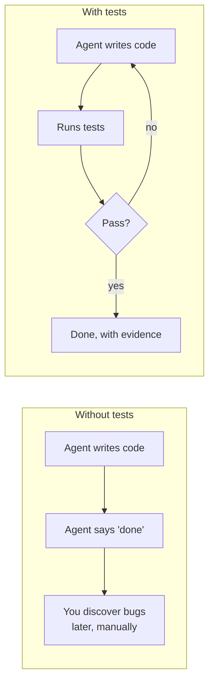
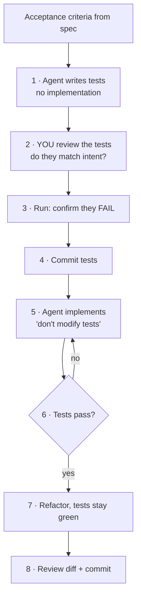
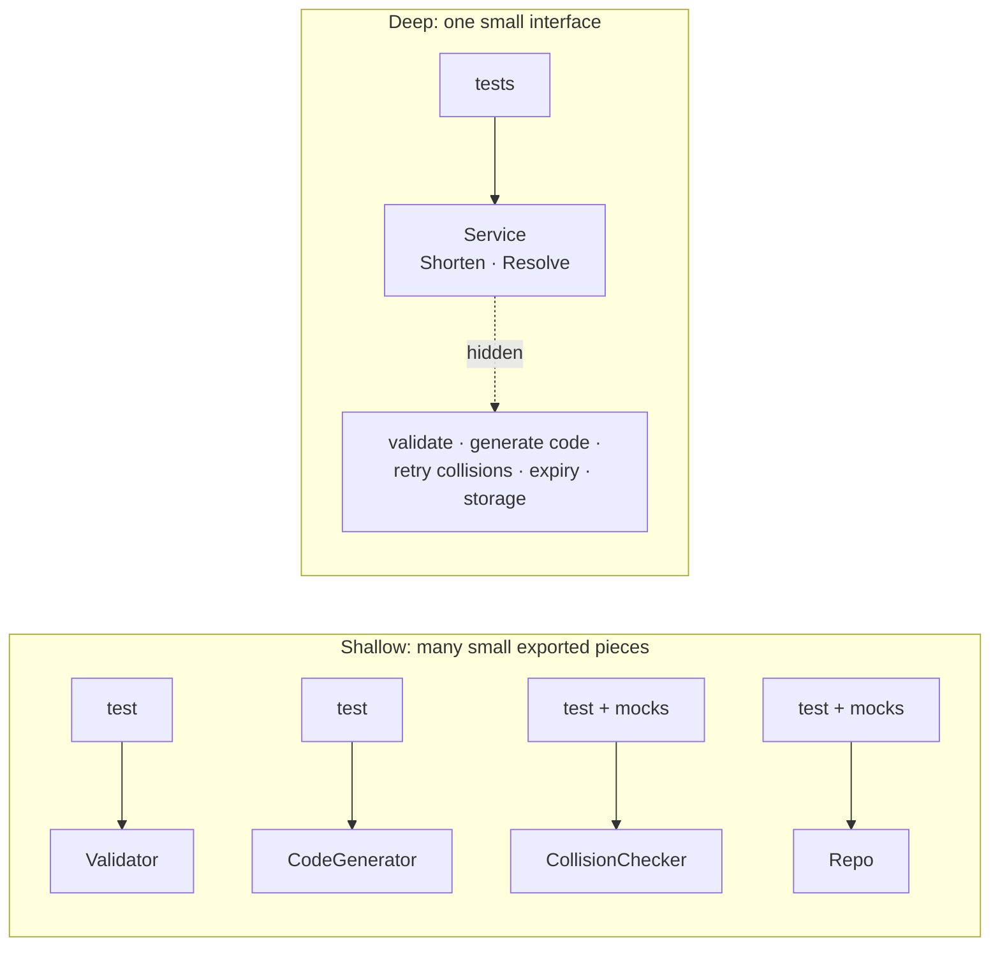
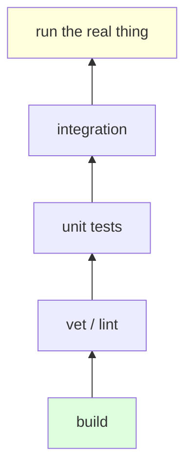
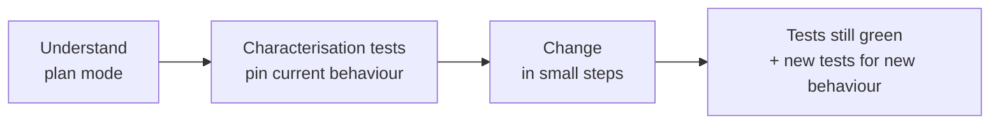

# L4 — Test-First

**Goal:** Make tests the agent's **feedback loop**. When the agent can check its own work objectively,
you can give it bigger tasks and trust the result more. This is the backbone of everything after this level.

---

## 1. Why tests matter more with AI



- The agent **iterates on its own** against a clear target instead of guessing.
- "Done" becomes **objective**, not just the agent claiming it.
- Tests are a **spec the agent can't misunderstand**. Acceptance criteria from L3 become executable.
- They protect you from **regressions** in later sessions, when the agent no longer remembers why code is the way it is.

---

## 2. TDD with an agent



```
 criteria ─▶ write tests ─▶ YOU review tests ─▶ confirm RED ─▶ commit tests
                                                                  │
          commit ◀─ review ◀─ refactor ◀── GREEN ◀── implement ◀──┘
                                                       ▲   │ fail
                                                       └───┘
```

**The key step is #2: you review the tests.** The tests are where your intent gets written down.
Reviewing 40 lines of tests is easier than reviewing 400 lines of implementation, and if the tests are right,
the implementation is constrained.

Prompts:

```text
# step 1
Based on the acceptance criteria in @docs/specs/link-expiry.md, write table-driven tests
in internal/store/expiry_test.go. Do NOT write the implementation. Use the fake clock
from internal/clock. Run them and confirm they fail for the right reason.

# step 5
Implement the code so the tests in internal/store/expiry_test.go pass.
Do not modify the test file. Run `go test ./... -race` and show the output.
```

**Committing the tests before implementing** means that if the agent touches them later, `git diff` shows it right away.

---

## 3. Deep modules: one small interface, one test boundary

A **deep module** hides a lot of behaviour behind a **small interface**. A **shallow module** has an interface
almost as complex as what it does (the term comes from John Ousterhout, *A Philosophy of Software Design*).

For TDD with an agent this matters a lot: **your tests sit on the interface.** The smaller the interface, the
more of the module one test boundary wraps.



```
 SHALLOW                                  DEEP
 test ─▶ Validator                        tests ─▶ ┌─ Shorten() ─ Resolve() ─┐  ◀ test boundary
 test ─▶ CodeGenerator                             │ validate, generate code,│
 test ─▶ CollisionChecker (mocks)                  │ retry, expiry, storage  │  ◀ free to change
 test ─▶ Repo (mocks)                              └─────────────────────────┘
```

### Why it matters with an agent

| Shallow modules | Deep modules |
|---|---|
| Tests mirror the implementation: one test file per helper, mocks everywhere | Tests describe **behaviour** through the public API |
| Every refactor breaks tests, so the agent "fixes" tests (tampering by another name) | The agent can rewrite internals freely, tests stay green and still mean something |
| You review many test files and the wiring between them | You review **one interface + one test file**. That's the spec. |
| Bugs live in the gaps between pieces, where no test looks | The whole module, gaps included, sits inside the test boundary |
| Lots of interface for the agent to keep in context | Small interface = less context, fewer ways to misuse it |

Agents drift toward shallow code by default: they add an exported helper, an interface and a mock for every
step, because each piece is easy to generate and test on its own. You have to steer them toward deep modules.

### shorty example

```go
// package shortener: the only exported surface
type Service struct{ /* unexported fields */ }

func New(store Store, clk clock.Clock) *Service
func (s *Service) Shorten(ctx context.Context, rawURL string, ttl time.Duration) (Link, error)
func (s *Service) Resolve(ctx context.Context, code string) (string, error)

var ErrInvalidURL, ErrNotFound, ErrExpired error
```

URL validation, code generation, collision retry and expiry checks are all **unexported**. The tests live in
`package shortener_test` and only call `Shorten`/`Resolve`. They use a real in-memory `Store` and the fake clock.
Fakes go only at true external edges (DB, network, time), never between internal pieces.

### How to guide Claude toward deep modules

**1. Design the interface before the tests.** Put it in the spec/plan (L3) and make it the first thing you review.

```text
Before writing any tests or code: propose the public interface for the shortener
package. Goal: a deep module, the smallest interface that covers the acceptance criteria
in @docs/specs/link-expiry.md. Hide validation, code generation, retries and expiry
behind it. Show me 2 alternative designs, say which is smaller/simpler for callers,
and list what stays unexported. No code yet.
```

**2. Review the interface like you review tests.** Ask: could a caller do everything with fewer methods/params?
Does any exported name only exist so it can be tested?

**3. Write the tests against the interface only.**

```text
Write table-driven tests in internal/shortener/shortener_test.go using package
shortener_test. Test ONLY through the exported API (New, Shorten, Resolve and the
error values). No tests for internal helpers. Use the in-memory store and fake clock,
no mocks of internal parts. Confirm they fail.
```

**4. Implement behind the interface.**

```text
Implement so the tests pass. Don't change the test file and don't add exported
identifiers beyond the agreed interface. Put helpers in unexported functions.
No new Go interfaces unless there are two real implementations.
```

**5. Deepen in the refactor step.**

```text
Review internal/shortener for shallow design: pass-through methods, exported things
only used inside the package, interfaces with one implementation, tiny types that
just forward calls. Propose merges that shrink the interface. Tests must stay unchanged and green.
```

**Put it in `CLAUDE.md`** so you don't have to repeat it:

```markdown
## Design
- Prefer deep modules: small exported API, rich behaviour hidden behind it.
- Agree on a package's public interface before writing tests or code.
- Test through the public API (`package foo_test`). No tests for unexported helpers.
- Don't export something just to test it. Don't add an interface with one implementation.
- Fakes only at external edges (DB, network, time).
```

### Signs the agent is going shallow

| Symptom | Fix |
|---|---|
| New exported funcs/types in a diff you didn't agree on | "Unexport X, it's not part of the agreed interface" |
| Tests in `package foo` reaching into internals | "Move to `package foo_test`, test through the public API" |
| An interface + mock per helper | "Delete the interface, use the concrete type; fake only the store" |
| A refactor that needs test changes | The boundary is wrong or the tests are too fine-grained. Stop and rethink the interface. |
| Methods that just call one other method | "Merge pass-through layers" |

---

## 4. Go testing conventions to put in CLAUDE.md

```markdown
## Testing
- Table-driven tests with `t.Run(tc.name, ...)`.
- Unit tests next to code (`foo_test.go`); use `package foo_test` for black-box tests of public API.
- No sleeps: inject time via `internal/clock.Clock`.
- HTTP handlers: test with `httptest.NewRecorder` / `httptest.NewServer`.
- Run single test: `go test ./internal/store -run TestExpiry -v`
- Always before done: `go test ./... -race && go vet ./...`
```

---

## 5. Verification beyond unit tests

The rule: **give the agent a way to see what you would see.**

| Layer | Go tooling | Prompt hint |
|---|---|---|
| Compiles | `go build ./...` | built in |
| Static checks | `go vet`, `golangci-lint run`, `staticcheck` | "lint must be clean" |
| Unit | `go test ./...` | TDD as above |
| Race conditions | `go test -race` | "run with -race" |
| Integration | `httptest.NewServer`, testcontainers | "start the server and curl it" |
| Behaviour | the actual running app | "run it, hit the endpoint, show the response" |
| Fuzz / property | `go test -fuzz` | for parsers, validators, encoders |



Cheap checks at the bottom run constantly. Expensive ones at the top run before you finish a task.

---

## 6. The AI review checklist

Use [`templates/review-checklist.md`](../templates/review-checklist.md) for every PR. At this level, add:

- [ ] Do the tests check **behaviour**, or do they just mirror the implementation?
- [ ] Are edge cases from the spec covered (empty, invalid, boundary, concurrent)?
- [ ] Would the tests **fail** if the feature broke? (Try it: break the code on purpose and run them.)
- [ ] Were any existing tests weakened, skipped (`t.Skip`), or deleted?
- [ ] Is there test logic that "can't fail" (assertions on mocks only, `if err != nil { return }` in tests)?
- [ ] Do tests go through the public API only? Did the diff export anything new that wasn't agreed?

> **Mutation spot-check:** sometimes ask the agent to *"introduce a subtle bug in the implementation and check
> whether the tests catch it, then revert."* It's a quick way to test your tests.

---

## 7. Legacy code: tests first, then change

For legacy repos without tests, don't refactor blind:



```text
Before changing internal/billing/calc.go, write characterisation tests that capture
its CURRENT behaviour (even if it looks wrong), including edge cases. Don't change
the code. List anything that looks like a bug separately.
```

---

## 8. Exercise

1. Add **click counting** to shorty with full TDD: criteria → tests → you review → red → commit → implement → green.
2. Do the mutation spot-check on it.
3. Before writing tests, have Claude propose the public interface of the package it touches (two designs). Pick the smaller one, then test only through it.
4. In your legacy repo, pick one untested function you'll need to change soon and write characterisation tests for it.

---

## Level up when…

- [ ] For new behaviour, tests come first by default
- [ ] You review tests more carefully than implementation
- [ ] You agree on a small public interface first and test through it, not through internal helpers
- [ ] Your `CLAUDE.md` has a definition of done the agent runs itself
- [ ] You've caught the agent weakening a test, and fixed your process so it can't happen quietly
- [ ] You use characterisation tests before touching legacy code

→ Next: [L5 — Extend](05-extend.md)
