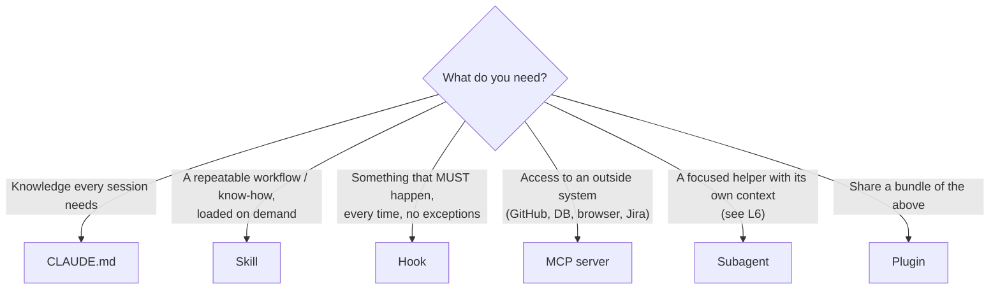
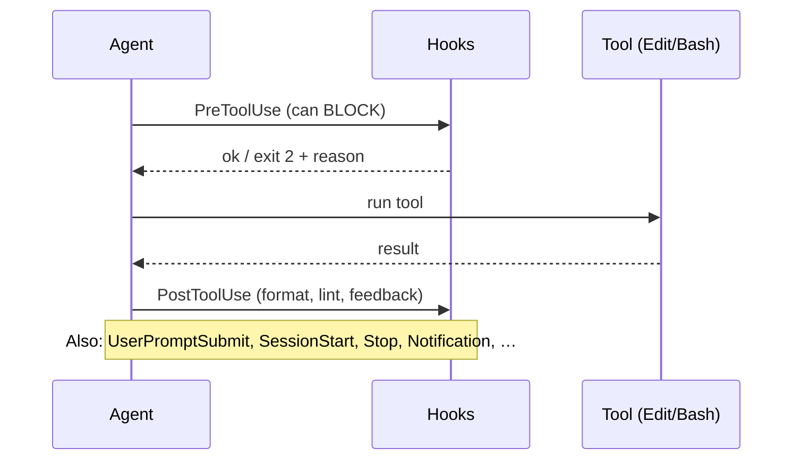

# L5 — Extend

**Goal:** Turn your process into **tooling**. Instead of remembering to type the same instructions, encode them so
they run the same way every time: skills for workflows, hooks for guarantees, MCP for outside systems.

---

## 1. Which extension when?



| Mechanism | Nature | Example |
|---|---|---|
| `CLAUDE.md` | Always loaded, advisory | "Use `errors.Is`" |
| **Skill** | Loaded when relevant or invoked with `/name`, advisory | `/tdd`, `/ship`, "how we write migrations" |
| **Hook** | Runs as code at lifecycle events, **deterministic** | gofmt after every edit; block edits to `.env` |
| **MCP** | Adds tools/data sources | GitHub issues, Postgres schema, browser |
| **Plugin** | Package of skills/agents/hooks/MCP | Share your setup across repos |

> **Rule of thumb:** if the agent *forgetting* something is merely annoying, put it in CLAUDE.md or a skill.
> If forgetting it is **unacceptable**, make it a hook.

---

## 2. Skills

A skill is a folder with a `SKILL.md`: instructions (and optionally scripts or reference files) that the agent loads
**only when needed**, so it costs almost no context until it's used. You can also call it directly with `/skill-name`.

```
.claude/skills/
  tdd/
    SKILL.md
  ship/
    SKILL.md
  spec/
    SKILL.md
  grill-me/      # from mattpocock/skills, hands off to grilling/
    SKILL.md
  grilling/
    SKILL.md
```

```markdown
---
name: tdd
description: Implement a change test-first. Use when adding new behaviour or fixing a bug.
---

1. Restate the behaviour as acceptance criteria. Ask if anything is ambiguous.
2. Propose the smallest public interface (deep module) that covers the criteria. Wait for approval.
3. Write failing table-driven tests through that public API only. Do not implement yet.
4. Run `go test` and show they fail for the right reason. STOP and wait for approval.
5. Implement the minimal code to pass. Never edit the test files from step 3. Export nothing beyond the agreed interface.
6. Run `go test ./... -race && go vet ./...`. Iterate until green.
7. Summarise: what changed, test output, anything left open.
```

Ready-made skills in [`templates/.claude/skills/`](../templates/.claude/skills/): `spec`, `tdd`, `ship`, plus [`grill-me`](https://claudemarketplaces.com/skills/mattpocock/skills/grill-me) (vendored with `grilling`).

**What makes a good skill:**

- The **description** decides when it gets used. Say *what* it does and *when* to use it.
- Keep steps concrete and include the exact commands.
- Put explicit **STOP points** where you want to review.
- Turn something into a skill once you've typed roughly the same instructions three times.

Personal skills that work across all projects go in `~/.claude/skills/`.

---

## 3. Hooks

Hooks are shell commands Claude Code runs at specific events. They're **code, not suggestions**: they run every time.



Common hooks for a Go project (full file in [`templates/.claude/settings.json`](../templates/.claude/settings.json)):

| Event | Hook | Why |
|---|---|---|
| `PostToolUse` on `Edit\|Write` | `gofmt -w` the edited `.go` file | Formatting is never a review topic again |
| `PreToolUse` on `Edit\|Write` | block `.env`, `go.sum` hand-edits, `vendor/` | Guardrails |
| `Stop` | run `go vet ./...` and report failures back | Agent can't finish with vet errors |
| `Notification` | desktop notification | Know when the agent is waiting for you |

```json
{
  "hooks": {
    "PostToolUse": [
      {
        "matcher": "Edit|Write",
        "hooks": [{ "type": "command", "command": "\"$CLAUDE_PROJECT_DIR\"/.claude/hooks/gofmt.sh" }]
      }
    ]
  }
}
```

```bash
#!/usr/bin/env bash
# .claude/hooks/gofmt.sh: hook input arrives as JSON on stdin
f=$(jq -r '.tool_input.file_path // empty')
[[ "$f" == *.go ]] && gofmt -w "$f"
exit 0
```

Hook exit codes: `0` = ok. `2` = **block** the action, and stderr is fed back to the agent so it can correct itself.
Use `/hooks` to inspect them. Keep hooks fast, because they run on every matching event.

> ⚠️ Hooks run with your user's permissions. Review hook scripts like any other code, especially ones you didn't write.

---

## 4. MCP servers

MCP (Model Context Protocol) connects the agent to external tools and data.

```bash
claude mcp add --transport http github https://api.githubcopilot.com/mcp/   # example remote server
claude mcp add --scope project postgres -- <postgres-mcp-command> "$DATABASE_URL_READONLY"   # placeholder: pick a server you trust
claude mcp list
/mcp            # inside a session: status, auth
```

`--scope project` writes `.mcp.json` into the repo so the setup is shared and versioned.

Useful categories for web/API/CLI work:

| MCP | Use |
|---|---|
| GitHub / Jira / issue tracker | Read the issue → spec → PR, without copy-paste (advanced setup: [L7](07-automate.md#advanced-optional-issue-tracker-as-the-spec)) |
| Database (read-only user!) | Agent sees the real schema, can check queries |
| Browser automation | Verify web UI changes visually (closes the loop for frontends) |
| Docs / search | Current library docs instead of stale training knowledge |

**Be picky:** every MCP server adds tool definitions to context and is a trust boundary.
Only install servers from sources you trust, give them least privilege (read-only DB users, scoped tokens),
and remove the ones you don't use. Often `gh` or `psql` through Bash is enough. You don't always need MCP.

---

## 5. Plugins

Once your `.claude/` setup is useful across repos, package it as a **plugin** (skills + agents + hooks + MCP)
and install it from a marketplace (`/plugin`). Start with a personal plugin or marketplace repo.
This is how you get the same process in every project without copying files around.

---

## 6. Exercise

1. Copy [`templates/.claude/`](../templates/.claude/) into shorty. Make the hook scripts executable.
2. Make a deliberately badly formatted edit and confirm the gofmt hook fixes it.
3. Use `/tdd` for the next feature (e.g. custom aliases: `POST /links {"url":..., "alias":"go"}`).
4. Write **one skill of your own** for something you repeat in your legacy repo (e.g. "add a DB migration", "add a CLI subcommand").
5. Add one MCP server you'd actually use, or decide on purpose that you don't need one.

---

## Level up when…

- [ ] Formatting and basic guardrails are enforced by hooks, not by asking
- [ ] You have 2–3 skills for workflows you repeat
- [ ] You can explain when to use CLAUDE.md vs. skill vs. hook vs. MCP
- [ ] Your `.claude/` directory is committed and reviewed like code
- [ ] Every MCP server you run has least-privilege credentials

→ Next: [L6 — Scale](06-scale.md)
