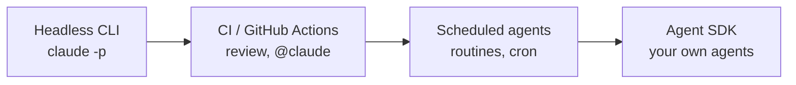
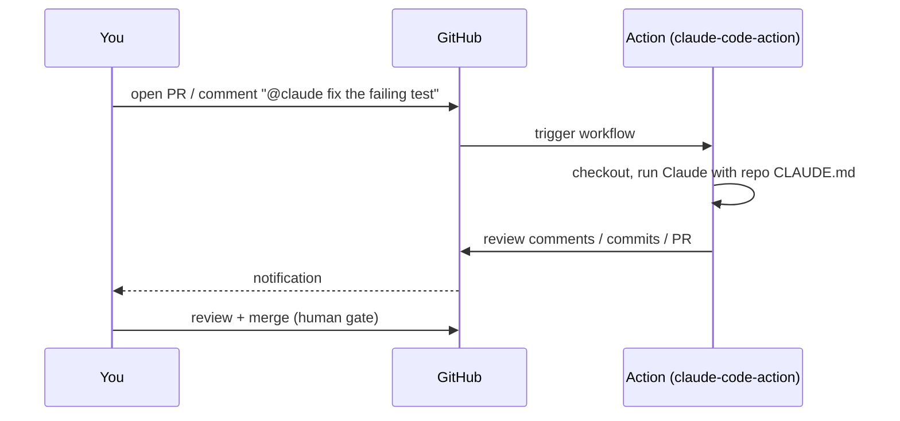
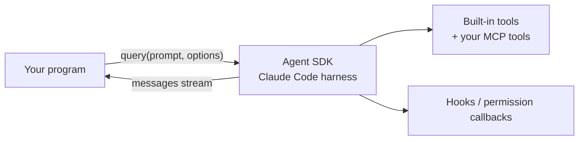
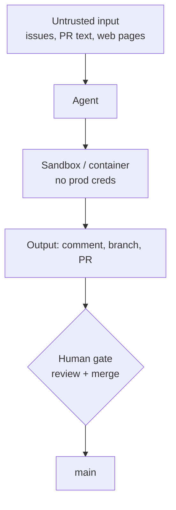

# L7 — Automate

**Goal:** Run the agent **without you at the keyboard**: in scripts, in CI, on a schedule, or inside your own tools.
The same principles apply. Only the trigger changes.

> Automation multiplies whatever your process already is. Automate after the manual workflow is reliable, not before.

---

## 1. The automation ladder



| Rung | Trigger | Typical use |
|---|---|---|
| Headless `claude -p` | You / a script | Fan-out, batch edits, pre-commit checks |
| GitHub Actions | PR, issue, `@claude` comment | Automated PR review, issue → PR |
| Scheduled | Cron / schedule | Nightly dependency check, weekly tech-debt report |
| Agent SDK | Your code | Custom internal agents and tools |

---

## 2. Headless mode

`-p` (print mode) runs one task non-interactively and exits.

```bash
# simple question
claude -p "Summarise what changed on this branch vs main" 

# machine-readable, restricted tools, bounded
claude -p "Run go vet ./... and fix any issues" \
  --allowedTools "Read,Edit,Bash(go vet:*),Bash(go build:*)" \
  --permission-mode acceptEdits \
  --max-turns 15 \
  --output-format json > result.json

# pipe input
git diff main...HEAD | claude -p "Review this diff for bugs. Output a markdown list."
```

Fan-out from a script (pattern from L6):

```bash
#!/usr/bin/env bash
set -euo pipefail
for f in $(grep -rl 'errors.New("not found")' --include='*.go' internal/); do
  claude -p "In $f, replace ad-hoc not-found errors with store.ErrNotFound \
following the pattern in internal/store/errors.go. Run go build ./... after." \
    --allowedTools "Read,Edit,Bash(go build:*)" --max-turns 10 \
  || echo "FAILED: $f" >> failed.txt
done
go test ./...
```

**Headless rules:**

- **Always restrict tools** with `--allowedTools`. Never use broad permissions in automation.
- **Bound it:** `--max-turns`, timeouts in CI.
- **Verify outside the agent:** the script runs the tests, not just the agent's word.
- **Run in a sandbox/container** when it can execute commands on untrusted input.

### From Go programs

There's no Agent SDK for Go. You have two options:

1. **Shell out to the CLI.** Run `claude -p ... --output-format json` with `os/exec` and decode the JSON. Simple, and you get the full Claude Code toolset.
2. **Use the Anthropic Go SDK** (`github.com/anthropics/anthropic-sdk-go`) with its tool runner. You define every tool yourself. Better for products that call Claude, rather than coding agents.

---

## 3. GitHub Actions

Set it up from a session with `/install-github-app` (installs the GitHub app and adds the API key secret),
or by hand with [`templates/.github/workflows/claude.yml`](../templates/.github/workflows/claude.yml).



Two workflows that pay off for a solo developer:

| Workflow | Trigger | What it does |
|---|---|---|
| **Auto review** | `pull_request` opened/synchronised | Reviews the diff against your checklist, comments inline |
| **@claude** | Comment containing `@claude` on issue/PR | Implements small fixes, answers questions, pushes to a branch |

Keep a **human merge gate**: CI may comment and push to branches, but **you** merge.
Branch protection on `main` (required status checks: `go test`, `go vet`, lint) makes that enforceable.

---

## 4. Scheduled agents

For recurring work, run the agent on a schedule:

- **Cloud routines** (`/schedule` in Claude Code): an agent runs on a cron in the cloud against your repo.
- **GitHub Actions `schedule:`** with the action from above.
- **`/loop`** inside a session for short-lived polling ("check the deploy every 5 min").

Good scheduled jobs produce **reports or PRs, never direct changes to main**:

- Weekly: "Check `go list -m -u all` for outdated deps. Open a PR for patch/minor updates if tests pass."
- Nightly: "Run `govulncheck ./...`. If anything is found, open an issue with details."
- Weekly: "Find TODOs older than 90 days (git blame) and post a summary issue."

---

## 5. Claude Agent SDK

The Agent SDK is Claude Code's agent loop as a **library** (Python and TypeScript): the same built-in tools
(Read, Edit, Bash, Grep, …), permissions, hooks, subagents, and MCP, driven from your own code.



```python
# pip install claude-agent-sdk
import asyncio
from claude_agent_sdk import query, ClaudeAgentOptions

async def main():
    options = ClaudeAgentOptions(
        allowed_tools=["Read", "Grep", "Glob", "Bash"],
        permission_mode="default",
        cwd="./shorty",
    )
    async for message in query(
        prompt="Run go test ./... and explain any failures with file:line.",
        options=options,
    ):
        print(message)

asyncio.run(main())
```

*(API shape as of writing. Check the [Agent SDK docs](https://code.claude.com/docs/en/agent-sdk) for the current interface.)*

**When to use which:**

| Need | Use |
|---|---|
| One-off or scripted coding tasks | `claude -p` |
| PR/issue automation | GitHub Action |
| Your own internal tool that needs a coding/filesystem agent (e.g. "triage bot", "migration assistant") | Agent SDK |
| A product feature that calls Claude with your own tools (no filesystem agent) | Claude API + tool use (any SDK, including Go) |

---

## 6. Guardrails for unattended agents



- **Least privilege:** scoped tokens, `--allowedTools` allowlist, read-only where possible.
- **Prompt injection is real:** issue text, PR descriptions, web pages, and dependency READMEs can contain instructions. Don't give an agent that reads untrusted input access to secrets or the ability to push to main.
- **Bounded:** max turns, timeouts, budget alerts.
- **Observable:** keep logs and JSON output, and review what automated runs actually did.
- **Human gate before production.** Always.

More in [Security & permissions](../practices/security.md).

---

## 7. Exercise

1. Write a headless script that runs `/code-review`-style review on `git diff main...HEAD` and saves it as `review.md`.
2. Add [`templates/.github/workflows/claude.yml`](../templates/.github/workflows/claude.yml) to shorty, open a PR, see the review, and try an `@claude` comment.
3. Set up one scheduled job (govulncheck or dependency updates) that opens an issue or PR.
4. Optional: build a small Agent SDK script (Python) that answers "why is this test failing?" for any repo path.

---

## Level up when… (you're there)

- [ ] Every PR gets an automated review before you look at it
- [ ] Repetitive maintenance runs on a schedule and reports through issues/PRs
- [ ] All automation runs with least privilege, bounded turns, and a human merge gate
- [ ] You can choose between `claude -p`, Actions, routines, Agent SDK and the raw API for a given problem
- [ ] You keep improving the loop: memory, skills, and hooks evolve from what automation runs show you

→ Keep going: [Best practices](../practices/best-practices.md) · [Anti-patterns](../practices/anti-patterns.md) · [Staying sharp](../practices/staying-sharp.md)
