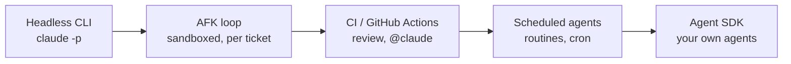
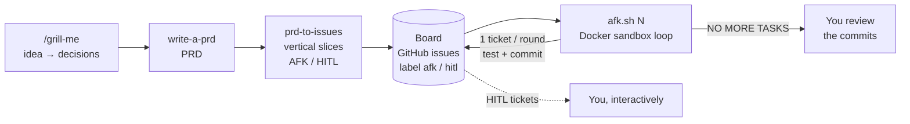
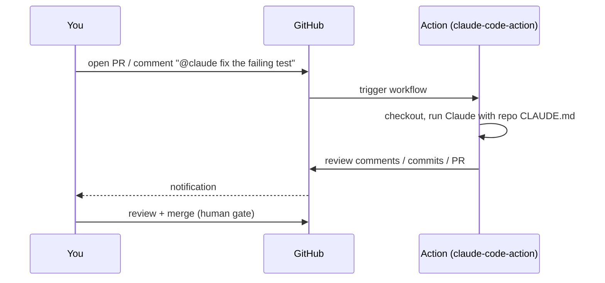
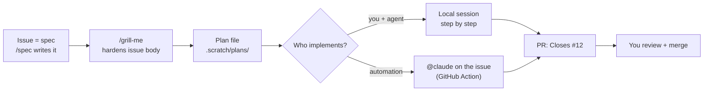
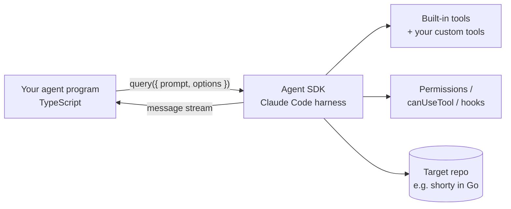
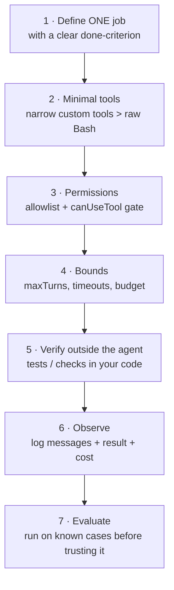
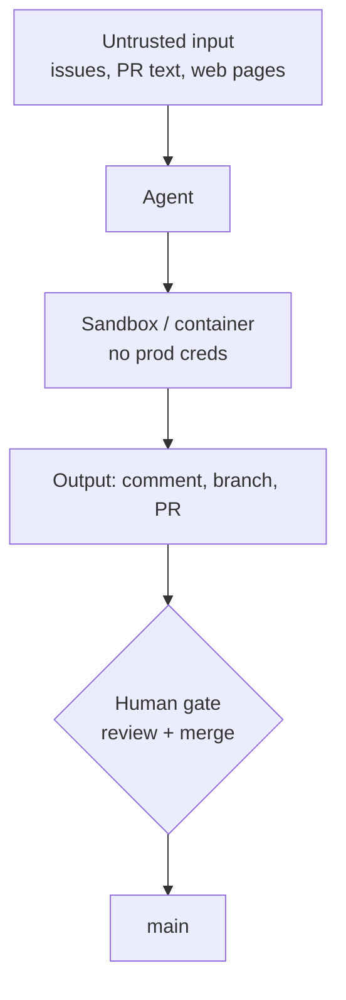

AFK# L7 — Automate

**Goal:** Run the agent **without you at the keyboard**: in scripts, in CI, on a schedule, or inside your own tools.
The same principles apply. Only the trigger changes.

> Automation multiplies whatever your process already is. Automate after the manual workflow is reliable, not before.

---

## 1. The automation ladder



| Rung | Trigger | Typical use |
|---|---|---|
| Headless `claude -p` | You / a script | Fan-out, batch edits, pre-commit checks |
| AFK loop (Ralph) | You start it, it runs N rounds | Work through a board of AFK tickets, one per round, in a sandbox |
| GitHub Actions | PR, issue, `@claude` comment | Automated PR review, issue → PR |
| Scheduled | Cron / schedule | Nightly dependency check, weekly tech-debt report |
| Agent SDK | Your code | Custom internal agents and tools |

---

## 2. Headless mode

`-p` (print mode) runs one task non-interactively and exits.

```bash
# simple question
claude -p "Summarise what changed on this branch vs main" 

# machine-readable, restricted tools, bounded
claude -p "Run go vet ./... and fix any issues" \
  --allowedTools "Read,Edit,Bash(go vet:*),Bash(go build:*)" \
  --permission-mode acceptEdits \
  --max-turns 15 \
  --output-format json > result.json

# pipe input
git diff main...HEAD | claude -p "Review this diff for bugs. Output a markdown list."
```

Fan-out from a script (pattern from L6):

```bash
#!/usr/bin/env bash
set -euo pipefail
for f in $(grep -rl 'errors.New("not found")' --include='*.go' internal/); do
  claude -p "In $f, replace ad-hoc not-found errors with store.ErrNotFound \
following the pattern in internal/store/errors.go. Run go build ./... after." \
    --allowedTools "Read,Edit,Bash(go build:*)" --max-turns 10 \
  || echo "FAILED: $f" >> failed.txt
done
go test ./...
```

**Headless rules:**

- **Always restrict tools** with `--allowedTools`. Never use broad permissions in automation.
- **Bound it:** `--max-turns`, timeouts in CI.
- **Verify outside the agent:** the script runs the tests, not just the agent's word.
- **Run in a sandbox/container** when it can execute commands on untrusted input.

> Once a script needs real logic (branching on results, custom tools, approval callbacks, structured output),
> switch from bash + `claude -p` to the **Agent SDK** (section 6).

---

## 3. AFK loop: work through a board in a sandbox ("Ralph")

The **Ralph Wiggum** pattern: run the same prompt headless in a loop. Each round starts with a **fresh context**,
picks **one** ticket, implements it, verifies it, commits, and exits. The next round starts clean.
State lives only in **git and the tickets** (GitHub issues), never in a long chat. You go AFK (away from keyboard) while it works through the board.

Reference implementation: Matt Pocock's AI Engineer workshop 2026,
[`mattpocock/ai-engineer-workshop-2026-project`](https://github.com/mattpocock/ai-engineer-workshop-2026-project), folder `ralph/`.
The repo has **no license file**, so read it there instead of copying it into your project.

### The pipeline



```
 /grill-me ─▶ PRD ─▶ prd-to-issues ─▶ BOARD (GitHub issues) ◀────────────┐
                     AFK / HITL        label afk / hitl                  │
                                          ▼                              │
                            afk.sh N: docker sandbox, claude --print     │
                            pick 1 AFK ticket → /tdd → test + typecheck  │
                            → commit "Closes #N" → close issue ──────────┘
                                          │ all AFK done
                                          ▼
                            "<promise>NO MORE TASKS</promise>" ─▶ you review
```

The "kanban board" is your GitHub issues: open issues labelled `afk` are the queue, a closed issue is done.
Don't use a folder of ticket files in the repo for this: finished tickets pile up, and later rounds (and later you)
read them as if they still applied ([Where work lives](../practices/best-practices.md#where-work-lives)).
Only **AFK** tickets go into the loop. **HITL** tickets (architecture calls, design review) stay with you.
Cut tickets as vertical slices ([L3](03-spec-plan-code.md#slice-vertically-not-horizontally)): each one must be done and
testable on its own, or a round can't finish it.

### What's in `ralph/`

| File | Role |
|---|---|
| `once.sh` | One interactive round on your machine (`--permission-mode acceptEdits`). Use it to watch and tune the prompt first. |
| `afk.sh <N>` | Up to **N** rounds of `docker sandbox run claude . -- --print --output-format stream-json …`. Each round gets the last 5 commits, all open tickets (local `issues/*.md` files in the workshop), and `prompt.md`. Stops early when the result contains `<promise>NO MORE TASKS</promise>`. |
| `prompt.md` | AFK tickets only, **one per round**. Priority: critical bugfix → dev infrastructure → tracer bullets → polish → refactors. Implement with `/tdd`, run the feedback loops (tests + typecheck), commit with decisions/files/notes for the next round, then move the ticket to `done/` or add a progress note to it. |

### Why it works

| Idea | Effect |
|---|---|
| Fresh context per round | No context rot, no compaction. Every round is a clean, focused session. |
| One ticket per round | Small diffs, one commit per ticket, easy to revert. |
| Commits and ticket notes as memory | The hand-off between rounds is written down and reviewable. |
| Tests + typecheck in the prompt | The loop is only as good as its feedback ([L4](04-test-first.md)). |
| `N` iterations + a stop word | Bounded cost, and a clean exit when the board is empty. |
| Docker sandbox | The agent runs without permission prompts, but in a box instead of on your machine. |

### Before you run it on shorty

- **The scripts target a Node/TypeScript project.** `prompt.md` runs `npm run test` and `npm run typecheck`.
  In a Go project the feedback loops are `go test ./...` and `go vet ./...`. Write your own `prompt.md` for that.
  Don't present it as the workshop file.
- **Point the loop at GitHub issues, not ticket files.** The workshop keeps tickets as local `issues/*.md` files.
  The upstream `prd-to-issues` in [`templates/.claude/skills/prd-to-issues/`](../templates/.claude/skills/prd-to-issues/)
  creates **GitHub issues**, so use that one and write your own round script and `prompt.md` to match:
  - Feed open tickets in with `gh issue list --label afk --state open --author @me --json number,title,body`.
  - One ticket per round. Commit with `Closes #N` (or `gh issue close N`). Progress notes for the next round go in an issue comment.
  - `--author @me` keeps tickets written by other people out of the prompt.
  - [`templates/.claude/skills/tdd/`](../templates/.claude/skills/tdd/) **stops and waits for your approval** of the tests.
    That's right for interactive work but blocks an AFK round. Don't point an AFK prompt at it.
- **`docker sandbox`** is a Docker Desktop feature (Docker Sandboxes). Check Docker's docs for setup, auth, and what gets mounted.
- **Start with `once.sh`**, then `afk.sh 3`, then larger N once the commits look right.

### Security: what the sandbox does and doesn't do

| Protected | Not protected |
|---|---|
| Your host filesystem, dotfiles, SSH keys, real credentials | Secrets you pass **into** the sandbox (API key, GitHub token): scope them to the minimum, e.g. a fine-grained token for this one repo with issues + contents only |
| Destructive commands (`rm -rf`, global installs) | **Network egress**: without an allowlist/firewall the agent can still send data out, and usually reach your LAN |
| Your other projects | **Prompt injection**: ticket text goes into the prompt as-is. Whoever writes tickets steers the agent |
| | **What it commits**: the loop commits to the current branch |

Run the loop on a **feature branch, never `main`**. Review the commits and merge through a PR with CI, the same human gate as
everywhere else (section 7). The sandbox makes it safe to let the agent *run*. It doesn't make the output safe to *merge*.

### Stronger isolation: a throwaway VM

For unattended runs on a **private repo with a write token**, go one step further: a fresh VM per run that reaches the
public internet only (not your host, LAN, VPN or Docker), destroyed afterwards. An Ansible playbook creates it, clones
the repo, runs a plan, one issue, or this AFK loop inside it, pushes a branch and opens a draft PR.
See [VM sandbox](../practices/vm-sandbox.md) and [`templates/vm-runner/`](../templates/vm-runner/).

---

## 4. GitHub Actions

Set it up from a session with `/install-github-app` (installs the GitHub app and adds the API key secret),
or by hand with [`templates/.github/workflows/claude.yml`](../templates/.github/workflows/claude.yml).



Two workflows that pay off for a solo developer:

| Workflow | Trigger | What it does |
|---|---|---|
| **Auto review** | `pull_request` opened/synchronised | Reviews the diff against your checklist, comments inline |
| **@claude** | Comment containing `@claude` on issue/PR | Implements small fixes, answers questions, pushes to a branch |
| **PR title + release** | `pull_request` / push to `main` | Checks Conventional Commit titles; release-please tags `vX.Y.Z` and the same run pushes the Docker image with that version. See [releases](../practices/releases.md). |

Keep a **human merge gate**: CI may comment and push to branches, but **you** merge.
Branch protection on `main` (required status checks: `go test`, `go vet`, lint) makes that enforceable.

### Advanced (optional): issue tracker as the spec

In [L3](03-spec-plan-code.md#where-the-spec-lives) the issue tracks the work and the spec is a temporary file in `.scratch/`. Once other people
discuss requirements with you, you plan on a board, or you want `@claude` to go from issue to PR, it pays to make
the **issue itself the spec** (PRD-style). Works with GitHub Issues and Jira (or any tracker with a CLI or MCP server).



```
 ISSUE (spec) ──▶ /grill-me ──▶ PLAN FILE ──┬──▶ local session ──┐
  body = spec     updates     .scratch/   └──▶ @claude Action ─┴──▶ PR "Closes #12" ──▶ you merge
                  issue body
```

| | GitHub Issues | Jira |
|---|---|---|
| Agent reads it | `gh issue view 12` | Atlassian MCP server or Jira CLI (check their docs) |
| Agent updates it | `gh issue edit 12 --body-file …` + comment | MCP tool / CLI, same idea |
| Links to the PR | `Closes #12` closes it on merge | Ticket key in branch/PR title (`SHORTY-12`), via the GitHub integration |
| `@claude` implements it | ✅ comment on the issue (workflow above) | Via a GitHub issue or a custom trigger |

Rules that keep it sane:
- **One source of truth.** Spec in the issue means no `.scratch/specs/x.md` for that feature. Don't keep both.
- **The plan stays a local file** in `.scratch/plans/` (gitignored). The agent re-reads it every step. Its key steps
  and decisions go into the PR description, where they get reviewed. Delete it after merge.
  The `@claude` Action has no `.scratch/`: put the plan in an issue comment for that path.
- **Grilling writes back to the issue:** the new body, plus a comment listing the decisions, so the history shows why it changed.
  `/spec` ([`templates/.claude/skills/`](../templates/.claude/skills/)) handles issues and asks before writing. `/grill-me` writes nothing:
  after grilling, ask the agent to draft the new body and the decisions comment, and confirm before it posts.
- **The agent asks before posting.** Creating or editing an issue publishes to everyone who can see the tracker.
- **Issue text is untrusted input.** Only the body you wrote is the spec. Comments from others can contain prompt
  injection, so don't let an agent that reads them hold secrets or push to `main` (see section 7 and [Security](../practices/security.md)).

---

## 5. Scheduled agents

For recurring work, run the agent on a schedule:

- **Cloud routines** (`/schedule` in Claude Code): an agent runs on a cron in the cloud against your repo.
- **GitHub Actions `schedule:`** with the action from above.
- **`/loop`** inside a session for short-lived polling ("check the deploy every 5 min").

Good scheduled jobs produce **reports or PRs, never direct changes to main**:

- Weekly: "Check `go list -m -u all` for outdated deps. Open a PR for patch/minor updates if tests pass."
- Nightly: "Run `govulncheck ./...`. If anything is found, open an issue with details."
- Weekly: "Find TODOs older than 90 days (git blame) and post a summary issue."

---

## 6. Claude Agent SDK: build your own agents

The Agent SDK is Claude Code packaged as a **library**: the same agent loop, built-in tools (Read, Edit, Bash, Grep, …),
permissions, hooks, subagents, MCP, sessions, and your project's `.claude/` skills and `CLAUDE.md`, driven from your own code.
It's the recommended way to build custom agents. Use it when a bash loop around `claude -p` isn't enough anymore.



### Choosing a language: TypeScript for the agent, any language for the project

The SDK exists for **TypeScript** and **Python**. The agent you build is a separate tool from the project it works on:
a TypeScript agent can maintain a Go codebase. Recommendation:

| | Recommended | Why |
|---|---|---|
| Agent tooling | **TypeScript** (Python is just as good if you prefer it) | Most complete SDK surface (some options are TS-only); Zod gives typed tool inputs |
| Target project | Whatever you build (Go for shorty) | The agent runs `go test`, `go vet` etc. like you would |
| Other languages (e.g. Go programs) | `claude -p --output-format json` as a subprocess | The official route when you can't use TS/Python |

Keep agents in their own folder or repo (e.g. `tools/agents/`) with their own `package.json`, tests, and README.

### Setup

```bash
mkdir -p tools/agents && cd tools/agents
npm init -y && npm pkg set type=module
npm install @anthropic-ai/claude-agent-sdk zod
npm install --save-dev tsx typescript
export ANTHROPIC_API_KEY=...        # the SDK does not read .env files by itself
```

### Example 1: a read-only test triage agent

```typescript
// tools/agents/triage.ts — usage: npx tsx triage.ts ../../shorty
import { query } from "@anthropic-ai/claude-agent-sdk";

const repo = process.argv[2] ?? ".";

for await (const message of query({
  prompt: "Run `go test ./... 2>&1 | tail -80`. For each failure, explain the likely cause with file:line. Do not edit files.",
  options: {
    cwd: repo,
    allowedTools: ["Read", "Grep", "Glob", "Bash(go test:*)"], // pre-approved
    disallowedTools: ["Edit", "Write"],                         // removed entirely: read-only agent
    permissionMode: "default",
    maxTurns: 20,
  },
})) {
  if (message.type === "result") {
    console.log(message.subtype === "success" ? message.result : `Agent stopped: ${message.subtype}`);
  }
}
```

### Example 2: custom tools and an approval gate

Custom tools are plain functions exposed through an in-process MCP server. Use them to give the agent
**narrow, safe capabilities** instead of broad shell access.

```typescript
// tools/agents/coverage.ts
import { query, tool, createSdkMcpServer } from "@anthropic-ai/claude-agent-sdk";
import { z } from "zod";
import { execFile } from "node:child_process";
import { promisify } from "node:util";

const run = promisify(execFile);
const repo = process.argv[2] ?? ".";

// A narrow tool: coverage for ONE package, nothing else.
const coverage = tool(
  "package_coverage",
  "Run Go tests with coverage for a single package and return the coverage summary",
  { pkg: z.string().regex(/^\.\/[\w\/.-]+$/).describe("Go package path, e.g. ./internal/store") },
  async ({ pkg }) => {
    try {
      const { stdout } = await run("go", ["test", "-cover", pkg], { cwd: repo });
      return { content: [{ type: "text", text: stdout }] };
    } catch (err: any) {
      return { content: [{ type: "text", text: `go test failed:\n${err.stdout ?? err.message}` }], isError: true };
    }
  },
  { annotations: { readOnlyHint: true } },
);

const goTools = createSdkMcpServer({ name: "go", version: "1.0.0", tools: [coverage] });

for await (const message of query({
  prompt: "Find the 3 packages with the lowest coverage and write missing table-driven tests for the most important one.",
  options: {
    cwd: repo,
    mcpServers: { go: goTools },
    allowedTools: ["Read", "Grep", "Glob", "mcp__go__package_coverage"],
    // Everything not pre-approved (e.g. Edit, Write) goes through this callback: your approval gate.
    canUseTool: async (toolName, input) => {
      const path = String((input as any).file_path ?? "");
      if ((toolName === "Edit" || toolName === "Write") && path.endsWith("_test.go")) {
        return { behavior: "allow", updatedInput: input };
      }
      return { behavior: "deny", message: "This agent may only write *_test.go files." };
    },
    maxTurns: 40,
  },
})) {
  if (message.type === "result") console.log(message.subtype === "success" ? message.result : message.subtype);
}
```

<details>
<summary>Python equivalent (minimal)</summary>

```python
# pip install claude-agent-sdk
import asyncio
from claude_agent_sdk import query, ClaudeAgentOptions, ResultMessage

async def main():
    options = ClaudeAgentOptions(
        cwd="../../shorty",
        allowed_tools=["Read", "Grep", "Glob", "Bash(go test:*)"],
        disallowed_tools=["Edit", "Write"],
        max_turns=20,
    )
    async for message in query(prompt="Run go test ./... and explain failures with file:line.", options=options):
        if isinstance(message, ResultMessage):
            print(message.result)

asyncio.run(main())
```
</details>

*(API as of writing. Check the [Agent SDK docs](https://code.claude.com/docs/en/agent-sdk/overview) and changelogs for the current interface.)*

### Agent SDK best practices



| Practice | Why |
|---|---|
| **One agent, one job** ("triage failing tests", "write missing tests") | Focused prompts and tools beat general-purpose agents |
| **Narrow custom tools over raw `Bash`** | Validated inputs (Zod), predictable outputs, much smaller attack surface |
| **Allowlist + `canUseTool`** as the approval gate | Encodes your rules ("only `_test.go` files") in code, not in the prompt |
| **Read-only by default** (`disallowedTools: ["Edit","Write"]`) | Add write access only for agents whose job needs it |
| **Bound every run** (`maxTurns`, process timeout) | No runaway loops or surprise bills |
| **Reuse the project's `.claude/`** (CLAUDE.md, skills) | The SDK loads them like Claude Code does, so one source of truth for conventions |
| **Verify in code after the run** (`go test ./...` yourself) | Don't rely on the agent's own "success" |
| **Log the message stream and the final result** (including cost/usage) | Debugging and cost tracking |
| **Write output to a branch/PR, never main** | Same human gate as everywhere else |
| **Keep a small eval set** (repos/cases with known answers) and rerun it after changing prompts or tools | Agents regress silently |
| **Secrets via env/secret manager, never in prompts** | Prompt-injection safety ([Security](../practices/security.md)) |

**When to use which:**

| Need | Use |
|---|---|
| One-off or scripted coding tasks | `claude -p` |
| Work through a board of small, well-tested tickets while you're away | AFK loop in a sandbox (section 3) |
| Unattended run on a private repo, isolated from your host and LAN | Throwaway VM runner ([VM sandbox](../practices/vm-sandbox.md)) |
| PR/issue automation | GitHub Action |
| Your own internal tool that needs a coding/filesystem agent (triage bot, test writer, migration assistant) | **Agent SDK (TypeScript)** |
| A program in another language that needs a coding agent | `claude -p --output-format json` as a subprocess |
| A product feature that calls Claude with your own tools (no filesystem agent) | Claude API + tool use (Anthropic client SDK for your language, e.g. Go) |
| Anthropic should host the agent and its sandbox | Managed Agents (Claude API) |

---

## 7. Guardrails for unattended agents



- **Least privilege:** scoped tokens, `--allowedTools` allowlist, read-only where possible.
- **Prompt injection is real:** issue text, PR descriptions, web pages, and dependency READMEs can contain instructions. Don't give an agent that reads untrusted input access to secrets or the ability to push to main.
- **Bounded:** max turns, timeouts, budget alerts.
- **Observable:** keep logs and JSON output, and review what automated runs actually did.
- **Human gate before production.** Always.

More in [Security & permissions](../practices/security.md).

---

## 8. Exercise

1. Write a headless script that runs `/code-review`-style review on `git diff main...HEAD` and saves it as `review.md`.
2. Add [`templates/.github/workflows/claude.yml`](../templates/.github/workflows/claude.yml) to shorty, open a PR, see the review, and try an `@claude` comment.
3. Run the AFK loop pattern (section 3) on shorty: cut a small feature into 2–3 GitHub issues labelled `afk`, write a Go
   `prompt.md` (`gh issue list --label afk`, `go test ./...`, `go vet ./...`, `Closes #N`), do one round interactively,
   then a bounded sandboxed run on a feature branch.
   Review the commits like a PR.
4. Set up one scheduled job (govulncheck or dependency updates) that opens an issue or PR.
5. Build the TypeScript triage agent (Example 1) in `tools/agents/`, run it against shorty with a deliberately broken test,
   then extend it with one narrow custom tool and a `canUseTool` gate (Example 2).

---

## Level up when… (you're there)

- [ ] Every PR gets an automated review before you look at it
- [ ] You can let a sandboxed loop work through AFK tickets on a branch and review its commits before merging
- [ ] Repetitive maintenance runs on a schedule and reports through issues/PRs
- [ ] Merging the release PR tags the repo and pushes a Docker image with the same version, and breaking changes bump the major
- [ ] All automation runs with least privilege, bounded turns, and a human merge gate
- [ ] You can choose between `claude -p`, Actions, routines, Agent SDK and the raw API for a given problem
- [ ] You keep improving the loop: memory, skills, and hooks evolve from what automation runs show you

→ Keep going: [Best practices](../practices/best-practices.md) · [Anti-patterns](../practices/anti-patterns.md) · [Staying sharp](../practices/staying-sharp.md)
