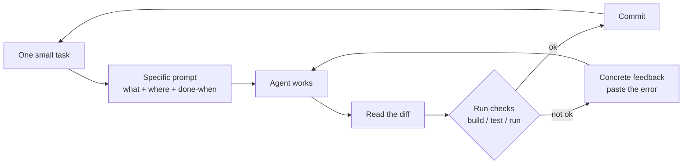
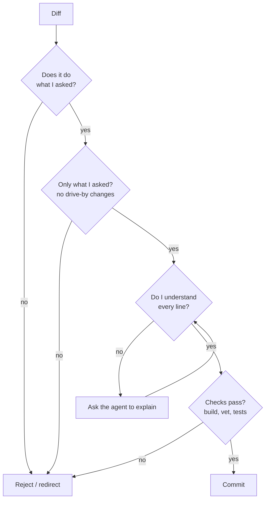

# L1 — Prompt → Verify

**Goal:** Give one well-defined task at a time, and verify every result before accepting it.
This level is boring, and it's where most of the quality comes from.

---

## 1. The micro-loop



```text
 small task ─▶ specific prompt ─▶ agent works ─▶ read diff ─▶ run checks ─┬─ ok ──▶ commit
                                       ▲                                   │
                                       └──────── paste exact error ◀── fail┘
```

**Small task** = something you could describe in 1–3 sentences and review in a few minutes.
If the diff is too big to review properly, the task was too big.

---

## 2. Anatomy of a good prompt

| Part | Bad | Good |
|---|---|---|
| **What** | "add shortening" | "Add `POST /links` that accepts `{\"url\": ...}` and returns a 6-char code" |
| **Where** | — | "in `internal/http/handlers.go`, following the style of the `/healthz` handler" |
| **Constraints** | — | "stdlib `net/http` only, no new dependencies; store in memory for now" |
| **Done when** | — | "`go build ./...` passes and `curl -XPOST localhost:8080/links -d '{\"url\":\"https://go.dev\"}'` returns 201" |
| **Verification** | — | "run the curl yourself and show me the output" |

Template:

```text
Goal: <what you want, one sentence>
Context: <relevant files with @, related code to imitate>
Constraints: <libraries, style, what NOT to touch>
Done when: <observable checks the agent can run itself>
```

Other prompt habits that pay off:

- **Point at examples:** "follow the pattern in `@internal/store/memory.go`" works better than describing style in words.
- **Paste real errors:** `!go test ./...` or paste the stack trace. Don't paraphrase.
- **Ask questions first when unsure:** "Before changing anything, tell me where X is handled."
- **Say what not to do:** "Don't modify tests", "don't add dependencies", "don't refactor unrelated code."
- **One concern per prompt.** "Fix the bug *and* refactor *and* add logging" gives you a diff you can't review.

---

## 3. Verify: read every diff

You're accountable for every line. Use [`templates/review-checklist.md`](../templates/review-checklist.md). The short version:



Red flags that need a closer look:

- Tests modified or deleted "to make them pass"
- New dependencies you didn't ask for
- `// TODO`, stubbed functions, `panic("not implemented")`
- Errors swallowed: `_ = err`, empty `if err != nil {}`
- Calls to functions or packages that don't exist (hallucinated APIs: the build will tell you)
- Big unrelated reformatting that hides the real change

---

## 4. Course-correct early

| Situation | Do |
|---|---|
| Agent is going the wrong way | `Esc` right away and redirect. Don't wait for it to finish. |
| Two failed correction attempts on the same thing | `/rewind` or `/clear`, then rewrite the prompt with what you learned |
| Agent "fixes" by weakening checks | "Do not change the test. Fix the implementation." |
| Agent claims success without evidence | "Show me the command output that proves it." |

> **The two-strikes rule:** after two failed corrections, the context is polluted with bad attempts.
> Starting fresh with a better prompt beats a third correction almost every time.

---

## 5. Commit small, commit often

- Commit after each verified micro-loop. Small commits are easy to revert.
- You can let the agent write the commit message ("commit this with a conventional commit message"), but read it.
  The type decides the next version, so a breaking change must never hide in a `fix:` ([releases](../practices/releases.md)).
- Never let un-reviewed AI changes pile up across several tasks.

---

## 6. Exercise (shorty)

Do each as a **separate** micro-loop with its own commit:

1. `POST /links` → returns a code (in-memory store).
2. `GET /{code}` → 302 redirect, 404 if unknown.
3. Input validation: reject non-http(s) URLs with 400.

For each one: write the prompt with the template, read the diff with the checklist, verify with curl, commit.

---

## Level up when…

- [ ] Your prompts routinely include *what, where, constraints, done-when*
- [ ] You've rejected or redirected at least one diff after reviewing it
- [ ] You stop the agent early instead of letting bad work finish
- [ ] Every commit is reviewed and verified
- [ ] You use `/clear` between unrelated tasks

→ Next: [L2 — Project Memory](L2-project-memory.md)
