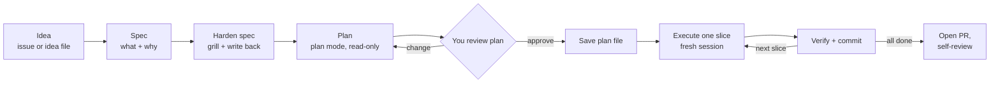
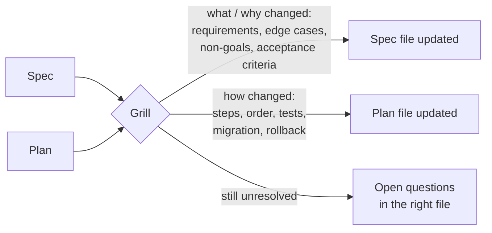
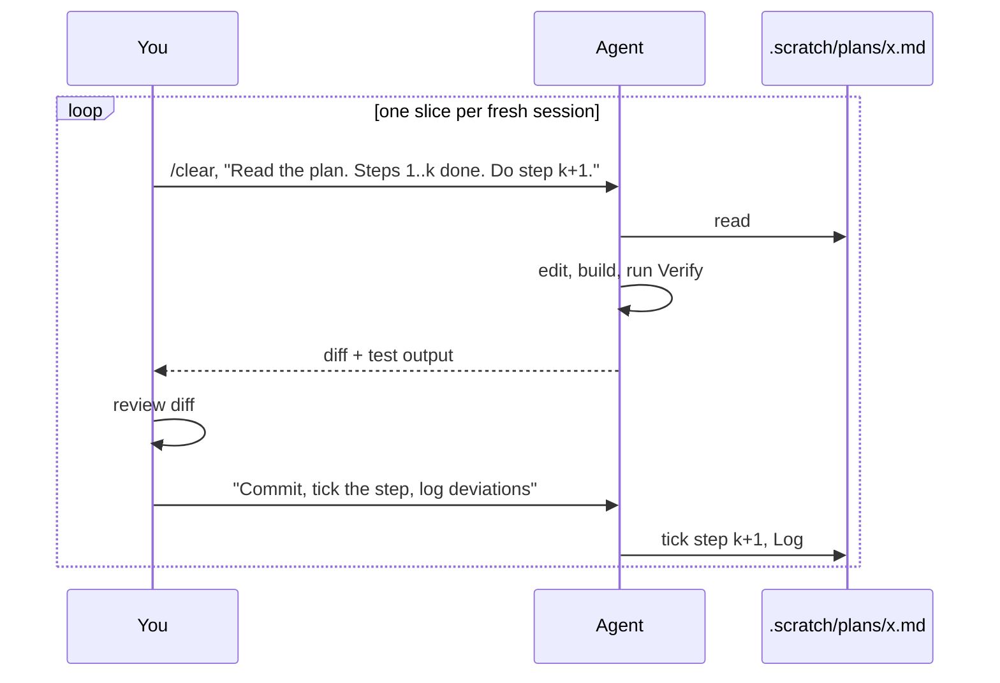
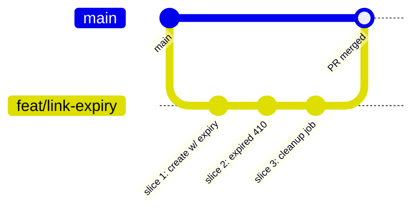

# L3 — Spec → Plan → Code

**Goal:** Handle features bigger than one prompt. Separate **thinking** from **typing**: decide *what* and *how*
before the agent edits anything, then run the work through branches and PRs.

---

## 1. The workflow: Spec → Plan → Slices → PR



```
 ┌───────┐  ┌───────┐  ┌────────┐  ┌──────┐  ┌──────┐  ┌───────────────┐  ┌────┐
 │ IDEA  │─▶│ SPEC  │─▶│ HARDEN │─▶│ PLAN │─▶│ SAVE │─▶│ SLICE ▸ COMMIT │─▶│ PR │
 └───────┘  └───────┘  └────────┘  └──────┘  └──────┘  └───────┬───────┘  └────┘
  ideas/x.md specs/x.md specs/x.md  (chat)   plans/x.md       ▲ │ one per slice
  or #N      (draft)    (approved)                             └─┘
```

**Why it works:** most bad AI code comes from the agent jumping straight to code with a wrong assumption.
A spec and a plan are cheap to correct. Ten edited files are not.

**When to use it:**

| Task size | Approach |
|---|---|
| Typo, rename, one-function fix | L1 micro-loop, no plan |
| Clear change touching 2–5 files | Plan mode → implement (steps 4–8, no spec) |
| New feature, unclear design, or legacy code | The full runbook below |

---

## 2. The core rule: every step ends in a file

Each step reads **one input file** and produces **one output file** (or a commit, a PR). Then you `/clear`
and start the next step from that file only.

```
 idea ─▶ ideas/x.md ─▶ specs/x.md ─▶ specs/x.md ─▶ plans/x.md ─▶ commit ─▶ commit ─▶ … ─▶ PR
          (or #N)       (draft)      (approved)    (approved)   slice 1   slice 2
               ▲             ▲             ▲             ▲           ▲
               └─────────────┴──── /clear between steps ─┴───────────┘
```

Why:

- **Small context per task.** A fresh session that loads one file starts in the
  [smart zone](../practices/context-and-cost.md#smart-zone-vs-dumb-zone). The interview chat, the dead-end
  explorations and the last slice's diffs don't get carried along.
- **Nothing gets lost.** The file survives `/clear` and compaction. The chat doesn't.
- **You review every hand-off.** If a decision isn't in the file, the next session doesn't know it. So before you
  `/clear`, check the file says what you agreed on.

---

## 3. The runbook at a glance

Files live in `.scratch/` (gitignored). `x` = your feature slug, e.g. `link-expiry`.

| # | Step | Start from | Goal | Output | Done when |
|---|---|---|---|---|---|
| 0 | Setup (once per project) | — | Working folder + templates | `.scratch/` in `.gitignore`, `docs/templates/` | `git status` ignores `.scratch/` |
| 1 | Write down the idea | Idea in your head | Capture it so it can be picked up later | `.scratch/ideas/x.md` or GitHub issue #N | Idea + why + rough scope, 3 lines |
| 2 | Draft the spec | Idea (file or issue) + spec template | Capture *what* and *why* | `.scratch/specs/x.md` (draft) | All template sections filled |
| 3 | Harden the spec | Spec draft | Remove gaps and guesses | Same file, rewritten (approved) | Spec-ready checklist passes |
| 4 | Draft the plan | Approved spec | Decide *how*, as vertical slices | Plan in chat (plan mode can't write) | Agent proposes slices |
| 5 | Review + save the plan | Plan in chat | Your design review | `.scratch/plans/x.md` (approved) | Plan-ready checklist passes |
| 6 | *Optional:* grill both | Spec + plan files | Harden *how* against *what* | Both files updated | No new open questions |
| 7 | Branch | Approved plan | Isolate the work | `feat/x` branch | — |
| 8 | Execute one slice (loop) | Plan file + git log | One working, tested slice | 1 commit + plan checkbox ticked | Slice's Verify command passes |
| 9 | Finish → PR | All slices ticked | Ship it for review | PR (`Closes #N` if there's an issue) | Merged, scratch files deleted |

The rest of this level walks through each step. Every step lists the same four things: **Start from**, **Goal**,
**Prompt**, **Output**.

---

## 4. Phase A: Spec (what and why)

### Step 0: Setup (once per project)

```bash
mkdir -p .scratch/ideas .scratch/specs .scratch/plans docs/templates && echo ".scratch/" >> .gitignore
cp <guide>/templates/spec.md <guide>/templates/plan.md docs/templates/
```

The templates ([`templates/spec.md`](../templates/spec.md), [`templates/plan.md`](../templates/plan.md)) are committed
in `docs/templates/` because they're knowledge (how *we* write specs). The filled-in copies are work and stay in `.scratch/`.
See [`templates/README.md`](../templates/README.md) for the full copy list.

### Step 1: Write down the idea

- **Start from:** the idea in your head.
- **Goal:** 3 lines that capture *what*, *why* and rough scope, so you (or the agent) can pick it up later.
- **Output:** pick one place:

| Where | Use it when | How |
|---|---|---|
| **Idea file** `.scratch/ideas/x.md` | Solo, offline, no GitHub, or just trying something out | Write it yourself, or *"Write .scratch/ideas/link-expiry.md: 3 lines, what the idea is, why we want it, rough scope."* |
| **GitHub issue** #N | You want a backlog others can see, or a PR that closes it (`Closes #N`) | *"Open a GitHub issue 'Link expiry' with gh: 3 lines, what, why, rough scope. Show it to me before creating it."* |

Either works for the rest of the runbook: step 2 starts from it. The idea file is a working file like the spec, so it stays
in gitignored `.scratch/` and is deleted after merge. Ideas you want to keep for later but won't start now belong in an
issue, or in an idea file you accept may get lost: don't commit a backlog to the repo (see [Where the spec lives](#where-the-spec-lives)).

### Step 2: Draft the spec (interview)

- **Start from:** `/clear`, the idea (file or issue), the spec template.
- **Goal:** get the requirements out of your head and into a file. The agent asks, you answer.
- **Prompt:**

```text
Read @.scratch/ideas/link-expiry.md (or: issue #12). Interview me with questions until the requirements
are clear, then write .scratch/specs/link-expiry.md using @docs/templates/spec.md, Status: draft.
Don't write any code.
```

- **Output:** `.scratch/specs/link-expiry.md` with `Status: draft`.

A good spec has:

- **Problem / goal**: why we're doing this
- **Scope / non-goals**: what we're *not* doing (this stops scope creep)
- **Behaviour**: concrete examples, inputs → outputs, edge cases
- **Acceptance criteria**: checkable statements. These later become tests (L4).

### Step 3: Harden the spec

A draft holds what *you* thought of. Hardening finds what you didn't: hidden assumptions, missing edge cases,
acceptance criteria you can't test. The result is **the same spec file, rewritten**. It's not a new document.

- **Start from:** `/clear`, the spec draft only. A fresh session questions the spec instead of remembering the interview.
- **Goal:** every requirement has a clear answer, or is written down as open.
- **Prompt, part 1: find the gaps and question you.** Either use the
  [`grill-me`](https://claudemarketplaces.com/skills/mattpocock/skills/grill-me) skill (vendored in
  [`templates/.claude/skills/grill-me/`](../templates/.claude/skills/grill-me/), it hands off to
  [`grilling/`](../templates/.claude/skills/grilling/), so copy both):

```text
/grill-me @.scratch/specs/link-expiry.md
```

  or a plain prompt:

```text
Read @.scratch/specs/link-expiry.md. Don't change it yet. List every gap: acceptance criteria
I can't test, edge cases missing from the Behaviour table, unclear non-goals, constraints nobody
named. Ask me about them in numbered rounds, each with your recommended answer.
```

- **Prompt, part 2: write the answers back into the file.** The grilling itself writes nothing. Without this step
  the answers are lost on the next `/clear`.

```text
Rewrite .scratch/specs/link-expiry.md with what we decided: new cases go into the Behaviour table,
new or sharper checks into Acceptance criteria, things we ruled out into Non-goals, anything still
unresolved under Open questions. If Open questions is empty, set Status: approved.
Don't write any code.
```

- **Output:** `.scratch/specs/link-expiry.md` with `Status: approved`.

**Spec-ready checklist** (read the file yourself before `/clear`):

- [ ] Every acceptance criterion is checkable, and you can imagine the test for it
- [ ] Edge cases are rows in the Behaviour table, not prose
- [ ] Non-goals are listed
- [ ] Open questions is empty, or every item in it is something the plan can't depend on

Grilling tips:
- **Don't just nod.** Answering "yes" to every recommendation means the agent decided, not you. Push back where you disagree.
- **"I don't know" is a valid answer.** Take the recommendation, or record it under *Open questions*.
- **Prefer one question at a time?** Add `When grilling, ask one question at a time.` to your CLAUDE.md.
- Leave plan mode off while grilling: it pushes the agent to produce a plan instead of asking.

### Where the spec lives

**Don't commit work items.** Specs, plans, TODO lists and tickets describe work that *will* be done. Once it's done,
they go stale, but a committed file stays in the repo, and months later the agent reads it as if it were still true.
So split the two jobs:

- **The work item is an idea file in `.scratch/ideas/` or a GitHub issue.** Idea and why. An issue doubles as a
  shared backlog, and `Closes #12` retires it when the PR merges. A closed issue doesn't sit in the agent's way.
  An idea file is simpler and works offline, but only you see it.
- **The spec and plan are working files in `.scratch/`** (gitignored). The agent reads them with `@.scratch/specs/x.md`.
  No network, no `gh`, no comments from other people in its context. They survive `/clear` and compaction.
- **When the PR is merged, condense and delete.** The final decisions go into the PR description or a closing comment
  on the issue (if there is one). A decision that should last (architecture, "why Postgres") becomes an ADR in `docs/decisions/`
  ([L2](L2-project-memory.md#4-beyond-claudemd-docs-as-context)). Then delete the scratch files.

```
.scratch/ideas/link-expiry.md    → idea, why, rough scope              (temporary, gitignored)
  or Issue #12 "Link expiry"     → same, plus final decisions          (work item, closed by the PR)
.scratch/specs/link-expiry.md    → the spec / PRD, hardened in step 3  (temporary, gitignored)
.scratch/plans/link-expiry.md    → the slices                          (temporary, gitignored)
PR ("Closes #12")                → closes the loop, explains the change
docs/decisions/NNNN-*.md         → only for decisions that outlive the feature
```

What stays committed is **knowledge**: code, tests, CLAUDE.md, `docs/architecture.md`, ADRs. See
[Where work lives](../practices/best-practices.md#where-work-lives).

Want the issue body itself to be the spec (team discussion, GitHub Projects, Jira, `@claude` issue → PR)?
See [L7: Issue tracker as the spec](L7-automate.md#advanced-optional-issue-tracker-as-the-spec).

---

## 5. Phase B: Spec → Plan (how)

### Step 4: Draft the plan in plan mode

- **Start from:** `/clear`, the approved spec. Switch to **plan mode** (Shift+Tab) so the agent can only read.
- **Goal:** the agent explores the code and proposes *how*, cut into vertical slices from the start.
- **Prompt:**

```text
Read @.scratch/specs/link-expiry.md. Explore how links are stored and served
(internal/store, internal/http). Then propose a plan in the structure of @docs/templates/plan.md:
- Steps are vertical slices: each one a thin end-to-end path (migration → store → handler → test)
  that is demoable on its own and fits one fresh session. Put any prefactoring first.
- Each step lists files, tests, a Verify command, and which earlier steps it's blocked by.
- Map every acceptance criterion in the spec to the step that covers it.
- List risks and open questions instead of silently deciding them.
Think hard about edge cases.
```

- **Output:** a plan **in the chat**. Plan mode is read-only, so the file gets written in step 5, after you've reviewed it.

### Slice vertically, not horizontally

Agents like to plan by layer: "1. models, 2. store, 3. handlers, 4. tests". Nothing works until the last step, and
step 1 can't be checked on its own. Ask for **vertical slices** (also called *tracer bullets*) instead: each step cuts a thin path
through **every** layer and ends in behaviour you can demo or test.

```
 HORIZONTAL (avoid)                        VERTICAL (prefer)
 ┌──────────────────────────────┐          ┌────────┬────────┬────────┐
 │ 1. migration + model         │          │ 1      │ 2      │ 3      │
 ├──────────────────────────────┤          │ create │ expired│ cleanup│
 │ 2. store methods             │          │ with   │ → 410  │ job    │
 ├──────────────────────────────┤          │ expiry │        │        │
 │ 3. HTTP handlers             │          │ (db→   │ (store→│ (store→│
 ├──────────────────────────────┤          │ api→   │ api→   │ cron→  │
 │ 4. tests                     │          │ test)  │ test)  │ test)  │
 └──────────────────────────────┘          └────────┴────────┴────────┘
 works only after step 4                   each column is green and demoable
```

**One slice = one plan step = one fresh session = one commit.** Every step stays verifiable (L4), you can stop after
any slice and still have working software, and slices whose blockers are done can run **in parallel**.
[L7](L7-automate.md#the-pipeline) turns them into tickets (GitHub issues) on a board.

If the agent planned by layer anyway: *"Re-cut this into vertical slices as asked."*

### Step 5: Review the plan, then save it

- **Start from:** the plan in the chat (same session, still in plan mode).
- **Goal:** your design review. Change the plan until you'd defend every step.
- **Push back while still in plan mode:** "Why a new package?", "Step 3 is too big, split it",
  "Use the existing clock interface for testability", "Which step covers the 'expired → 410' criterion?"
- **Then leave plan mode and write the file:**

```text
Write the approved plan to .scratch/plans/link-expiry.md using @docs/templates/plan.md,
Status: approved, link the spec (and the issue, if there is one). Don't write any code.
```

- **Output:** `.scratch/plans/link-expiry.md` with `Status: approved`.

> Claude Code may keep its own copy of the plan when you leave plan mode (check the docs for your version). The file in
> `.scratch/plans/` is the one you own, edit and re-read in every slice session.

**Plan-ready checklist** (read the file yourself before `/clear`):

- [ ] Every acceptance criterion in the spec is covered by a step (and a test in that step)
- [ ] Every step goes through all layers and ends in something you can demo or test
- [ ] Every step has Files, Tests and a Verify command
- [ ] Every step is small enough for one fresh session
- [ ] Blockers are noted, risks and open questions are listed

### Step 6 (optional): Grill spec and plan together

Step 3 hardened *what*. This one checks *how* against *what*. Use it for big or risky features.

- **Start from:** `/clear`, both files.
- **Prompt:** `/grill-me @.scratch/specs/link-expiry.md @.scratch/plans/link-expiry.md` (or the plain prompt from step 3, pointed at both files).
- **Write back**, because grilling writes nothing:

```text
Write the decisions back: requirement/scope changes into the spec, step/task/test/
migration changes into the plan, anything unresolved under "Open questions" in the
file it belongs to. Check every acceptance criterion is covered by a plan step and
a test. Don't write any code.
```



```
               ┌──────────────────────────────────────┐
 spec file  ──▶│                                      │──▶ .scratch/specs/x.md  (what/why decisions)
               │  /grill-me: rounds of questions      │
 plan file  ──▶│                                      │──▶ .scratch/plans/x.md  (how decisions)
               └──────────────────────────────────────┘
                     unresolved ──▶ "Open questions" in the file it belongs to
```

| Use it when | Skip it when |
|---|---|
| Unclear design, legacy code, data migrations, anything hard to undo | The change is small and obvious (2–3 clear steps) |
| You feel "pretty sure" but couldn't defend each step in a design review | Nothing has changed since the last grilling |

---

## 6. Phase C: Slices → Execution

### Step 7: Branch

```bash
git switch -c feat/link-expiry
```

Spec and plan stay in `.scratch/`, not in a commit.

### Step 8: Execute one slice (repeat per slice)

- **Start from:** `/clear`, the plan file and the git log. **Not** the previous slice's chat: whatever matters from it
  is in the commit and the plan.
- **Goal:** one slice, working and tested, committed.
- **Prompt:**

```text
Read @.scratch/plans/link-expiry.md. Steps 1–2 are done (see git log). Implement step 3 only.
Run its Verify command. Stop and show me the diff and the test output.
```

- **You:** review the diff, run the Verify command yourself if in doubt.
- **Then:**

```text
Commit as "feat(links): <step title>". Tick step 3 in the plan. If anything differed from
the plan, add a line to its Log.
```

- **Output:** one commit, and the plan file updated (checkbox ticked, Log line if needed).



Rules:

- **One slice → verify → commit.** Don't say "implement the whole plan" until you trust the process (and the tests).
- **Reality differs from the plan?** Stop. Update the plan file first (the step, plus a Log line), then continue.
  Improvising leaves the next session with a plan that's wrong.
- **The plan file is the hand-off.** If the next session would need to know something, it goes in the plan or the commit message.

### Step 9: Finish → PR

- **Start from:** all steps ticked in the plan.
- **Done when:** every acceptance criterion in the spec has a passing test. Ask: *"Check every acceptance criterion in
  @.scratch/specs/link-expiry.md against the tests. List any that aren't covered."*



1. Ask the agent to open the PR: *"Push and open a PR with `gh pr create`. Use a Conventional Commit title, with `!` if it's breaking. Summarise the change and the key decisions
   from the spec, list how it was tested, and include `Closes #12` if there's an issue."*
2. **Self-review the PR on GitHub** as if a stranger wrote it. Seeing the change in a different UI catches things you missed in the terminal.
3. Optionally get an independent AI review in a **fresh session** (no shared bias): `/code-review` or *"Review this PR diff for bugs and missing tests."* More in [L6](L6-scale.md).
4. After merge: anything from the spec worth keeping goes into the PR/issue (or an ADR), then
   `rm -f .scratch/{ideas,specs,plans}/link-expiry.md`.

Squash merge makes the PR title the commit on `main`, and that title decides the next version: see
[Commits, versions & releases](../practices/releases.md).

Even solo, PRs give you a reviewable unit, a CI gate (L7), and history that explains *why*.
In a team: one owner per issue, a human reviewer on every PR. See [Working in a team](../practices/team.md).

---

## 7. It gets easier: skills later

L3 uses plain prompts on purpose: you should know what each step does before you automate it. Once you've typed the same
prompt about three times, [L5](L5-extend.md#2-skills) turns it into a skill. Ready-made ones are in
[`templates/.claude/skills/`](../templates/.claude/skills/):

| Step | Now (L3) | Later |
|---|---|---|
| 2 Draft the spec | Interview prompt | `/spec` ([L5](L5-extend.md#2-skills)) |
| 3, 6 Harden | Gap-finding prompt | `/grill-me` (you can use it now) |
| 8 Execute a slice | Slice prompt | `/tdd`, test-first with a review stop ([L4](L4-test-first.md), [L5](L5-extend.md#2-skills)) |
| 9 PR | `gh pr create` prompt | `/ship` ([L5](L5-extend.md#2-skills)) |
| Slices → tickets | Steps in the plan file | `/to-tickets` + a board ([L7](L7-automate.md#the-pipeline)) |

The files and the `/clear` between steps stay the same. Skills only shorten the prompts.

---

## 8. Exercise

Feature: **link expiry** for shorty (links can have `expires_at`; expired links return 410).
After every step, check the output exists and says what you agreed on, then `/clear`.

1. **Step 0–1:** setup `.scratch/` and `docs/templates/`, write down the idea "Link expiry" (idea + why, 3 lines) as `.scratch/ideas/link-expiry.md` or a GitHub issue
2. **Step 2:** interview-style spec → `.scratch/specs/link-expiry.md` (draft)
3. **Step 3:** harden it in a fresh session, write back, pass the spec-ready checklist → `Status: approved`
4. **Step 4–5:** plan mode → vertical-slice plan → push back at least once → leave plan mode → `.scratch/plans/link-expiry.md`
   - If the agent planned by layer, re-cut it.
   - *Optional, step 6:* `/grill-me` on spec + plan, write back, and check the decisions landed in the right file
5. **Step 7–8:** branch, then one fresh session + one commit per slice, ticking the plan as you go
6. **Step 9:** check acceptance criteria against tests, PR via `gh` (`Closes #N` if you opened an issue), self-review on GitHub, merge
7. Condense the decisions into the PR/issue, delete the scratch files, and check `git status` shows no work files

---

## Level up when…

- [ ] You default to plan mode for anything touching more than ~2 files
- [ ] You can name the input and the output file of every step
- [ ] Every step ended in a file, and you started the next step from that file after `/clear`
- [ ] Your specs are hardened and written back before you plan
- [ ] You've changed a plan before approving it
- [ ] Your plans are cut into vertical slices, each one demoable on its own
- [ ] Features have a spec with acceptance criteria and non-goals
- [ ] Work starts from an idea (file or issue) and goes through a branch and a PR with one commit per slice
- [ ] No specs, plans or TODO lists are committed; they live in `.scratch/` and are deleted after merge
- [ ] You can resume a feature after `/clear` from the plan file

→ Next: [L4 — Test-First](L4-test-first.md)
