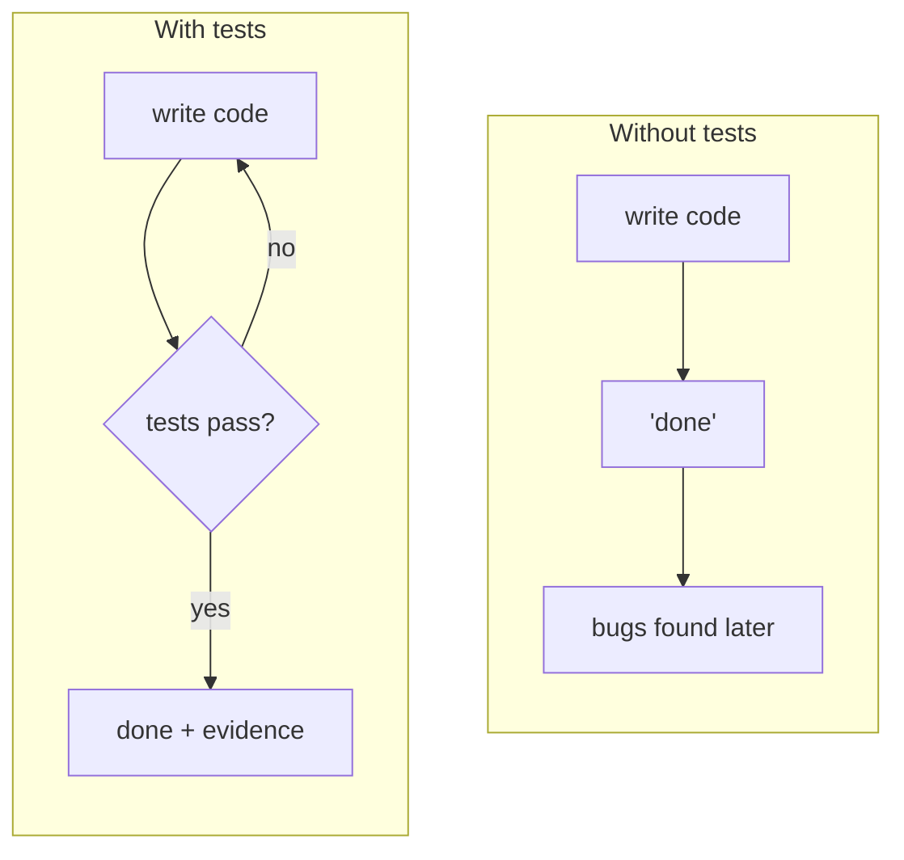
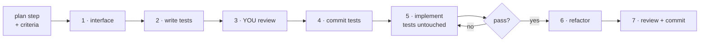
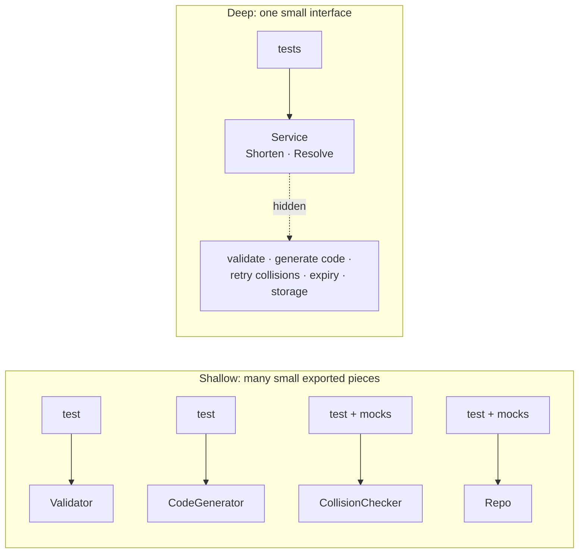
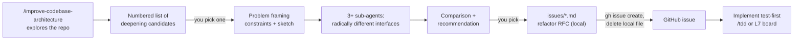
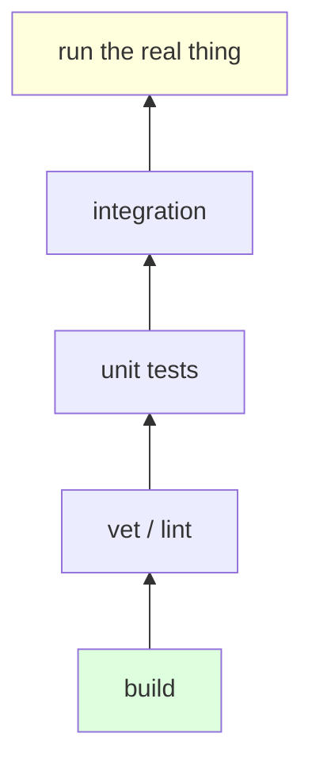
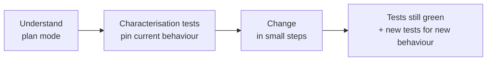

# L4 — Test-First

**Goal:** Make tests the agent's **feedback loop**. When the agent can check its own work objectively,
you can give it bigger tasks and trust the result more. This is the backbone of everything after this level.

**Where this fits:** L4 continues the [L3 runbook](L3-spec-plan-code.md#3-the-runbook-at-a-glance). You start with an
**approved plan** (`.scratch/plans/link-expiry.md`, the output of L3 step 5). L4 zooms into **L3 step 7
"Execute one slice"** and splits it into test-first steps 1–7. L3 steps 0–6 and 8 stay as they are.

> **Already thinking "this could be automated"?** The [`/tdd`](../templates/.claude/skills/tdd/) skill runs most of these
> sub-steps with a stop for your test review. Learn the steps by hand first. See
> [10. It gets easier: `/tdd`](#10-it-gets-easier-tdd).

---

## 1. Why tests matter more with AI



- The agent **iterates on its own** against a clear target instead of guessing.
- "Done" becomes **objective**, not just the agent claiming it.
- Tests are a **spec the agent can't misunderstand**. Acceptance criteria from L3 become executable.
- They protect you from **regressions** in later sessions, when the agent no longer remembers why code is the way it is.

---

## 2. The TDD loop per slice



The L3 core rule still holds: **every step ends in a file or a commit**, and the next session starts from that.

```text
 plan step k ─▶ Interface: line ─▶ *_test.go ─▶ test: commit ─▶ code ─▶ feat: commit + tick
 (approved)     (in plan file)     (RED)        (approved)      (GREEN)  (plan updated)
     ▲                                               │
     └── /clear ─────────────────── /clear ──────────┘
```

Why this order:

- **You review the tests (step 3), not just the code.** The tests are where your intent gets written down.
  Reviewing 40 lines of tests is easier than reviewing 400 lines of implementation, and if the tests are right,
  the implementation is constrained.
- **Tests are committed before the implementation (step 4).** If the agent touches them later, `git diff` shows it
  right away. Without the commit, a "fixed" test looks the same as a new one.
- **Interface before tests (step 1).** Tests sit on the interface. Agree on it first, or the tests freeze a design
  nobody chose. See [5. Deep modules](#5-deep-modules-one-small-interface-one-test-boundary).
- **`/clear` before implementing (step 5).** A fresh session implements against the committed tests, not against
  the reasoning that produced them. The tests are the hand-off.

---

## 3. The runbook at a glance

`x` = feature slug (`link-expiry`), `k` = the plan step (slice) you're on. "Step N" means a runbook step below, "plan step k" means a slice in the plan file.

| # | Step | Start from | Goal | Output | Done when |
|---|---|---|---|---|---|
| — | Setup (once per project) | — | The agent can check itself | CLAUDE.md `## Testing`, `## Design`, definition of done; fake clock | Agent runs the DoD without being told how |
| 1 | Pick slice, agree interface | `/clear`, plan file, git log | Smallest public API for this slice | `Interface:` line in plan step k | You approved it (skip if it exists) |
| 2 | Write failing tests | Plan step k + its *Covers* criteria in the spec | Executable criteria | `*_test.go` (uncommitted) | RED for the right reason |
| 3 | **You** review the tests | Test file | Tests match your intent | Edited test file | Test-review checklist passes |
| 4 | Commit the tests | Approved tests | Make tampering visible | `test(links): …` commit | `git log` shows it |
| 5 | Implement | `/clear`, plan step k, committed tests | Make them pass | Code (uncommitted) | Verify + DoD green, test files unchanged |
| 6 | Refactor / deepen | Green code | Simpler, deeper code | Code (uncommitted) | Tests unchanged and green, no new exports |
| 7 | Review + commit | Diff | Ship the slice | `feat(links): …` commit, step ticked, Log line | Review checklist passes |

Then the next slice (back to step 1), or after the last one [L3 step 8: Finish → PR](L3-spec-plan-code.md#step-8-finish--pr).

---

## 4. Runbook steps

### Setup (once per project)

- **Goal:** the agent knows how to test and when it's done, without you repeating it in every prompt.
- **Do:** add the [Go testing conventions](#6-go-testing-conventions-to-put-in-claudemd) and the
  [Design rules](#put-it-in-claudemd) to `CLAUDE.md`. Make sure time is injectable (`internal/clock` with a fake), so
  tests never sleep.
- **Output:** `CLAUDE.md` with `## Testing`, `## Design` and a definition of done
  (`gofmt -l . && go vet ./... && go test ./... -race`).

### Step 1: Pick the slice, agree on the interface

- **Start from:** `/clear`, the plan file, `git log`.
- **Goal:** the smallest public interface that covers this slice's criteria. Skip this step if the slice only uses
  an interface that already exists.
- **Prompt:**

```text
Read @.scratch/plans/link-expiry.md. Take the first plan step not ticked done and name it. If
git log disagrees with the ticks, stop and tell me. For that step only: propose the public
interface of the package it touches. Goal: a deep module, the smallest interface that covers
the criteria the step lists from @.scratch/specs/link-expiry.md.
Show me 2 alternative designs, say which is smaller/simpler for callers, and list what
stays unexported. No tests, no code yet.
```

- **You:** pick one. Ask: could a caller do everything with fewer methods/params? Does any exported name only exist
  so it can be tested?
- **Then:** *"Write the chosen interface into that plan step as an `Interface:` line."*
- **Output:** plan step k with an `Interface:` line.

### Step 2: Write failing tests

- **Start from:** the same session (the interface is fresh), plan step k, the spec criteria it covers.
- **Goal:** the acceptance criteria become tests that fail because the behaviour is missing.
- **Prompt:**

```text
Based on the criteria this plan step covers in @.scratch/specs/link-expiry.md, write table-driven
tests in internal/shortener/shortener_test.go using package shortener_test. Test ONLY
through the interface in the plan. No tests for internal helpers. Use the in-memory store
and the fake clock from internal/clock, no mocks of internal parts.
Do NOT write the implementation. Run the tests and show that they fail for the right reason.
```

- **Plus the outer layers** ([why](#where-integration-tests-come-in)), only when the slice touches them:

| Slice touches | Add |
|---|---|
| A store or API client (new method, new query) | a case in that port's contract suite, run against fake + real (testcontainers) |
| A handler, route or wiring | one `httptest` end-to-end test: happy path + key errors |

Vertical slices usually reach the handler, so most slices get one e2e test. They go red first too.

- **Output:** a test file, not committed yet.
- **Done when:** the tests fail because the behaviour is missing, **not** because of a compile error or a typo in the test.
  A test that's red for the wrong reason proves nothing.

### Step 3: You review the tests

**This is the key step.** Read the test file yourself, line by line. Go through the
[test-review checklist](#8-the-ai-review-checklist), especially:

- [ ] Every criterion step k covers has at least one test case
- [ ] Edge cases from the spec's Behaviour table are cases in the table (empty, invalid, boundary, expired)
- [ ] Slice touches a store or handler? A contract case or e2e test is there too
- [ ] Tests check **behaviour** through the public API, not how the code does it
- [ ] Nothing "can't fail" (assertions on mocks only, `if err != nil { return }` in a test)

- **Change it:** *"Add a case for `ttl == 0`"*, *"This asserts on the mock, assert on the returned error instead."*
- **Optional mutation spot-check:** once the code exists (step 5), ask *"introduce a subtle bug in the implementation,
  check that the tests catch it, then revert."* It's a quick way to test your tests.
- **Output:** a test file you'd sign off on.

### Step 4: Commit the tests

```text
Commit only the test file as "test(links): <behaviour from this plan step>".
```

- **Why:** from now on any change to the tests shows up in `git diff`. That's how you catch the agent
  "fixing" a test instead of the code.
- **Output:** a `test(links): …` commit. The tests are still red.

### Step 5: Implement

- **Start from:** `/clear`, plan step k, the committed tests.
- **Goal:** make the tests pass without touching them.
- **Prompt:**

```text
Read @.scratch/plans/link-expiry.md, first step not ticked done. Implement it so the tests in
internal/shortener/shortener_test.go pass. Don't change the test file. Don't add exported
identifiers beyond the Interface in the plan, put helpers in unexported functions, no new
Go interfaces unless there are two real implementations. If a test looks wrong, stop and
tell me why instead of changing it. Run its Verify command and
`go test ./... -race && go vet ./...`, and show the output.
```

- **Output:** code, not committed yet.
- **Done when:** Verify and the definition of done are green, and `git diff HEAD -- '*_test.go'` is empty.
- **A test really is wrong?** Go back to steps 2–3 on purpose: fix it, review it, commit it as its own `test:` commit.
  Never as part of the implementation.
- Need more than unit tests to trust it? Use the [verification layers](#7-verification-beyond-unit-tests).

### Step 6: Refactor / deepen

- **Start from:** green code, same session.
- **Goal:** simpler, deeper code. Behaviour stays the same.
- **Prompt:**

```text
Review internal/shortener for shallow design: pass-through methods, exported things
only used inside the package, interfaces with one implementation, tiny types that
just forward calls. Propose merges that shrink the interface. Tests must stay unchanged and green.
```

- **Done when:** tests unchanged and green, no new exports. If a refactor needs test changes, the boundary is wrong.
  Stop and rethink the interface (back to step 1).
- Small slice, nothing to improve? Skip it.

### Step 7: Review the diff and commit

- **Start from:** the diff since the `test:` commit.
- **You:** review it with [`templates/review-checklist.md`](../templates/review-checklist.md) and
  [the L4 additions](#8-the-ai-review-checklist). Run the Verify command yourself if in doubt.
- **Prompt:**

```text
Commit as "feat(links): <plan step title>". Tick that step in the plan. If anything differed from
the plan, add a line to its Log.
```

- **Output:** a `feat(links): …` commit right after its `test(links): …` commit, plan step k ticked.
- **Next:** `/clear` → step 1 for the next slice. After the last slice: [L3 step 8](L3-spec-plan-code.md#step-8-finish--pr),
  where *"every acceptance criterion has a passing test"* is now easy to check.

### Rules

- **Approved tests don't change quietly.** Changing a test is a separate, reviewed `test:` commit.
- **One slice at a time.** Each slice gets its own `test:` → `feat:` pair.
- **Reality differs from the plan?** Stop. Update the plan file first (step + Log line), then continue (as in L3).

---

## 5. Deep modules: one small interface, one test boundary

A **deep module** hides a lot of behaviour behind a **small interface**. A **shallow module** has an interface
almost as complex as what it does (the term comes from John Ousterhout, *A Philosophy of Software Design*).

For TDD with an agent this matters a lot: **your tests sit on the interface.** The smaller the interface, the
more of the module one test boundary wraps.



### Why it matters with an agent

| Shallow modules | Deep modules |
|---|---|
| Tests mirror the implementation: one test file per helper, mocks everywhere | Tests describe **behaviour** through the public API |
| Every refactor breaks tests, so the agent "fixes" tests (tampering by another name) | The agent can rewrite internals freely, tests stay green and still mean something |
| You review many test files and the wiring between them | You review **one interface + one test file**. That's the spec. |
| Bugs live in the gaps between pieces, where no test looks | The whole module, gaps included, sits inside the test boundary |
| Lots of interface for the agent to keep in context | Small interface = less context, fewer ways to misuse it |

Agents drift toward shallow code by default: they add an exported helper, an interface and a mock for every
step, because each piece is easy to generate and test on its own. You have to steer them toward deep modules.
The runbook does that in steps **1** (agree on the interface), **2** (test only through it), **5** (no extra
exports) and **6** (deepen).

### shorty example

```go
// package shortener: the only exported surface
type Service struct{ /* unexported fields */ }

func New(store Store, clk clock.Clock) *Service
func (s *Service) Shorten(ctx context.Context, rawURL string, ttl time.Duration) (Link, error)
func (s *Service) Resolve(ctx context.Context, code string) (string, error)

var ErrInvalidURL, ErrNotFound, ErrExpired error
```

URL validation, code generation, collision retry and expiry checks are all **unexported**. The tests live in
`package shortener_test` and only call `Shorten`/`Resolve`. They use a real in-memory `Store` and the fake clock.
Fakes go only at true external edges (DB, network, time), never between internal pieces.

### How a small interface still checks the internals

A small interface doesn't mean few tests. It means **many tests through one door**. You check the internals by what
they cause, not by calling them directly.

- **Only observable behaviour matters.** Every internal rule must show up through the interface as a return value, an
  error, a change in the store, or an effect of time. If it never shows up, it's dead code: delete it.
- **One input per internal branch.** Two methods can carry 30+ table cases.
- **Injected dependencies are part of the interface.** `New(store, clk)` gives you the knobs (time, storage state)
  to put the module into any internal state without reaching inside.
- **Coverage as a check.** `go test -cover` on the boundary tests: if an internal branch isn't covered, either a test
  case is missing or the code can't be reached and should go.
- **The gaps are covered too.** "Validation passes but generation fails" happens inside the test boundary. With
  shallow modules + mocks, no test looks at it.

| Internal | Reached through the interface by |
|---|---|
| URL validation | `Shorten(ctx, "ftp://x", 0)` → `ErrInvalidURL` |
| Expiry | fake clock advanced past `ttl` → `Resolve` returns `ErrExpired` |
| Collision retry | store already holding the next code → `Shorten` still returns a unique code |
| Not found | `Resolve(ctx, "nope")` → `ErrNotFound` |

### Where integration tests come in

A deep-module test with a real in-memory store already integrates all the internal pieces. Only the external edges
are faked. Integration tests cover what's left: **the real adapters and the wiring.**

| Layer | Test | How many |
|---|---|---|
| Deep module | boundary tests: in-memory store + fake clock | many, fast |
| Adapter (Postgres `Store`) | **contract tests**: one shared suite run against the in-memory store *and* real Postgres (testcontainers) | one suite per port |
| Wiring (HTTP → service → DB) | `httptest` end-to-end: happy paths + key errors | few |

The contract test is what lets you trust the fast tests. It proves the fake behaves like the real thing:

```go
// one suite, every Store implementation must pass it
func testStoreContract(t *testing.T, newStore func(t *testing.T) shortener.Store) {
    t.Run("save then get", func(t *testing.T) { /* ... */ })
    t.Run("duplicate code is rejected", func(t *testing.T) { /* ... */ })
}

func TestMemStore(t *testing.T)      { testStoreContract(t, newMemStore) }
func TestPostgresStore(t *testing.T) { testStoreContract(t, newPostgresStore) } // testcontainers
```

**Keep the slow ones out of the inner loop.** Tests that need Docker go in `*_integration_test.go` with a build tag:

```go
//go:build integration
```

| Command | Runs | When |
|---|---|---|
| `go test ./... -race` | boundary, `httptest` e2e (in-memory store), contract vs. fake | constantly, every slice |
| `go test -tags=integration ./... -race` | + contract vs. real Postgres, e2e against real DB | slice touched a store/handler, `/ship`, CI |

CI ([`ci.yml`](../templates/.github/workflows/ci.yml)) always runs both, so nothing slips through when you skip it locally.

| Layer | Catches |
|---|---|
| Boundary tests | logic bugs |
| Contract tests | the fake and the real store disagree (SQL, constraints, transactions) |
| End-to-end | wiring and config bugs |

### Put it in `CLAUDE.md`

So you don't have to repeat it:

```markdown
## Design
- Prefer deep modules: small exported API, rich behaviour hidden behind it.
- Agree on a package's public interface before writing tests or code.
- Test through the public API (`package foo_test`). No tests for unexported helpers.
- Don't export something just to test it. Don't add an interface with one implementation.
- Fakes only at external edges (DB, network, time).
```

### Signs the agent is going shallow

| Symptom | Fix |
|---|---|
| New exported funcs/types in a diff you didn't agree on | "Unexport X, it's not part of the agreed interface" |
| Tests in `package foo` reaching into internals | "Move to `package foo_test`, test through the public API" |
| An interface + mock per helper | "Delete the interface, use the concrete type; fake only the store" |
| A refactor that needs test changes | The boundary is wrong or the tests are too fine-grained. Stop and rethink the interface. |
| Methods that just call one other method | "Merge pass-through layers" |

### Deepening existing code: `/improve-codebase-architecture`

The runbook keeps *new* code deep. For code that is **already shallow**, use the vendored skill
[`improve-codebase-architecture`](../templates/.claude/skills/improve-codebase-architecture/) (`SKILL.md` +
`REFERENCE.md`). It looks for clusters of shallow, tightly coupled modules and turns one of them into a refactor RFC for
a deeper module. Read its `SKILL.md` for the exact process. In short, this is how you use it:



| Your step | What to do |
|---|---|
| Start | Run it on a clean branch: `/improve-codebase-architecture`. Optionally name an area: `… focus on internal/shortener and internal/store`. |
| Pick a candidate | Prefer clusters where bugs keep appearing *between* pieces, or where tests are mostly mocks. |
| Pick an interface | Apply the review questions from step 1: fewer methods/params? anything exported only for tests? |
| Review the RFC | It's a spec (L3): check the interface, the dependency strategy and the list of tests to delete *before* any code. |
| Move it out of the repo | *"Create a GitHub issue from issues/<name>.md with `gh issue create --body-file`, show me the title first, then delete the local file."* |
| Implement | Plan it like any feature (L3 steps 4–5), then run the [runbook](#4-runbook-steps) per slice: boundary tests first, move code behind the interface, then delete the old shallow tests as a separate, visible commit. |

**Map the skill's dependency categories (see its `REFERENCE.md`) to shorty:**

| Category | shorty example | How you test the deep module |
|---|---|---|
| In-process | URL validation, code generation, collision retry | Merge into `shortener`, test through `Shorten`/`Resolve` |
| Local-substitutable | `Store` (Postgres) | In-memory store or testcontainers Postgres |
| Remote but owned | a separate analytics service you run | Port (Go interface) + HTTP adapter in prod + in-memory adapter in tests |
| True external | a third-party Safe Browsing / malware-check API | Port + fake at the boundary |

**Watch out:**

- **Cost.** It explores with sub-agents and spawns 3+ more for interface designs. Run it occasionally on a module
  that hurts, not on every PR ([context & cost](../practices/context-and-cost.md)).
- **Deleting tests is on purpose here.** The skill's testing strategy is "replace, don't layer": once boundary tests
  exist, the old shallow tests go. That's fine **only** when it's listed in the RFC you approved and the new boundary
  tests were green first. An unplanned test deletion is still tampering ([Rules](#rules)).
- **Go idiom.** "Port" in Go means a small interface defined by the *consumer*. Only add it at a real boundary
  (categories 3 and 4). Keep the "no interface with one implementation" rule everywhere else.
- **Output location.** The skill writes a local `issues/*.md` file. Don't commit it: add `issues/` to `.gitignore`
  and move the RFC into a GitHub issue (step above). A committed RFC goes stale as soon as the refactor lands
  ([Where work lives](../practices/best-practices.md#where-work-lives)). An RFC is usually a **HITL** ticket: cut it
  into AFK slices before the [L7 loop](L7-automate.md#the-pipeline) picks it up.

---

## 6. Go testing conventions to put in CLAUDE.md

```markdown
## Testing
- Table-driven tests with `t.Run(tc.name, ...)`.
- Unit tests next to code (`foo_test.go`); use `package foo_test` for black-box tests of public API.
- No sleeps: inject time via `internal/clock.Clock`.
- HTTP handlers: test with `httptest.NewRecorder` / `httptest.NewServer`.
- Run single test: `go test ./internal/store -run TestExpiry -v`
- Always before done: `go test ./... -race && go vet ./...`
- Docker-backed tests: `*_integration_test.go` with `//go:build integration`; run `go test -tags=integration ./... -race`
```

---

## 7. Verification beyond unit tests

The rule: **give the agent a way to see what you would see.**

| Layer | Go tooling | Prompt hint |
|---|---|---|
| Compiles | `go build ./...` | built in |
| Static checks | `go vet`, `golangci-lint run`, `staticcheck` | "lint must be clean" |
| Unit | `go test ./...` | TDD as above |
| Race conditions | `go test -race` | "run with -race" |
| Integration | `httptest.NewServer`, testcontainers (`-tags=integration`) | "start the server and curl it" |
| Behaviour | the actual running app | "run it, hit the endpoint, show the response" |
| Fuzz / property | `go test -fuzz` | for parsers, validators, encoders |



Cheap checks at the bottom run constantly. Expensive ones at the top run before you finish a task (step 5).

---

## 8. The AI review checklist

Use [`templates/review-checklist.md`](../templates/review-checklist.md) for every PR. At this level, add
(use it at step 3 for the tests and at step 7 for the diff):

- [ ] Do the tests check **behaviour**, or do they just mirror the implementation?
- [ ] Are edge cases from the spec covered (empty, invalid, boundary, concurrent)?
- [ ] Would the tests **fail** if the feature broke? (Try it: break the code on purpose and run them.)
- [ ] Were any existing tests weakened, skipped (`t.Skip`), or deleted?
- [ ] Is there test logic that "can't fail" (assertions on mocks only, `if err != nil { return }` in tests)?
- [ ] Do tests go through the public API only? Did the diff export anything new that wasn't agreed?

---

## 9. Legacy code: tests first, then change

For legacy repos without tests, don't refactor blind. If a slice touches untested code, pin its current
behaviour **before step 1**, as its own `test:` commit:



```text
Before changing internal/billing/calc.go, write characterisation tests that capture
its CURRENT behaviour (even if it looks wrong), including edge cases. Don't change
the code. List anything that looks like a bug separately.
```

---

## 10. It gets easier: `/tdd`

Once you've run the runbook by hand a few times, the vendored [`/tdd`](../templates/.claude/skills/tdd/) skill
shortens the prompts. Read its `SKILL.md` for what it does exactly. Roughly:

| Runbook step | With `/tdd` |
|---|---|
| 1 Interface | The skill proposes it and asks for your OK |
| 2 Failing tests | The skill writes them and shows RED |
| 3 You review | The skill **stops** and waits. You still do the review. |
| 4 Commit tests | The skill commits after your approval |
| 5–6 Implement, refactor | The skill does them, without touching the tests |
| 7 Review + commit | Still you: review the diff, commit, tick the plan |

`/clear` between slices and the plan file as hand-off stay the same. The skill only shortens the prompts. It
doesn't replace your review in step 3.

**Next step up:** [`/implement`](../practices/pocock-workflow.md#step-4-implement-one-ticket) runs `/tdd` per ticket
and closes with `/code-review`. See the [fast track](../practices/pocock-workflow.md) for the full idea → PR flow.

---

## 11. Exercise

Feature: **click counting** for shorty (each redirect increments a counter; a stats endpoint returns it).

1. **L3 steps 1–5:** short spec with acceptance criteria, then a vertical-slice plan → `.scratch/plans/click-counting.md`
2. **L3 step 6:** branch `feat/click-counting`
3. **Per slice, steps 1–7:**
   - Step 1: have Claude propose two interfaces, pick the smaller one, write it into the plan
   - Steps 2–4: tests through that interface only, RED for the right reason, your review, `test:` commit
   - Steps 5–7: `/clear`, implement, check `git diff HEAD -- '*_test.go'` is empty, `feat:` commit, tick the plan
4. On one slice, do the mutation spot-check (step 3)
5. **L3 step 8:** check every criterion has a passing test, open the PR. `git log` should show `test:` before `feat:` for every slice
6. Run `/improve-codebase-architecture` on shorty (or your own repo). Pick one candidate, approve an RFC, and implement it with the runbook.
7. In your legacy repo, pick one untested function you'll need to change soon and write characterisation tests for it.

---

## Level up when…

- [ ] For new behaviour, tests come first by default
- [ ] You can name the input and the output of every step from 1 to 7
- [ ] Every slice has a `test:` commit before its `feat:` commit
- [ ] You review tests more carefully than implementation
- [ ] You agree on a small public interface first and test through it, not through internal helpers
- [ ] Every fake has a contract suite that also runs against the real thing, and every endpoint has an `httptest` e2e test
- [ ] Your `CLAUDE.md` has a definition of done the agent runs itself
- [ ] You've caught the agent weakening a test, and fixed your process so it can't happen quietly
- [ ] You use characterisation tests before touching legacy code
- [ ] You've deepened one existing shallow cluster with `/improve-codebase-architecture`: RFC approved, boundary tests green, old shallow tests deleted on purpose

→ Next: [L5 — Extend](L5-extend.md)
