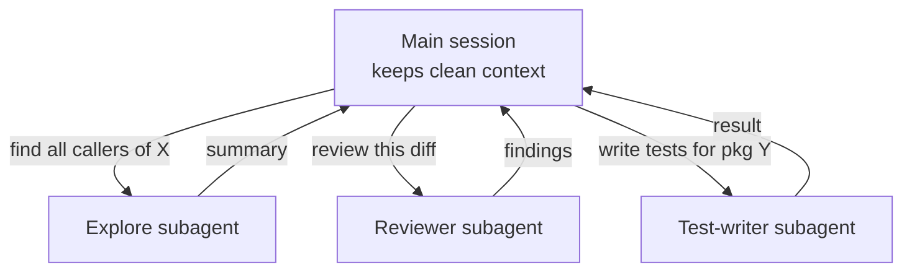
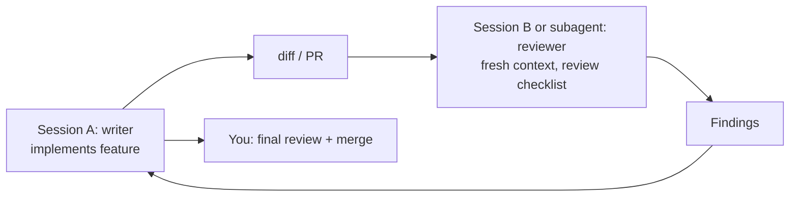
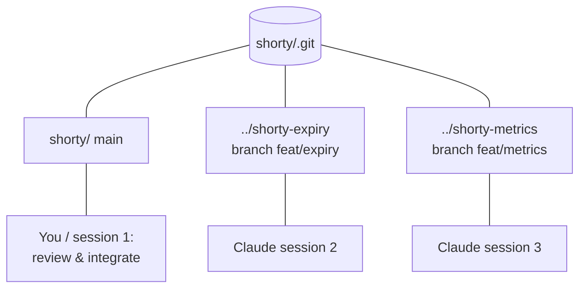
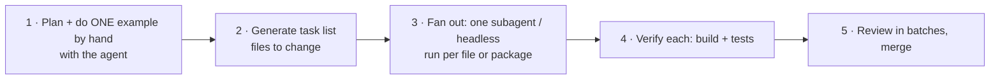
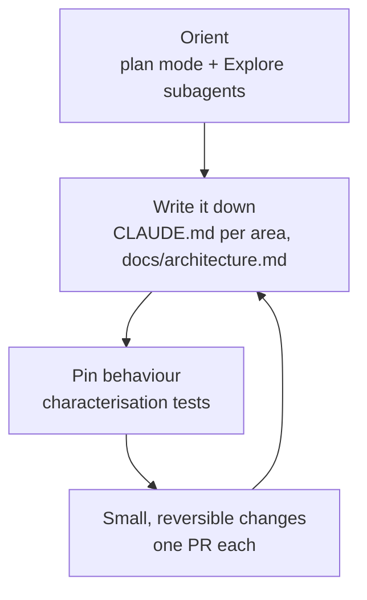

# L6 — Scale

**Goal:** Do more than one thing at a time, and handle big codebases, without losing control.
You go from *working with* one agent to *orchestrating* several.

> Scaling only works if L1–L5 are solid. Parallel agents with weak verification just produce bugs faster.

---

## 1. Subagents: separate context for separate jobs

A subagent is a helper the main agent hands work to. It runs in its **own context window** and only returns a summary.



**Why:** reading 40 files to answer "where is X used?" would flood your main context. A subagent reads them
and hands back three lines.

Built-in subagents (like **Explore** and **Plan**) are used automatically. You can also ask for them:
*"Use a subagent to find every place we build SQL strings by hand."*

**Custom subagents** live in `.claude/agents/*.md` (manage with `/agents`):

```markdown
---
name: go-reviewer
description: Reviews Go diffs for bugs, error handling, concurrency issues and missing tests. Use after implementing a change.
tools: Read, Grep, Glob, Bash
model: sonnet
---
You are a strict Go reviewer. Review ONLY the current diff (`git diff main...HEAD`).
Report concrete issues with file:line, severity, and a suggested fix. Don't edit files. ...
```

Templates: [`templates/.claude/agents/`](../templates/.claude/agents/).

| Good subagent jobs | Poor subagent jobs |
|---|---|
| Research / search across many files | Tightly coupled edits that need shared context |
| Independent review (fresh eyes, no bias from writing it) | Tasks where you need to see each step |
| Writing tests for a well-defined unit | Anything that needs back-and-forth with you |
| Cheaper model for bulk reading (`model: haiku`/`sonnet`) | |

---

## 2. Writer / reviewer split

One of the most effective patterns: **the agent that wrote the code shouldn't be the only one reviewing it.**



Options: the `go-reviewer` subagent, a second terminal session (`claude` → *"review the diff on this branch"*),
the `/code-review` command, or the CI review in [L7](L7-automate.md). You still do the final review.

---

## 3. Parallel sessions with git worktrees

Several agents editing **the same checkout** will collide. Git worktrees give each agent its own working directory
on its own branch, sharing one `.git`.



```bash
git worktree add ../shorty-metrics -b feat/metrics
cd ../shorty-metrics && claude          # session 2, in its own terminal / tmux pane

git worktree list
git worktree remove ../shorty-metrics   # after merge
```

(Recent Claude Code versions can also create worktrees for you with `claude --worktree <name>`. Check `claude --help`.)

**Rules for parallel work:**

1. **Independent tasks only.** Different packages/features. If two tasks touch the same files, run them in sequence.
2. **Each task fully specified up front** (spec + plan from L3). You won't be watching closely.
   `.scratch/` is gitignored, so a new worktree **doesn't have it**. Copy the spec + plan into that worktree's
   `.scratch/`, or put the spec in the GitHub issue and start the agent with *"Read `gh issue view 12`"*.
3. **Strong verification** (L4), because tests are what make unattended work trustworthy.
4. **Notification hook** (L5) so you know when a session needs you.
5. **Your bottleneck is review.** 2–3 parallel streams is a realistic maximum for one person doing proper review.

```text
 you: spec+plan ─┬─▶ worktree A ─▶ agent ─▶ PR A ─┐
                 ├─▶ worktree B ─▶ agent ─▶ PR B ─┼─▶ you review & merge one at a time
                 └─▶ worktree C ─▶ agent ─▶ PR C ─┘
```

---

## 4. Fan-out for large mechanical changes

For big, repetitive changes (migrate 80 handlers to a new error type, add context.Context everywhere):



- The worked example becomes the pattern the others follow. Nail it first.
- Ask the agent to use subagents in parallel, or script it headless (`claude -p` per file, see [L7](L7-automate.md)).
- Verify per unit, so failures are isolated and easy to retry.

---

## 5. Working in large / legacy codebases



Practices:

- **Ask before you change:** *"How does a request flow from the router to the DB? Cite files and functions."* Spot-check the citations.
- **Nested CLAUDE.md:** put `internal/billing/CLAUDE.md` next to tricky code with its own gotchas.
- **Fence off danger zones:** a deny rule or PreToolUse hook for frozen dirs, generated code, migrations already applied.
- **Narrow the scope explicitly:** "Only modify files in `internal/billing/`."
- **Trust git history:** *"Look at `git log -p` for this file and explain why it's written this way"* often finds the reason behind odd code.
- **Strangler pattern for rewrites:** new code beside the old, switched over gradually, never one big rewrite.

---

## 6. Exercise

1. Create the `go-reviewer` subagent and use it on your last PR. Compare its findings with your own review.
2. Run two features on shorty **in parallel** with worktrees (e.g. metrics endpoint + rate limiting). Notice where your review becomes the bottleneck.
3. In the legacy repo: use Explore subagents to map one subsystem, then write a nested `CLAUDE.md` for it.

---

## Level up when…

- [ ] You use subagents to keep the main context clean
- [ ] Every non-trivial change gets an independent (fresh-context) review
- [ ] You've shipped two features in parallel via worktrees without conflicts
- [ ] You know your own review capacity and don't go past it
- [ ] Legacy areas you touch get a nested CLAUDE.md and characterisation tests

→ Next: [L7 — Automate](L7-automate.md)
