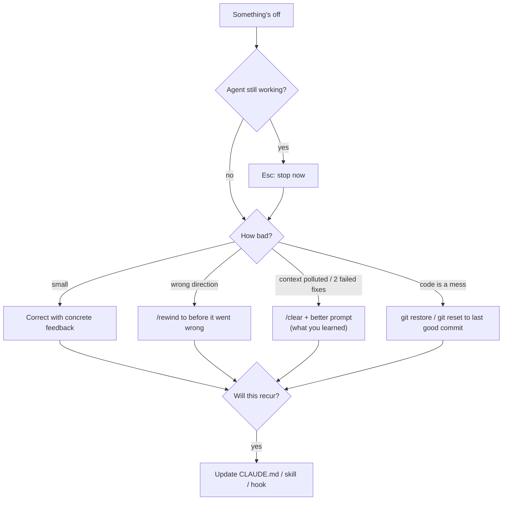

# Anti-Patterns & Recovery

Common ways AI-assisted development goes wrong, how to spot them, and how to recover.

---

## Recovery flow



---

## The catalogue

| Anti-pattern | Symptom | Fix |
|---|---|---|
| **Vibe-merging** | Merging code you haven't read or don't understand | Read every diff. Ask the agent to explain unclear parts. ([L1](../levels/01-prompt-verify.md)) |
| **Mega-prompt** | "Build the whole app" → 2,000-line diff | Spec → plan → small steps ([L3](../levels/03-spec-plan-code.md)) |
| **The correction spiral** | 5th attempt at the same fix, each one worse | Two-strikes rule: `/clear` and re-prompt with what you learned |
| **Kitchen-sink session** | One session for 6 unrelated tasks, agent gets confused | `/clear` between tasks |
| **Test tampering** | Tests changed/skipped/deleted to "pass" | Commit tests first, "never modify tests", review test diffs ([L4](../levels/04-test-first.md)) |
| **Hallucinated APIs** | Calls to functions/packages/flags that don't exist | Build + vet in the loop. Point to real docs or examples. |
| **Fake completion** | "Done!" with stubs, TODOs, or `panic("not implemented")` | Definition of done in CLAUDE.md, demand command output as evidence |
| **Scope creep** | Asked for a bugfix, got a refactor + new abstractions | Constraints in prompt ("only change X"), non-goals in spec |
| **Over-engineering** | Interfaces, factories, config for one use case | "Simplest solution that works; no new abstractions unless asked" in CLAUDE.md |
| **Error swallowing** | `_ = err`, empty error branches, broad recovers | Review checklist, linters (`errcheck`), rule in CLAUDE.md |
| **Duplicate code** | Agent writes a new helper instead of using the existing one | "Search for existing helpers first" in CLAUDE.md, point at them |
| **Stale memory** | CLAUDE.md describes how the project worked six months ago | Treat CLAUDE.md as code: update it in the same PR as the change |
| **Work files in the repo** | Old `issues/*.md`, `TODO.md`, specs and plans still committed. The agent follows them after the code has moved on. | Work items in GitHub issues; specs/plans in a gitignored `.scratch/`, deleted after merge ([Where work lives](best-practices.md#where-work-lives)) |
| **Rule bloat** | 600-line CLAUDE.md, the agent ignores half of it | Prune. Keep only rules it would otherwise get wrong. Move the rest to skills/docs, referenced by plain path + "read when…", not `@`-imported. |
| **Permission fatigue** | Clicking "yes" to everything without reading | Allowlist safe commands so the prompts that remain matter |
| **YOLO on the host** | `bypassPermissions` on your laptop with real credentials | Only in containers/VMs ([Security](security.md)) |
| **Parallel chaos** | Three agents, one checkout, conflicting edits | Worktrees, independent tasks only ([L6](../levels/06-scale.md)) |
| **Automation before process** | CI agent producing PRs nobody can review | Automate only workflows that already work manually ([L7](../levels/07-automate.md)) |
| **Outsourcing thinking** | You can't explain your own system anymore | [Staying sharp](staying-sharp.md) |

---

## Prompt fixes for common situations

```text
# agent going in circles
Stop. Summarise what you've tried, what failed and why. Then propose 2 different
approaches and wait for me to choose.

# suspected hallucination
Before using <X>, show me where it's defined (file:line or official docs).

# scope creep
Revert everything not strictly needed for <goal>. Show me the minimal diff.

# fake done
Run `go build ./... && go vet ./... && go test ./...` and paste the full output.
List anything stubbed or left as TODO.

# test tampering
Restore the tests from the last commit (`git checkout HEAD -- <file>_test.go`)
and fix the implementation instead.
```
