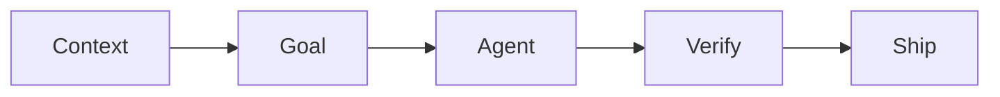

# Best Practices Cheat Sheet

The most common practices in AI-assisted development, grouped by the core loop. Each one links to the level that explains it.

## Context

| # | Practice | Level |
|---|---|---|
| 1 | Every repo has a short, committed `CLAUDE.md` with exact commands and a definition of done | [L2](../levels/L2-project-memory.md) |
| 2 | When the agent repeats a mistake, add one line to `CLAUDE.md` | [L2](../levels/L2-project-memory.md) |
| 3 | `CLAUDE.md` holds only what the agent can't know by itself: commands, boundaries, gotchas, definition of done | [L2](../levels/L2-project-memory.md#only-what-the-agent-cant-know-by-itself) |
| 4 | Point to files with `@path` and to examples to imitate ("like `X`") | [L1](../levels/L1-prompt-verify.md) |
| 5 | One task per session. `/clear` between unrelated tasks. | [L0](../levels/L0-foundations.md) |
| 6 | In `CLAUDE.md`, reference deep docs by plain path with a "read when…" hint. Don't paste or `@`-import them. | [L2](../levels/L2-project-memory.md#-import-or-plain-path) |
| 7 | Use subagents for wide searches to keep the main context clean | [L6](../levels/L6-scale.md) |
| 8 | Keep specs and plans in gitignored `.scratch/` files so they survive `/clear`. Track work in GitHub issues, not in committed files. | [L3](../levels/L3-spec-plan-code.md#where-the-spec-lives) |

### Where work lives

Anything that describes work *still to do* goes stale once it's done. If it's committed, the agent keeps reading it
as current and follows outdated instructions when the code changes. So the repo holds **knowledge**, and work items live elsewhere:

| What | Where | When it's done |
|---|---|---|
| Backlog, tickets, AFK/HITL board, refactor RFCs | **GitHub issues** (labels `afk` / `hitl`) | `Closes #N` in the PR closes it |
| Spec, plan, agent TODO list, progress notes | **`.scratch/`**, gitignored | Condense the decisions into the PR/issue, then delete |
| A decision that outlives the feature | **ADR** in `docs/decisions/` | Stays, and gets updated or superseded like code |
| How the project works | `CLAUDE.md`, `docs/architecture.md`, code, tests | Updated in the same PR as the change |

Skills that write local ticket files (e.g. `issues/*.md`): gitignore the folder and move the output into a GitHub issue.
See [L3](../levels/L3-spec-plan-code.md#where-the-spec-lives), [L4](../levels/L4-test-first.md#deepening-existing-code-improve-codebase-architecture), [L7](../levels/L7-automate.md#the-pipeline).

## Goal

| # | Practice | Level |
|---|---|---|
| 9 | Prompts state *what, where, constraints, done-when* | [L1](../levels/L1-prompt-verify.md) |
| 10 | Small tasks: if you can't review the diff in a few minutes, split the task | [L1](../levels/L1-prompt-verify.md) |
| 11 | Say what NOT to do (no new deps, don't touch tests, don't refactor X) | [L1](../levels/L1-prompt-verify.md) |
| 12 | For non-trivial work: spec → plan mode → review plan → implement | [L3](../levels/L3-spec-plan-code.md) |
| 13 | Let the agent interview you to sharpen vague requirements. Optional: let it grill you to harden the spec and plan before you approve. | [L3](../levels/L3-spec-plan-code.md) |
| 14 | Write non-goals explicitly to prevent scope creep | [L3](../levels/L3-spec-plan-code.md) |

## Agent works

| # | Practice | Level |
|---|---|---|
| 15 | Start from a clean git tree. Commit before every session. | [L0](../levels/L0-foundations.md) |
| 16 | Choose the permission mode by risk. Pre-allow safe commands, deny dangerous ones. | [L0](../levels/L0-foundations.md) |
| 17 | Stop early (`Esc`) when it's going the wrong way | [L1](../levels/L1-prompt-verify.md) |
| 18 | Two failed corrections → `/rewind` or `/clear` and re-prompt | [L1](../levels/L1-prompt-verify.md) |
| 19 | Implement plans step by step, one commit per step | [L3](../levels/L3-spec-plan-code.md) |
| 20 | Parallel work only in separate worktrees, only for independent tasks | [L6](../levels/L6-scale.md) |

## Verify

| # | Practice | Level |
|---|---|---|
| 21 | Read every diff. You own every line. | [L1](../levels/L1-prompt-verify.md) |
| 22 | Give the agent a way to check itself: build, vet, tests, running app | [L4](../levels/L4-test-first.md) |
| 23 | Tests first for new behaviour. Review the tests harder than the code. | [L4](../levels/L4-test-first.md) |
| 24 | Commit tests before implementing so any test tampering shows up | [L4](../levels/L4-test-first.md) |
| 25 | Prefer deep modules: agree on a small public interface first, test only through it. Deepen existing shallow code with `/improve-codebase-architecture` | [L4](../levels/L4-test-first.md#3-deep-modules-one-small-interface-one-test-boundary) |
| 26 | Demand evidence: "show me the output", not just "done" | [L1](../levels/L1-prompt-verify.md) |
| 27 | Independent review in fresh context (subagent / second session / CI) | [L6](../levels/L6-scale.md) |
| 28 | Enforce what must always happen with hooks (format, guards) | [L5](../levels/L5-extend.md) |

## Ship

| # | Practice | Level |
|---|---|---|
| 29 | Branch + PR even when solo. Self-review on GitHub. In a team, a human approves every merge. | [L3](../levels/L3-spec-plan-code.md) |
| 30 | CI runs tests/lint and an automated review. A human merges. | [L7](../levels/L7-automate.md) |
| 31 | Automation gets least privilege, bounded turns, sandboxing. AFK loops run in a container on a branch. Unattended runs on private repos run in a throwaway VM that only reaches the public internet. | [L7](../levels/L7-automate.md), [VM sandbox](vm-sandbox.md) |
| 32 | Encode repeated workflows as skills, and share them as plugins | [L5](../levels/L5-extend.md) |
| 33 | Conventional Commits mark breaking changes (`!`). CI checks the PR title; versions, git tags and image tags are calculated, never picked by hand. | [Releases](releases.md) |

## Always

- **Never paste secrets** into prompts. Deny-list `.env` and credential files. → [Security](security.md)
- **Watch context, not just cost.** A bloated context gives worse answers. Stay in the smart zone (roughly the first ~40%). → [Smart zone vs. dumb zone](context-and-cost.md#smart-zone-vs-dumb-zone)
- **Understand what you merge.** If you couldn't explain it in a code review, don't merge it. → [Staying sharp](staying-sharp.md)
- **Know the failure modes** so you notice them early. → [Anti-patterns](anti-patterns.md)
- **Version from commits.** One release workflow tags the repo and the Docker image with the same version. → [Commits, versions & releases](releases.md)
- **In a team**, shared agent config goes through PRs, personal config stays local. → [Working in a team](team.md)
- **Small tweaks add up.** E.g. one line in `~/.claude/CLAUDE.md` for short reports. → [Tips](tips.md)
