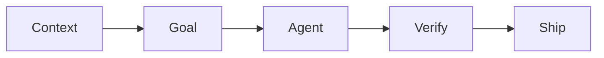

# Best Practices Cheat Sheet

The most common practices in AI-assisted development, grouped by the core loop. Each one links to the level that explains it.

## Context

| # | Practice | Level |
|---|---|---|
| 1 | Every repo has a short, committed `CLAUDE.md` with exact commands and a definition of done | [L2](../levels/02-project-memory.md) |
| 2 | When the agent repeats a mistake, add one line to `CLAUDE.md` | [L2](../levels/02-project-memory.md) |
| 3 | Point to files with `@path` and to examples to imitate ("like `X`") | [L1](../levels/01-prompt-verify.md) |
| 4 | One task per session. `/clear` between unrelated tasks. | [L0](../levels/00-foundations.md) |
| 5 | Link deep docs. Don't paste them. | [L2](../levels/02-project-memory.md) |
| 6 | Use subagents for wide searches to keep the main context clean | [L6](../levels/06-scale.md) |
| 7 | Keep plans and specs in files so they survive `/clear` and compaction | [L3](../levels/03-spec-plan-code.md) |
| 8 | Unknown territory? Save expensive exploring to `docs/research/` and answer open questions with a throwaway prototype on a `spike/` branch before the spec | [L3](../levels/03-spec-plan-code.md#2-before-the-spec-optional-research-and-prototype) |

## Goal

| # | Practice | Level |
|---|---|---|
| 9 | Prompts state *what, where, constraints, done-when* | [L1](../levels/01-prompt-verify.md) |
| 10 | Small tasks: if you can't review the diff in a few minutes, split the task | [L1](../levels/01-prompt-verify.md) |
| 11 | Say what NOT to do (no new deps, don't touch tests, don't refactor X) | [L1](../levels/01-prompt-verify.md) |
| 12 | For non-trivial work: spec → plan mode → review plan → implement | [L3](../levels/03-spec-plan-code.md) |
| 13 | Let the agent interview you to sharpen vague requirements. Optional: let it grill you to harden the spec and plan before you approve. | [L3](../levels/03-spec-plan-code.md) |
| 14 | Write non-goals explicitly to prevent scope creep | [L3](../levels/03-spec-plan-code.md) |

## Agent works

| # | Practice | Level |
|---|---|---|
| 15 | Start from a clean git tree. Commit before every session. | [L0](../levels/00-foundations.md) |
| 16 | Choose the permission mode by risk. Pre-allow safe commands, deny dangerous ones. | [L0](../levels/00-foundations.md) |
| 17 | Stop early (`Esc`) when it's going the wrong way | [L1](../levels/01-prompt-verify.md) |
| 18 | Two failed corrections → `/rewind` or `/clear` and re-prompt | [L1](../levels/01-prompt-verify.md) |
| 19 | Implement plans step by step, one commit per step | [L3](../levels/03-spec-plan-code.md) |
| 20 | Parallel work only in separate worktrees, only for independent tasks | [L6](../levels/06-scale.md) |

## Verify

| # | Practice | Level |
|---|---|---|
| 21 | Read every diff. You own every line. | [L1](../levels/01-prompt-verify.md) |
| 22 | Give the agent a way to check itself: build, vet, tests, running app | [L4](../levels/04-test-first.md) |
| 23 | Tests first for new behaviour. Review the tests harder than the code. | [L4](../levels/04-test-first.md) |
| 24 | Commit tests before implementing so any test tampering shows up | [L4](../levels/04-test-first.md) |
| 25 | Demand evidence: "show me the output", not just "done" | [L1](../levels/01-prompt-verify.md) |
| 26 | Independent review in fresh context (subagent / second session / CI) | [L6](../levels/06-scale.md) |
| 27 | After an AFK loop, a fresh session writes a QA plan and **you** run it. Failures become new tickets. | [L7](../levels/07-automate.md#after-the-loop-qa-plan-for-a-human) |
| 28 | Enforce what must always happen with hooks (format, guards) | [L5](../levels/05-extend.md) |

## Ship

| # | Practice | Level |
|---|---|---|
| 29 | Branch + PR even when solo. Self-review on GitHub. | [L3](../levels/03-spec-plan-code.md) |
| 30 | CI runs tests/lint and an automated review. A human merges. | [L7](../levels/07-automate.md) |
| 31 | Automation gets least privilege, bounded turns, sandboxing. AFK loops run in a container on a branch. | [L7](../levels/07-automate.md) |
| 32 | Encode repeated workflows as skills, and share them as plugins | [L5](../levels/05-extend.md) |

## Always

- **Never paste secrets** into prompts. Deny-list `.env` and credential files. → [Security](security.md)
- **Watch context, not just cost.** A bloated context gives worse answers. → [Context & cost](context-and-cost.md)
- **Understand what you merge.** If you couldn't explain it in a code review, don't merge it. → [Staying sharp](staying-sharp.md)
- **Know the failure modes** so you notice them early. → [Anti-patterns](anti-patterns.md)
