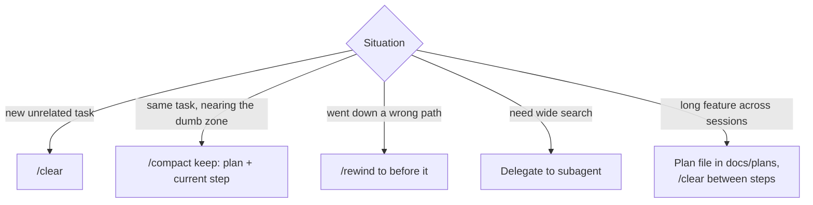

# Context & Cost Management

The context window is the agent's **working memory**. Answer quality depends on what's in it,
and cost depends on how much is in it. Managing context is the most underrated skill in AI-assisted development.

---

## Smart zone vs. dumb zone

Answer quality doesn't drop evenly as the context fills up. While the window is fairly empty, the agent is in the
**smart zone**: it follows instructions, remembers constraints and reasons well. Past a fill level (a common rule of thumb is
**~40%**), it enters the **dumb zone**: older instructions get less attention, rejected ideas come back, and the work gets sloppier.
The exact threshold depends on the model and the task. Treat ~40% as a reason to check, not a hard limit.

### What fills the window, and what makes it grow

```mermaid
flowchart LR
    subgraph SMART["SMART ZONE · ~0–40%"]
        direction TB
        subgraph FIXED["Fixed: loaded before you type, every session"]
            direction TB
            SYS[System prompt + built-in tools]
            MCP[MCP tool definitions]
            MEM[CLAUDE.md + memory]
            SK[Skill + subagent descriptions]
        end
        subgraph TASK["Your task"]
            direction TB
            P["Prompt + @files"]
            R1[First file reads]
            PL[Plan]
        end
    end
    subgraph DUMB["DUMB ZONE · ~40%+"]
        direction TB
        R2[More reads + re-reads after edits]
        LOG[Build / test / grep output]
        DIFF[Edits and diffs]
        FAIL[Failed attempts + corrections]
        SIDE[Unrelated follow-up tasks]
    end
    FIXED --> TASK --> DUMB --> AC["Auto-compact near the limit<br/>(lossy, and it happens late)"]

    style SMART fill:#e8f5e9,stroke:#2e7d32,color:#1b5e20
    style DUMB fill:#ffebee,stroke:#c62828,color:#b71c1c
    style FIXED fill:#eceff1,stroke:#546e7a,color:#263238
    style TASK fill:#e3f2fd,stroke:#1565c0,color:#0d47a1
```



ASCII fallback (one session, left to right):

```
0%                       ~40%                             100%
[▓▓▓▓▓▓▓▓░░░░░░░░░░░░░░░░│▒▒▒▒▒▒▒▒▒▒▒▒▒▒▒▒▒▒▒▒▒▒▒▒▒▒▒▒▒▒▒▒▒▒▒]
 └fixed─┘└──── task ────┘ └──────────── growth ─────────────┘
 ◀───── SMART ZONE ─────▶ ◀─────────── DUMB ZONE ───────────▶

▓ fixed   system prompt, tools, MCP definitions, CLAUDE.md, memory, skill descriptions
░ task    your prompt, @files, first reads, the plan
▒ growth  re-reads, test/build logs, diffs, failed attempts, corrections, side tasks
```

**Context only grows during a session.** Nothing leaves on its own. Only `/compact`, `/rewind` and `/clear` free space.

| Source | When it's added | How it grows | Shrink it with |
|---|---|---|---|
| System prompt + built-in tools | Session start | Fixed | Nothing to do |
| MCP tool definitions | Session start | One block per server | Remove servers you don't use |
| `CLAUDE.md`, memory, skill descriptions | Session start | Fixed, but **in every session** | Keep `CLAUDE.md` lean. Link docs, don't paste them. |
| Your prompts and `@files` | Every turn | Linear | Point to exact files. Don't paste whole docs. |
| Files the agent reads | Each read | Big jumps. Re-reads after edits count again. | Name files up front. Use subagents for wide searches. |
| Command output (tests, builds, grep) | Each run | **Fastest grower**. One noisy log can be thousands of lines. | `tail -50`, `go test -run TestX`, quiet flags |
| Edits and diffs | Each change | Grows with step size | Small steps, one commit each |
| Failed attempts and corrections | Each wrong turn | Stays in context after you correct it, and keeps pulling the agent back | `/rewind` to before it. Two strikes → `/clear`. |
| Unrelated tasks in one session | Each new topic | Everything from task A stays while you do B | `/clear` between tasks |

**Check it:** `/context` shows what's using space right now.

### Staying in the smart zone

| Do | Why |
|---|---|
| Size each step so it fits in the smart zone | A step that only finishes in the dumb zone ends with the worst-quality work |
| Check `/context` at step boundaries, not only when things go wrong | The symptoms (see below) show up after quality has already dropped |
| Near ~40%: finish the step, write state to a plan file, then `/compact` with a focus or `/clear` | Restarting from a file puts you back at the start of the smart zone |
| Don't wait for auto-compact | It only kicks in near the limit, deep in the dumb zone, and you don't choose what it keeps |
| Push exploration into subagents | Their reading fills *their* window. Only the summary lands in yours. |
| Treat a bigger context window as more room, not a bigger smart zone | Long-context models still lose focus as they fill up |

---

## Context hygiene



| Practice | Why |
|---|---|
| `/clear` between tasks | Leftover context from task A confuses task B |
| `/compact` with a focus ("keep the plan and the failing test") | Summarises, keeps what matters |
| Store state in **files** (plans, specs, TODO lists) | Survives clears, compaction, and new sessions |
| Subagents for exploration | Their reading doesn't land in your context |
| Trim noisy output: `go test ./... 2>&1 \| tail -50`, `-run TestX` | Logs are context-hungry |
| Remove unused MCP servers | Each one adds tool definitions to every session |
| Keep `CLAUDE.md` lean | It's loaded into **every** session |

---

## Cost

What drives cost: **tokens in + tokens out**, multiplied by the model's price. Long sessions get expensive because
the context is processed again on each turn (prompt caching softens this a lot, but doesn't remove it).

| Lever | Effect |
|---|---|
| Short, focused sessions | Biggest single lever |
| Choosing the right model (`/model`) | Strongest model for planning/hard debugging, cheaper/faster for routine edits and subagents |
| Subagents on smaller models (`model: haiku` / `sonnet`) | Cheap bulk reading/search |
| Good prompts up front | Fewer correction rounds, which are the most expensive part |
| Tests as feedback | Fewer "is it done?" loops with you in the middle |
| Bounded automation (`--max-turns`) | No runaway headless jobs |

Watch spending with `/cost` or `/usage` (depending on version and plan) and your account's usage dashboard.
For automation, look at the JSON output of `claude -p --output-format json`, which includes cost/usage fields.

> **Measure cost per completed task, not per request.** A cheap model that needs four correction rounds can cost
> more than a strong model that gets it right the first time.

---

## Signals your context is unhealthy

You're probably in the [dumb zone](#smart-zone-vs-dumb-zone) when:

- The agent forgets an instruction from earlier in the session
- It re-reads files it already read
- It brings back an approach you already rejected
- Responses get slower and vaguer

→ Write down what matters (plan file), `/clear`, and restart with a focused prompt.
