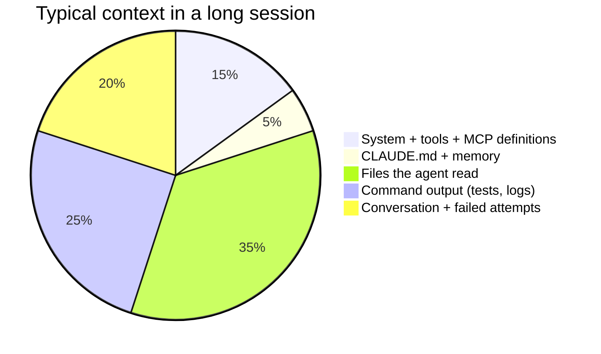
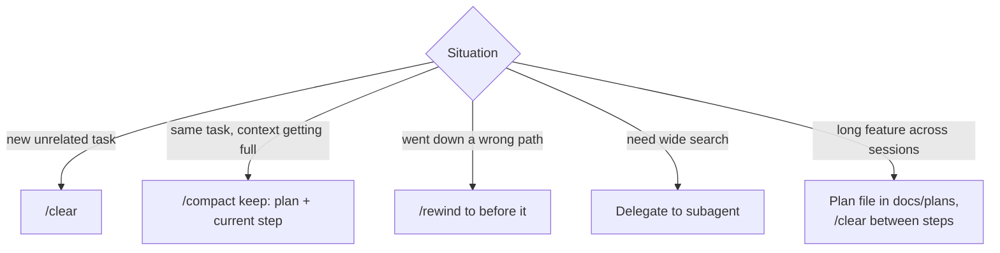

# Context & Cost Management

The context window is the agent's **working memory**. Answer quality depends on what's in it,
and cost depends on how much is in it. Managing context is the most underrated skill in AI-assisted development.

---

## How context fills up

Every file read, every test log, every failed attempt stays in context. Quality drops as it fills:
older instructions get less attention, and failed attempts pull the agent back toward bad ideas.

**Check it:** `/context` shows what's using space.

---

## Context hygiene

| Practice | Why |
|---|---|
| `/clear` between tasks | Leftover context from task A confuses task B |
| `/compact` with a focus ("keep the plan and the failing test") | Summarises, keeps what matters |
| Store state in **files** (plans, specs, TODO lists) | Survives clears, compaction, and new sessions |
| Subagents for exploration | Their reading doesn't land in your context |
| Trim noisy output: `go test ./... 2>&1 \| tail -50`, `-run TestX` | Logs are context-hungry |
| Remove unused MCP servers | Each one adds tool definitions to every session |
| Keep `CLAUDE.md` lean | It's loaded into **every** session |

---

## Cost

What drives cost: **tokens in + tokens out**, multiplied by the model's price. Long sessions get expensive because
the context is processed again on each turn (prompt caching softens this a lot, but doesn't remove it).

| Lever | Effect |
|---|---|
| Short, focused sessions | Biggest single lever |
| Choosing the right model (`/model`) | Strongest model for planning/hard debugging, cheaper/faster for routine edits and subagents |
| Subagents on smaller models (`model: haiku` / `sonnet`) | Cheap bulk reading/search |
| Good prompts up front | Fewer correction rounds, which are the most expensive part |
| Tests as feedback | Fewer "is it done?" loops with you in the middle |
| Bounded automation (`--max-turns`) | No runaway headless jobs |

Watch spending with `/cost` or `/usage` (depending on version and plan) and your account's usage dashboard.
For automation, look at the JSON output of `claude -p --output-format json`, which includes cost/usage fields.

> **Measure cost per completed task, not per request.** A cheap model that needs four correction rounds can cost
> more than a strong model that gets it right the first time.

---

## Signals your context is unhealthy

- The agent forgets an instruction from earlier in the session
- It re-reads files it already read
- It brings back an approach you already rejected
- Responses get slower and vaguer

→ Write down what matters (plan file), `/clear`, and restart with a focused prompt.
