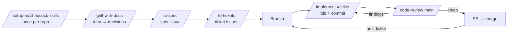

# Fast track: Matt Pocock's skill workflow

**Goal:** Run a whole feature, idea → merged PR, with ready-made skills from
[mattpocock/skills](https://github.com/mattpocock/skills) instead of long hand-written prompts.
Same thinking as [L3](../levels/L3-spec-plan-code.md) and [L4](../levels/L4-test-first.md), far less typing.

> **When to use it:** once you've done the L3/L4 runbooks by hand a few times and know what each step is for.
> The skills shorten the prompts. They don't replace your review at each gate.

> **The skills are his, not ours.** Install them from his repo and let them update. This page only shows the order and
> what you check between steps. For what a skill does exactly, read its `SKILL.md` upstream. Names and behaviour can
> change; if something here doesn't match, his README wins.

---

## 1. The workflow



```text
  once per repo           per feature                          per ticket (fresh session each)
 ┌──────────────┐   ┌───────────────┐   ┌─────────┐   ┌────────────┐   ┌────────┐   ┌────────────┐   ┌────────────┐   ┌────┐
 │ /setup-matt- │──▶│ /grill-with-  │──▶│ /to-spec│──▶│ /to-tickets│──▶│ branch │──▶│ /implement │──▶│/code-review│──▶│ PR │
 │ pocock-skills│   │ docs          │   └─────────┘   └────────────┘   └────────┘   └────────────┘   └────────────┘   └────┘
 └──────────────┘   └───────────────┘                                      ▲              ▲   findings  │              │
                                                                            │              └─────────────┘              │
                                                                            └──────────────── next ticket ──────────────┘
```

---

## 2. The runbook at a glance

`x` = your feature slug, e.g. `click-stats`. Tracker = GitHub Issues (picked in step 0).

| # | You type | The agent does | Output (where it lives) | Your gate |
|---|---|---|---|---|
| 0 | Install + `/setup-matt-pocock-skills` | Asks tracker, labels, doc layout; writes config | `## Agent skills` in `CLAUDE.md`, `docs/agents/*.md`, labels on GitHub | Config reads right, committed |
| 1 | `/grill-with-docs` + the idea | Interviews you, one question at a time; updates glossary + ADRs as decisions land | Decisions in chat, `GLOSSARY.md`, ADRs | No open questions left |
| 2 | `/to-spec` (same session) | Turns the conversation into a spec, confirms test seams with you | Spec issue #N (`ready-for-agent`) | Spec says what you agreed |
| 3 | `/to-tickets #N` | Cuts the spec into tracer-bullet tickets with blockers, asks you to approve | Ticket issues #N+1… | Slices vertical, blockers right |
| 4 | `git switch -c feat/x`, `/clear`, `/implement #T` | Builds the ticket test-first, runs code review, commits | Commits on `feat/x` | Tests green |
| 5 | `/code-review main` | Two fresh reviewers: standards + spec | Report in chat | Findings fixed, diff read by you |
| 6 | `gh pr create` | Opens the PR | PR `Closes #T` | Merged |

Repeat 4–6 per ticket. Work the **frontier**: any ticket whose blockers are done.

---

## 3. Runbook steps

Example feature for `shorty`: **click stats** (count redirects per link, `GET /links/{code}/stats`).

### Step 0: Setup (once per repo)

Install the skills once, globally (check his README for the current command):

```bash
claude plugin install mattpocock-skills@claude-plugins-official
```

Then in your project:

```text
/setup-matt-pocock-skills
```

- **Answer:** tracker → **GitHub** (needs a `gh`-authenticated remote). Domain docs → single context unless it's a monorepo.
- **It writes:** an `## Agent skills` block in `CLAUDE.md` and `docs/agents/*.md`; creates the triage labels on GitHub.
- **Check:** read the drafts before it writes; your other `CLAUDE.md` content stays.
- **Commit** `CLAUDE.md` + `docs/agents/`: that's knowledge (how this repo tracks work), not a work item.
- **Done when:** `gh label list` shows `ready-for-agent`, and `git status` is clean.

> Picking **local markdown** as tracker puts tickets in `.scratch/`. Fine solo/offline, but keep `.scratch/` gitignored
> (see [where work lives](best-practices.md#where-work-lives)).

### Step 1: Grill the idea, write down decisions

```text
/grill-with-docs I want click stats for shorty: count every redirect per link and expose
GET /links/{code}/stats. Why: users want to know if their links get used.
```

- **What happens:** one question at a time, each with a recommended answer. Terms go into `GLOSSARY.md`, hard-to-reverse
  decisions become ADRs, as you go.
- **Your job:** answer, push back, say "don't know yet" when true. Don't accept a recommendation you don't understand.
- **Check:** `git diff GLOSSARY.md docs/` reads like *your* decisions, in your words. Commit them (knowledge).
- **Done when:** the agent has no open branches left and you can explain the design in two sentences.

### Step 2: Spec → issue

Same session (the spec is built from the conversation, so don't `/clear` first):

```text
/to-spec
```

- **What happens:** no new interview. It explores the code, proposes **test seams** (where tests attach), asks you to
  confirm, then publishes the spec as a GitHub issue labelled `ready-for-agent`.
- **Your job on the seams:** as few as possible, as high as possible, ideally one deep module
  (see [L4 deep modules](../levels/L4-test-first.md#5-deep-modules-one-small-interface-one-test-boundary)).
  For click stats: the `links` service interface, not the SQL layer.
- **Check the issue:** user stories cover what you agreed; **Out of Scope** is filled; no file paths baked in.
- **Done when:** spec issue #N exists and you'd hand it to a colleague as-is. Now `/clear`.

### Step 3: Spec → tickets

```text
/to-tickets #N
```

- **What happens:** it reads the spec, proposes tracer-bullet tickets with **Blocked by** edges, and waits for your OK.
- **Your job:** same checks as [L3 vertical slices](../levels/L3-spec-plan-code.md#slice-vertically-not-horizontally):
  - each ticket is end-to-end and demoable (not "add table", "add handler")
  - each one fits in one fresh session
  - blockers only where truly needed
- **Push back** at least once if it feels too coarse or too fine. It iterates until you approve.
- **Done when:** ticket issues exist on GitHub, each `ready-for-agent`. `/clear`.

### Step 4: Implement one ticket

`/implement` commits to the **current branch** and doesn't branch for you. Branch first:

```bash
git switch main && git pull && git switch -c feat/click-stats
```

Fresh session, one ticket:

```text
/implement #12
```

- **What happens:** it fetches the ticket, builds it test-first via `/tdd` at the agreed seams, runs tests, runs
  `/code-review`, then commits.
- **Your job:** watch the RED step like in [L4 step 3](../levels/L4-test-first.md#step-3-you-review-the-tests): do the
  tests check behaviour through the seam? Stop it (`Esc`) if it goes wide.
- **Check:** `go test ./... -race && go vet ./...` yourself. Don't trust "done", read the output.
- **Done when:** ticket behaviour works, tests green, commit on `feat/click-stats`.

### Step 5: Code review

`/implement` already runs it. Run it again after you changed anything, and always before the PR:

```text
/code-review main
```

- **What happens:** two fresh-context reviewers in parallel: **Standards** (your repo rules + common code smells) and
  **Spec** (does the diff do what the ticket/spec says, nothing more). Report only, it doesn't edit code.
- **Your job:** decide per finding. Fix real ones (*"Fix findings 1 and 3, leave 2: intended"*), rerun.
- **Then read the diff yourself** with the [review checklist](../templates/review-checklist.md). The review skill
  doesn't own your code; you do.
- **Done when:** no findings you'd block a colleague's PR for.

### Step 6: PR, then next ticket

```text
Open a PR with gh for this branch. Title in Conventional Commits. Body: what changed, how verified, Closes #12.
```

- Self-review on GitHub, CI green ([L7](../levels/L7-automate.md)), merge.
- **Next ticket:** pick one whose blockers are closed, back to step 4 (`/clear`, new branch or the same one if your
  team prefers one PR per feature).
- **Done when:** all tickets closed, spec issue closed, no `.scratch/` leftovers.

---

## 4. Rules

- **One ticket per session.** `/clear` between tickets. The issue is the hand-off, not the chat.
- **Every gate is yours.** Grill answers, seams, ticket cut, tests, diff. Skills make it fast, not unattended.
- **Work lives in GitHub issues** (spec, tickets). Committed: only knowledge (`CLAUDE.md`, `docs/agents/`, `GLOSSARY.md`, ADRs).
- **Don't fork or edit his skills.** If one doesn't fit, use the L3/L4 prompts for that step instead.
- **"Tracker not configured"** from any skill → rerun `/setup-matt-pocock-skills`.
- **Ticket too big for one session** → stop, `/to-tickets` it again, smaller.

---

## 5. Manual step ↔ skill

| L3/L4 by hand | Fast track |
|---|---|
| [L3 step 0](../levels/L3-spec-plan-code.md#step-0-setup-once-per-project) `.scratch/` + templates | `/setup-matt-pocock-skills` |
| L3 steps 1–3: idea, interview, harden | `/grill-with-docs` |
| L3 step 2 output: spec file | `/to-spec` → spec issue |
| L3 steps 4–5: plan in vertical slices | `/to-tickets` → ticket issues |
| L3 step 7 + [L4 runbook](../levels/L4-test-first.md#3-the-runbook-at-a-glance) | `/implement` (uses `/tdd`) |
| [L4 review checklist](../levels/L4-test-first.md#8-the-ai-review-checklist) | `/code-review` + your own read |
| L3 step 8: PR | `gh pr create` (unchanged) |

---

## 6. Exercise

Feature: **click stats** for shorty.

1. Install the skills, run `/setup-matt-pocock-skills` with GitHub as tracker, commit the config
2. `/grill-with-docs` the idea until nothing is open; commit glossary/ADR changes
3. `/to-spec`, confirm one seam, read the issue
4. `/to-tickets`, push back once on the cut, approve
5. Per ticket: branch, `/clear`, `/implement #T`, `/code-review main`, read the diff, PR, merge
6. Compare with your L3/L4 run: what took less time, what did you still have to catch yourself?

---

## Done well when…

- [ ] Setup ran once per repo and its config is committed
- [ ] Every spec came out of a grilling session, not a one-liner
- [ ] You confirmed (or changed) the test seams before the spec was published
- [ ] Tickets are vertical, sized for one session, with correct blockers
- [ ] Each ticket ran in a fresh session on a branch, never on `main`
- [ ] You read every diff after `/code-review`, and fixed or consciously dismissed every finding
- [ ] No specs or tickets committed; they live in GitHub issues

← Back to [L3](../levels/L3-spec-plan-code.md) · [L4](../levels/L4-test-first.md) · [Best practices](best-practices.md)
