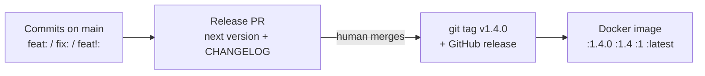

# Commits, Versions & Releases

If every commit on `main` says what kind of change it is, the version number can be calculated instead of guessed.
A **breaking change** then bumps the major version, the git tag and the Docker image tag follow, and nobody has to
remember to do it by hand.

The agent writes most commit messages, so this only works if it knows the rules and if CI checks them.

---

## The chain



```text
  commits on main ──▶ release PR ──(you merge)──▶ git tag v1.4.0 ──▶ image :1.4.0 :1.4 :1 :latest
  feat: / fix: / !     version + CHANGELOG          + GitHub release
```

One source of truth: the commit history. The tag in the repo and the image tag in the registry always carry the same version.

---

## Conventional Commits in one table

Format: `type(scope): summary`. See [conventionalcommits.org](https://www.conventionalcommits.org).

| Commit | Meaning | Version bump |
|---|---|---|
| `fix(links): return 404 for unknown code` | Bug fix | patch `1.3.2 → 1.3.3` |
| `feat(links): add expiry date` | New feature, backwards compatible | minor `1.3.2 → 1.4.0` |
| `feat(api)!: rename "url" to "target"` | **Breaking change** | major `1.3.2 → 2.0.0` |
| `docs:`, `test:`, `refactor:`, `chore:`, `ci:`, `build:` | No change for users | none |

Two ways to mark a breaking change. Use both:

```text
feat(api)!: rename "url" field to "target" in POST /links

BREAKING CHANGE: clients must send "target" instead of "url".
```

The `!` is what the tools and reviewers see at a glance. The footer tells users what to do about it and ends up in the changelog.

### What counts as breaking (shorty example)

The question is always: **does an existing client, deployment or operator break without changing anything?**

| Breaking | Not breaking |
|---|---|
| Endpoint removed or renamed | New endpoint |
| JSON field removed, renamed or its type changed | New optional field |
| Status code changed (`404` → `410`) | Better error message text |
| Env var or flag renamed, new **required** config | New optional config with a default |
| Migration that old app versions can't run against | Additive migration (new table, nullable column) |
| Exported Go API changed (if others import your module) | Internal refactor |

This is a judgement call, and it's where agents slip: a "small rename" in a handler struct is a breaking API change.
Write the rule into `CLAUDE.md` and ask the agent to check.

---

## Teach the agent

Add to the project's `CLAUDE.md` (the [template](../templates/CLAUDE.md) has it):

```markdown
## Commits
- Conventional Commits: `type(scope): summary`. Types: feat, fix, perf, refactor, test, docs, chore, ci, build.
- Breaking = an existing client or deployment breaks without changing anything (API field/endpoint/status code,
  env var, required config, incompatible migration). Mark it with `!` and a `BREAKING CHANGE:` footer.
- Not sure whether something is breaking? Ask. Never hide a breaking change in a `fix:` or `refactor:`.
```

Before you open a PR, ask in the same session or a fresh one:

> *"Does `git diff main...HEAD` contain a breaking change for API clients or deployments? Check handlers,
> request/response structs, status codes, env vars, config and migrations. Answer yes/no with file:line evidence,
> and propose the PR title."*

The [`/ship`](../templates/.claude/skills/ship/SKILL.md) skill does this check and writes a conventional PR title.

---

## Enforce it in CI

Instructions are a request; CI is a guarantee. Keep it simple:

1. **Squash merge only** (repo settings). Then the **PR title** becomes the commit on `main`, so it's the only thing that has to be right.
   Messy WIP commits on the branch don't matter.
2. **Check the PR title** with a required status check:
   [`templates/.github/workflows/pr-title.yml`](../templates/.github/workflows/pr-title.yml).
3. Reviewers check the title too: a `!` (or its absence) is part of the review ([checklist](../templates/review-checklist.md)).

If you want the `BREAKING CHANGE:` footer on `main` as well, set the squash default commit message to
"Pull request title and description" and put the footer in the PR description. The `!` in the title is enough for the version bump.

---

## Release: tag + Docker image

Template: [`templates/.github/workflows/release.yml`](../templates/.github/workflows/release.yml).
It uses [release-please](https://github.com/googleapis/release-please-action) plus the Docker actions:

| Step | What happens |
|---|---|
| Push to `main` | release-please reads the new commits and opens/updates a **release PR**: next version + `CHANGELOG.md` |
| You merge the release PR | release-please creates the git tag `v1.4.0` and a GitHub release |
| Same workflow run | Builds the image and pushes `ghcr.io/<owner>/shorty:1.4.0`, `:1.4`, `:1` and `:latest` |

Why a release PR instead of tagging every merge: you see the version **before** it exists. A wrong `2.0.0` is
caught when you read the PR, not after the image is in the registry. It's the same human merge gate as for code.

Image tags and what they're for:

| Tag | Moves? | Use it for |
|---|---|---|
| `1.4.0` | never | Deployments. Pin this. |
| `1.4`, `1` | yes, to the newest patch/minor | Consumers who want fixes automatically |
| `latest` | yes | Local tries only, never in production manifests |
| `sha-abc1234` | never | Tracing an image back to a commit |

### Gotchas

- **Tags created by `GITHUB_TOKEN` don't trigger other workflows.** That's why the image is built in the same
  workflow, gated on `release_created`. A separate `on: push: tags` workflow would silently never run.
- **Before 1.0.0**, decide what a breaking change does (stay on `0.x` or jump to `1.0.0`). release-please has
  options for this (`bump-minor-pre-major`). Check its docs for the current config format.
- **Go libraries:** a major version `v2+` also needs the `/v2` module path in `go.mod`. A service that is only
  shipped as a Docker image (like shorty) doesn't care.
- **Never re-tag.** If a release is wrong, ship a new patch version. Image `1.4.0` must always be the same bytes.
- Action versions and inputs change. Check each action's README when you copy the template.

---

## Anti-patterns

| Anti-pattern | Fix |
|---|---|
| Version numbers picked by hand at release time | Calculated from commits; you only review the release PR |
| Breaking change hidden in `fix:` / `refactor:` | Breaking rule in `CLAUDE.md`, ask the agent to check, reviewer checks the title |
| Agent-written commit messages merged unread | You read the PR title like code. It decides the version. |
| Production pulls `:latest` | Deploy the exact version tag |
| Git tag and image tag created by different scripts | One workflow does both from the same version |
| Moving or reusing a released tag | New patch release instead |
