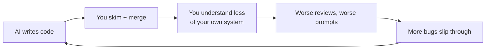

# Staying Sharp

If the AI writes most of the code, your value shifts to **judgment**: knowing what to build, spotting what's wrong,
and understanding the system. Those skills fade if you don't use them.

---

## The risk

You can't review code you couldn't have written, and you can't prompt well about a system you don't understand.

---

## Practices

| Practice | How |
|---|---|
| **Explain-back** | Before merging something non-trivial, explain it in your own words (or ask the agent to quiz you on it). If you can't, you don't merge. |
| **Predict first** | Before asking the agent, sketch your own approach for 2 minutes. Then compare. You'll learn from the differences. |
| **Learning mode** | When working with an unfamiliar library or concept, ask for explanations and write the key parts yourself. Ask the agent to review *your* code. |
| **Debug by hand sometimes** | For some bugs, find the cause yourself first and only then ask the agent. |
| **Read the plans critically** | Plan mode output is a design proposal. Argue with it. |
| **No-AI reps** | Regularly do small tasks without AI (a kata, a small tool) to keep your fluency in Go. |
| **Own the architecture** | You write or approve specs, interfaces, and data models. The agent fills in the rest. |
| **Study the diffs** | When the agent uses an idiom you don't know, look it up. That's free learning. |

---

## When NOT to use the agent (or use it differently)

| Situation | Better |
|---|---|
| You're learning the fundamentals of a language/concept | Write it yourself. Use the AI as a tutor, not a typist. |
| A 30-second change you already know exactly | Just do it |
| Security-critical design (auth model, crypto choices) | Think it through yourself, use the AI for review and research |
| You don't know what you want yet | Think, sketch, or use the AI for *discussion* (plan mode), not code |
| Debugging something you need to deeply understand for later | Drive it yourself, with the agent as a pair |

---

## A weekly self-check

- [ ] Could I explain the architecture of my main project from memory?
- [ ] Did I reject or significantly change at least one AI proposal this week?
- [ ] Did I learn at least one new thing from reading AI-written code?
- [ ] Did I write some meaningful code without AI?
