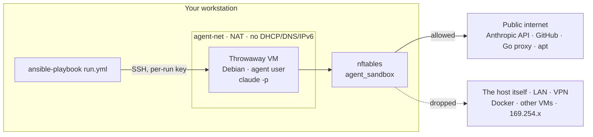
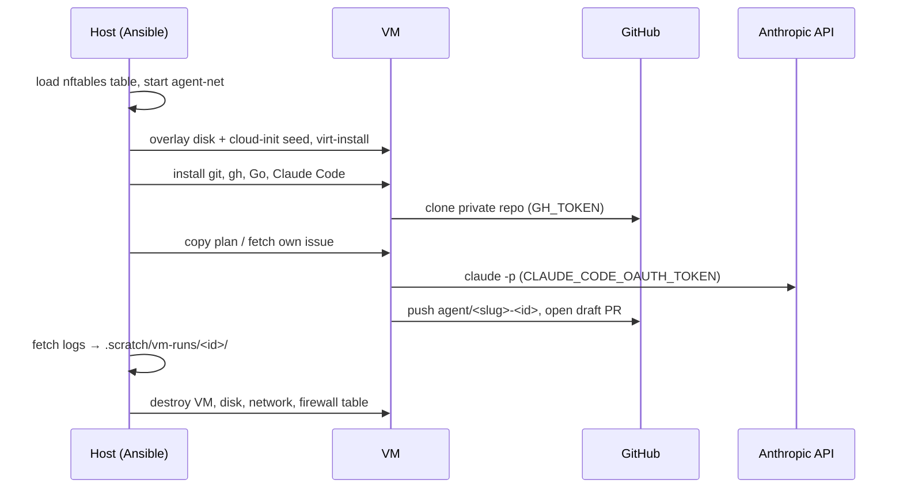

# VM Sandbox: Unattended Runs in a Throwaway VM

For automation that runs **without you watching** (`--dangerously-skip-permissions`, AFK loops), the strongest simple
setup is a **throwaway VM** that is created per run and destroyed afterwards. It reaches the **public internet only**:
not your host, not your LAN, VPN, Docker networks or other VMs.
An Ansible playbook does the whole run: create VM → clone the private repo → inject a plan or issue → run Claude Code
→ push a branch + draft PR → destroy VM.

Runnable files: [`templates/vm-runner/`](../templates/vm-runner/). Linux host with KVM required.

---

## Why a VM

| Layer | Stops | Doesn't stop |
|---|---|---|
| Permission deny rules ([Security](security.md)) | Honest mistakes | A script that does the same thing. Not a boundary. |
| Built-in sandbox (`/sandbox`) | Writes outside the project, unlisted domains for shell commands | Still your host, your user, your logged-in tools |
| Container (`docker sandbox`, devcontainer) | Host filesystem, dotfiles, SSH keys | Usually reaches your LAN and host services. Shares the host kernel. |
| **Throwaway VM (this page)** | Host filesystem and services, LAN/VPN/Docker, cloud metadata, leftovers between runs | Public internet egress, the secrets you hand it, what it pushes |

Use it when the run has **no human in the loop** and touches a **private repo with a write token**.

---

## Architecture



```text
 workstation ─────────────────────────────────────────────────────────────┐
 │ ansible-playbook ──SSH──▶ VM (agent-net, static IP, public DNS)        │
 │                            │                                           │
 │                   nftables agent_sandbox                               │
 │                    ├─ VM → host (any IP/port) ........ DROP            │
 │                    ├─ VM → 10/8 172.16/12 192.168/16                   │
 │                    │       100.64/10 169.254/16 ... ... DROP           │
 │                    ├─ VM → IPv6 ...................... DROP            │
 │                    └─ VM → everything else ── NAT ──▶ public internet  │
 └────────────────────────────────────────────────────────────────────────┘
```

### One run



```text
 nft + network ─▶ VM boots ─▶ tools ─▶ clone ─▶ plan/issue ─▶ claude -p ─▶ push + draft PR
                                                                                 │
              teardown (always, even on failure) ◀── fetch logs ◀────────────────┘
```

---

## Network model

| Decision | Why |
|---|---|
| Own libvirt network `agent-net`, NAT | The VM gets internet through the host, but in a network nothing else uses |
| No DHCP, no DNS, no IPv6 on it | The VM needs **no service on the host**. Static IP and public DNS come from cloud-init. |
| Firewall table `inet agent_sandbox`, loaded **before** the VM boots | The VM never exists without it. Deleted at teardown. |
| `input`: from the bridge, only replies to the host's SSH | Blocks every host IP and port, including the host's LAN IP and services bound to `0.0.0.0` |
| `forward`: drop private, CGNAT, link-local, loopback, multicast, reserved ranges | Your LAN, Tailscale (100.64/10), Docker (172.16/12), other libvirt networks, cloud metadata (169.254.169.254) |
| `forward`: everything else allowed | "Public internet only", as wanted. Anthropic, GitHub, Go proxy, apt all work. |

The rules are in [`agent-sandbox.nft.j2`](../templates/vm-runner/templates/agent-sandbox.nft.j2) with a comment on each line.
A drop in any nftables chain is final, so this table can't be undone by `accept` rules elsewhere.

> If your "private" network uses **public** IP ranges (some company networks do), add them to `blocked4`.

### Check the isolation yourself (once)

Run once with `-e keep=true`, SSH in with the printed command, then:

```bash
curl -sI https://api.anthropic.com | head -1   # works (any HTTP status line)
curl -m 5 http://192.168.250.1                 # the host's bridge IP: times out
curl -m 5 http://192.168.1.1                   # your router (use your LAN's IP): times out
curl -m 5 http://169.254.169.254               # metadata: times out
```

Then remove it: `ansible-playbook tools/vm-runner/down.yml -K -e run_id=<id>`.

---

## One-time host setup

**Packages** (hypervisor, Ansible, nftables, ISO tool for the cloud-init seed):

| Distro | Command |
|---|---|
| Debian / Ubuntu | `sudo apt install qemu-system-x86 qemu-utils libvirt-daemon-system virtinst ansible nftables xorriso` |
| Arch | `sudo pacman -S --needed qemu-base libvirt virt-install dnsmasq ansible nftables libisoburn` |
| Fedora | `sudo dnf install @virtualization ansible nftables xorriso` |

```bash
sudo systemctl enable --now libvirtd    # distros with modular daemons: virtqemud.socket + virtnetworkd.socket
sudo virt-host-validate qemu            # KVM must be PASS

# Base image: downloaded once, never modified (each run gets a copy-on-write overlay).
# Check https://cloud.debian.org/images/cloud/ for the current file name.
sudo curl -fLo /var/lib/libvirt/images/debian-13-genericcloud-amd64.qcow2 \
  https://cloud.debian.org/images/cloud/trixie/latest/debian-13-genericcloud-amd64.qcow2
```

Refresh the base image now and then (same command). Packages inside the VM are updated on every run anyway.

**Into your project:**

```bash
cp -r templates/vm-runner ~/repos/shorty/tools/vm-runner
$EDITOR ~/repos/shorty/tools/vm-runner/vars.yml   # repo: owner/name, and a subnet your LAN doesn't use
```

---

## Credentials

Two secrets go into the VM. Both are scoped to the job, stored in a password manager, and passed as **env vars only**.

### Claude Code

| Option | How | When |
|---|---|---|
| **Subscription token** (recommended with Pro/Max) | On your workstation: `claude setup-token`, log in, copy the token. `pass insert claude/oauth-token` | No extra cost. Usage counts against your plan's limits. |
| API key | Console → API keys, ideally in its own workspace with a spend limit. `pass insert claude/api-key` | Pay per token, separate budget, easy to revoke |

The playbook uses `CLAUDE_CODE_OAUTH_TOKEN` if set, otherwise `ANTHROPIC_API_KEY`.
With **Pro**, long runs stop when you hit the usage limit. The round fails, and the runner pushes what was committed.
Start with `afk=3`. Token validity and flags change: check `claude setup-token --help` and the docs.

### Private GitHub repo: fine-grained personal access token

GitHub → Settings → Developer settings → Fine-grained tokens → Generate:

| Setting | Value |
|---|---|
| Repository access | **Only select repositories** → just this repo |
| Expiration | Short: 7–30 days |
| Contents | Read and write (clone, push the branch) |
| Pull requests | Read and write (draft PR) |
| Issues | Read and write, **only for issue/AFK mode** (read tickets, comment when stuck) |
| Metadata | Read (mandatory) |

Store it: `pass insert github/shorty-agent`. If the repo belongs to an organisation, it may need to approve the token.

**Protect `main`** with a ruleset or branch protection (require a PR, block force-push). Otherwise the token can push
to `main` directly. Check whether your GitHub plan offers this for private repos. If it doesn't, the only guard is reviewing what the run pushed.

### How the secrets travel

| Where | What happens |
|---|---|
| Host | `pass show …` straight into the `ansible-playbook` process env. Not exported, not in shell history, not in `vars.yml`. |
| Ansible → VM | Only as `environment:` on the clone/run/push tasks. Never written to a file. `gh auth setup-git` stores a helper reference, not the token. |
| VM | Process env of `git`, `gh` and `claude`. The disk is deleted at teardown. |

Caveats, said plainly:

- **The agent can read both tokens** (they're in its environment). That's why they're scoped to one repo and the job, short-lived, and revoked if a run looks wrong.
- `ansible-playbook -vvv` prints task environments. Don't use it with real tokens.

---

## Usage

From the project root (`.scratch/` is gitignored, see [Where work lives](best-practices.md#where-work-lives)):

```bash
# One plan file (e.g. written in plan mode, saved to .scratch/plans/)
CLAUDE_CODE_OAUTH_TOKEN="$(pass show claude/oauth-token)" GH_TOKEN="$(pass show github/shorty-agent)" \
  ansible-playbook tools/vm-runner/run.yml -K -e plan=.scratch/plans/add-expiry.md

# One GitHub issue: refused unless you wrote it
CLAUDE_CODE_OAUTH_TOKEN="$(pass show claude/oauth-token)" GH_TOKEN="$(pass show github/shorty-agent)" \
  ansible-playbook tools/vm-runner/run.yml -K -e issue=42

# AFK loop: up to 5 rounds over open issues labelled `afk` that you wrote, one per round
CLAUDE_CODE_OAUTH_TOKEN="$(pass show claude/oauth-token)" GH_TOKEN="$(pass show github/shorty-agent)" \
  ansible-playbook tools/vm-runner/run.yml -K -e afk=5
```

`-K` asks for your sudo password (firewall, libvirt). Add `-e keep=true` to keep the VM for debugging.

| Mode | Input | Output |
|---|---|---|
| `plan` | Local file, copied into the VM **outside** the checkout | Branch `agent/<plan-name>-<id>`, draft PR |
| `issue` | Issue title + body (author must be you, comments are never read) | Draft PR with `Closes #N` |
| `afk` | Open `afk` issues by you, refreshed every round. Issues already closed by a commit on the branch are filtered out. | One branch, one draft PR. Each ticket's last commit says `Closes #N`, so issues close on merge. |

What runs inside: `claude -p --dangerously-skip-permissions --max-turns N --output-format stream-json`.
It's bounded by max turns, a timeout per round, and the number of rounds. The prompts ([`prompts/`](../templates/vm-runner/prompts/)) tell it to
run `go build`/`go vet`/`go test`, commit in small Conventional Commits, and never push. The runner pushes.
They don't use the [`/tdd`](../templates/.claude/skills/tdd/) skill, because it waits for your approval and that would block an unattended round.

After the run:

- [ ] Read `.scratch/vm-runs/<id>/` (`round-*.jsonl`, `notes.md` if the agent got stuck)
- [ ] Review the draft PR like any other ([review checklist](../templates/review-checklist.md)). Fix the PR title if it isn't a proper Conventional Commit ([Releases](releases.md)).
- [ ] CI green → mark ready → merge. **You** merge.

---

## What it does not protect

| Risk | Still open | Mitigation |
|---|---|---|
| Exfiltration to the internet | The VM can reach any public host | Nothing in the VM is worth stealing except the scoped tokens and the repo. Keep it that way. |
| Prompt injection | Plan/issue text steers the agent. So does anything it fetches from the web or dependencies. | Only your own issues go in. Don't paste untrusted text into plans. |
| Bad code | The agent can write subtly wrong or malicious code | Draft PR, CI, your review. The VM makes it safe to *run*, not safe to *merge*. |
| Token misuse | Push junk branches, comment on issues | One repo, short expiry, protected `main`, revoke after suspicious runs |
| Leftover VM after Ctrl-C | Teardown didn't run | `down.yml -e run_id=<id>`. `run.yml` refuses to start while `agent-net` exists. |

---

## Troubleshooting

| Symptom | Likely cause |
|---|---|
| VM has no internet at all | Docker on the host sets the iptables `FORWARD` policy to drop. Allow forwarding for `virbr-agent` (see libvirt/Docker docs), or test on a host without Docker. |
| `apt`/`curl` can't resolve names | `dns_servers` in `vars.yml` points to a private IP. It must be public. |
| Network won't start | Subnet in `vars.yml` collides with a LAN/VPN route |
| `Failed to set permissions on the temporary files…` | The `acl` package is missing in the VM (the playbook installs it, so check the apt step) |
| Want to look inside | `-e keep=true`, then the printed SSH command, or `sudo virsh console agent-<id>` |

---

## Use it when…

- [ ] The run is unattended (no permission prompts) and touches a private repo
- [ ] You've checked the isolation once (section "Check the isolation yourself")
- [ ] Tokens are fine-grained, single-repo, short-lived, and live in a password manager
- [ ] `main` is protected, and every run ends in a draft PR that you review
- [ ] The plan or tickets are written by you and are small, testable vertical slices ([L3](../levels/L3-spec-plan-code.md))

Related: [Security](security.md) · [L7 Automate](../levels/L7-automate.md) · [Best practices](best-practices.md)
